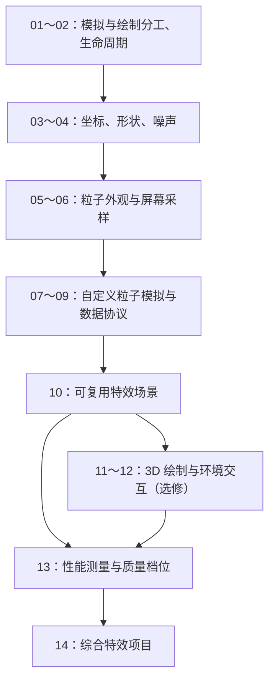

# Godot 粒子系统与 GDShader 渐进课程

适合对象：已完成 Godot 官方粒子系统与 Shader 入门教程，能创建粒子节点、配置材质、编写简单的 `fragment()`，希望独立设计和实现特效。

项目基线：当前 `project.godot` 标记为 Godot 4.7、Forward+，Windows 图形驱动为 D3D12。本课程使用 Godot 4 的语法，具体属性位置以安装的编辑器及其内置帮助为准。官方 stable 文档会更新；查阅时核对版本，不混用 Godot 3 教程。

## 学完后的目标

- 能把一个参考特效拆成形状、运动、颜色、时间节奏和交互五部分。
- 能判断何时使用 ParticleProcessMaterial、绘制 Shader、自定义粒子 Shader 或 GDScript。
- 能独立制作带噪声、溶解、扭曲、生命周期变化的粒子效果。
- 能将 2D 经验迁移到 3D，使用拖尾、碰撞和吸引器。
- 能定位坐标错误、材质共享、粒子裁剪、透明叠加和性能问题。
- 能交付一个可复用、可配置、有质量档位的特效场景。

课程是实践路线，不要求先学完图形学。主线先用 2D 降低空间与光照的干扰，再进入 3D。若只做 2D，可将第 11～12 课作为选修。

## 时间与学习方式

建议 8 周，每周 5～7 小时，总计约 40～56 小时；实际以验收结果推进。每课约 2～3 小时，综合项目另留 6～8 小时。

| 周次 | 课程 | 阶段成果 |
| --- | --- | --- |
| 第 1 周 | 01～02 | 可观察、可解释的粒子实验场 |
| 第 2 周 | 03～04 | 参数化的程序图形与溶解材质 |
| 第 3 周 | 05～06 | 可独立控制的粒子外观与冲击波 |
| 第 4 周 | 07～08 | 自定义粒子模拟与数据传递 |
| 第 5 周 | 09～10 | 力场运动与可复用特效接口 |
| 第 6 周 | 11～12 | 3D 特效、拖尾与环境交互 |
| 第 7 周 | 13～14 | 性能对照与完整项目设计 |
| 第 8 周 | 综合项目完善 | 可演示、可复用的最终作品 |

每课按这个循环学习：先预测效果 → 实现最小版本 → 一次只改一个变量 → 制造并修复一个错误 → 不看原实现做一个变体 → 写简短复盘。查文档时优先查当前问题对应的属性或内置变量，不要求通读整个 API。

### 图解约定

后续课程优先使用 Mermaid 图解释数据流、资源关系、生命周期、调用顺序和排查路径。每张图聚焦一个问题，配合文字、公式和实际画面阅读：流程图说明处理过程，时序图说明调用先后，状态图说明状态变化。参数对照继续使用表格。阅读 Markdown 时请使用支持 Mermaid 的预览器。



## 阶段一：从调参数到理解行为

### 01｜建立特效实验场：区分模拟与绘制

**课程内容已制作：[第一课讲义与实验场](lessons/01_playground/README.md)**。打开其中的 `playground.tscn`，按 F6 运行。

**目标**：能判断问题发生在哪一层，而不是凭感觉乱调。

- 知识：粒子节点管理发射；Process Material 管理粒子状态；CanvasItem/Spatial 材质负责绘制；GDScript 管理触发和游戏逻辑。
- 实践：建立一个 2D 实验场，提供重播、背景切换、数量调整；同一套运动分别使用普通纹理与自定义圆点 Shader。
- 对照：保持材质不变只改初速度；保持运动不变只改透明度。
- 验收：能分别演示“运动变了、外观不变”和“外观变了、运动不变”，并画出数据流。
- 常见问题：混淆 `Process Material` 与 `Material`；直接覆盖 `COLOR` 后丢失粒子传来的颜色或淡出。

### 02｜生命周期、随机性与时间节奏

**课程内容已制作：[第二课讲义与实验场](lessons/02_lifetime/README.md)**。打开 `lifetime_lab.tscn`，按 F6 运行。

**目标**：通过曲线设计效果，不依赖增加粒子数量。

- 知识：寿命、一次性发射、爆发程度、预热；颜色/大小曲线；初始随机值与逐帧随机变化的区别；本地与世界运动。
- 实践：用同一张简单纹理制作火星、烟尘和命中爆点；每种效果只用一个发射器。
- 对照：移动发射器，比较 `local_coords` 开关；用固定随机种子复现一次发射，再测试不同种子。
- 验收：三个效果在运动、节奏和衰减上明显不同；能解释为什么烟尘通常先扩散再淡出。
- 常见问题：靠突然结束寿命实现消失，导致闪断；移动发射器时全部旧粒子跟随，造成拖尾不符合预期。

**阶段检查**：不用复制参数表，独立做出一个“先爆发、后缓慢消散”的效果，并说明每条曲线的作用。

## 阶段二：掌握绘制 Shader 的核心工具

### 03｜坐标、距离场与程序形状

**课程内容已制作：[第三课讲义与实验场](lessons/03_shapes/README.md)**。打开 `shapes_lab.tscn`，按 F6 运行。

**目标**：能从公式构造形状，并知道公式在哪个坐标空间工作。

- 知识：UV 居中与缩放、宽高比、向量长度、点积、二维旋转、极坐标；`step`、`smoothstep`、`mix`；简单有符号距离场（SDF）。
- 实践：制作圆环、扇形与胶囊形，暴露半径、厚度、角度、柔边参数。
- 对照：在正方形与长方形绘制区域中测试圆；分别输出 UV、距离值、最终遮罩作为调试视图。
- 验收：圆环在目标宽高比下不变形，形状可组合；能说明柔边宽度使用的是 UV 单位还是像素单位。
- 加餐：使用导数 `fwidth` 调整边缘过渡，比较缩放前后的锯齿。
- 常见问题：混用像素坐标与 UV；旋转中心不在预期位置。

### 04｜噪声、纹理采样与溶解

**课程内容已制作：[第四课讲义与实验场](lessons/04_noise/README.md)**。打开 `noise_lab.tscn`，按 F6 运行。

**目标**：把规则形状变成有层次的自然效果。

- 知识：采样、过滤与重复；噪声频率、振幅、滚动方向；阈值遮罩；两层噪声组合；UV 扭曲。
- 实践：使用噪声纹理制作带亮边的溶解，再组合一个向上流动的火焰遮罩。
- 对照：分别显示原噪声、扭曲后的 UV、溶解遮罩和最终颜色；一次只调整频率或振幅。
- 验收：溶解参数从 0 到 1 能完整覆盖“完全显示 → 完全消失”；可独立调节边缘宽度和噪声尺度。
- 常见问题：噪声未平铺导致接缝；扭曲过大导致纹理拉伸；把颜色图和数据纹理按相同方式处理。

### 05｜让每个粒子拥有自己的外观进度

**课程内容已制作：[第五课讲义与实验场](lessons/05_particle_age/README.md)**。打开 `age_lab.tscn`，按 F6 运行。

**目标**：连接生命周期数据与绘制 Shader。

- 知识：粒子颜色、`INSTANCE_CUSTOM`、`varying`；全局时间与单粒子年龄；普通透明混合与加法混合。
- 实践：让光点随自身寿命扩张、变色、溶解；添加出生时确定的随机相位，避免所有粒子同步闪烁。
- 数据原则：先核对内置过程材质的通道约定，再决定读取什么；需要在 `fragment()` 使用的顶点阶段数据通过 `varying` 传递。
- 对照：用 `TIME` 驱动全部粒子，再改用各自的生命周期进度，观察同步程度。
- 验收：不同时刻生成的粒子各自完整播放动画；保留过程材质输出的颜色和淡出；在明暗背景上都检查混合效果。
- 常见问题：认为 `INSTANCE_CUSTOM` 的所有分量都可随意占用，破坏旋转或序列帧；把全局时间当作出生后的时间。

### 06｜屏幕采样与冲击波

**课程内容已制作：[第六课讲义与实验场](lessons/06_screen/README.md)**。打开 `screen_lab.tscn`，按 F6 运行。

**目标**：理解局部纹理特效与屏幕空间特效的区别。

- 知识：`SCREEN_UV`、`hint_screen_texture`、屏幕拷贝、绘制顺序；2D 中的 `BackBufferCopy`。
- 实践：制作圆环冲击波，用环形遮罩限定扭曲范围，向外扩散后消失。
- 对照：同时播放两个重叠冲击波，比较调整拷贝位置前后的结果。
- 验收：窗口尺寸改变后，波纹中心与目标位置一致；遮罩外背景不受影响；能解释两个效果重叠时读取了哪份画面。
- 常见问题：用局部 UV 直接采样屏幕；采样超出已拷贝区域；误以为每个屏幕采样材质都会自动获取前一个效果的结果。

**阶段检查**：完成一个由粒子爆点、圆环和短暂扭曲组成的 2D 命中特效；允许多个发射器，但每一层都要说明用途。

## 阶段三：编写粒子模拟与工程化接口

### 07｜第一个自定义粒子 Shader

**课程内容已制作：[第七课讲义与实验场](lessons/07_simulation/README.md)**。打开 `simulation_lab.tscn`，按 F6 运行。

**目标**：理解粒子状态如何初始化并跨帧更新。

- 知识：`shader_type particles`、`start()`、`process()`；`TRANSFORM`、`VELOCITY`、`COLOR`、`ACTIVE`、`DELTA`。
- 实践：从零写最小的发射与重力运动；另存一份内置过程材质转成的 Shader，仅对照初始化与速度更新部分。
- 对照：比较引擎基于速度推进位置，与开启 `disable_velocity` 后自己积分位置的两种实现。
- 验收：粒子可重启、能正常结束，速度量纲清楚；不会同时使用自动位移和手动位移造成重复推进。
- 常见问题：每帧重新初始化速度；忽略时间步长；为了改一处行为直接维护整份复杂生成代码。

### 08｜随机种子、自定义数据与生命周期协议

**课程内容已制作：[第八课讲义与实验场](lessons/08_data_protocol/README.md)**。打开 `data_lab.tscn`，按 F6 运行。

**目标**：明确模拟 Shader 与绘制 Shader 之间传递什么。

- 知识：`INDEX`、`NUMBER`、`RANDOM_SEED`；出生时随机与每帧噪声；`CUSTOM` 与绘制端的 `INSTANCE_CUSTOM`。
- 实践：自定义并记录四个通道的用途，例如年龄、随机相位、初始大小和效果类型；在绘制端读取并显示不同状态。
- 约束：该协议用于自己完整控制的模拟与绘制组合；若使用内置旋转或序列帧逻辑，先检查它们占用的通道。
- 验收：相同配置与种子可复现实验；重生不会继承不该保留的旧状态；两个粒子即使同龄也可外观不同。
- 常见问题：随机值每帧改变造成抖动；只重置部分自定义数据；未经说明覆写内置通道。

### 09｜用力场设计运动：旋涡与吸引

**课程内容已制作：[第九课讲义与实验场](lessons/09_fields/README.md)**。打开 `field_lab.tscn`，按 F6 运行。

**目标**：从“指定方向”进阶到“根据位置计算运动”。

- 知识：朝向目标的向量、归一化、切向速度、径向吸引、阻尼、距离衰减；局部/世界空间转换；简单数值积分。
- 实践：实现可移动中心的旋涡；暴露吸引强度、旋转强度和阻尼，做出吸入与喷散两个变体。
- 对照：改变模拟更新频率，观察稳定性；显示或用颜色编码速度、距离，辅助判断。
- 验收：中心附近不会出现除零、NaN 或无界加速；移动发射器和目标时运动仍符合设计；能解释参数的作用。
- 常见问题：混用目标世界坐标与粒子局部坐标；无条件归一化零向量；把渲染帧率与粒子模拟频率混为一谈。
- 加餐：采样向量场；之后再研究 curl noise，不作为本课先修要求。

### 10｜把效果变成可复用的场景

**课程内容已制作：[第十课讲义与实验场](lessons/10_reusable/README.md)**。打开 `reuse_lab.tscn`，按 F6 运行；`impact.tscn` 是供调用的独立特效组件。

**目标**：让游戏逻辑能可靠控制特效。

- 知识：材质资源共享与独立副本；`set_shader_parameter()`；自定义时间参数；Tween/AnimationPlayer；一次性效果结束与复用。
- 实践：设计 `play(position, direction, intensity, color)` 接口；统一协调爆点、烟雾、圆环和扭曲。
- 对照：同时创建三个不同颜色的实例；暂停、恢复、连续重播，观察参数与时间是否串扰。
- 验收：每个实例独立可控；重复触发不会留下旧状态；所有层结束后正确清理或回收；暂停行为与设计一致。
- 常见问题：改一个共享 ShaderMaterial 导致所有实例一起改变；以为 `TIME` 自动跟随场景暂停；只按某一层的寿命清理整个效果。

**阶段检查**：完成可由鼠标触发的旋涡法术，包含蓄力、释放和消散，能在场上同时存在三个独立实例。

## 阶段四：迁移到 3D 并加入环境交互

### 11｜3D 粒子绘制与 Spatial Shader

**课程内容已制作：[第十一课讲义与实验场](lessons/11_spatial/README.md)**。打开 `spatial_lab.tscn`，按 F6 运行。

**目标**：理解从二维图形到三维场景新增的限制。

- 知识：`GPUParticles3D` 的 Draw Pass 与网格；Billboard；`spatial` 的颜色、透明度与自发光输出；坐标变换、透明排序与可见范围。
- 实践：把第 05 课的光点迁移到 3D，制作漂浮魔法尘；比较固定朝向与面向相机的卡片。
- 对照：绕场景移动相机，将粒子放在明暗背景及不透明物体前后，检查遮挡与外观。
- 验收：卡片朝向合理；粒子颜色正确传入绘制材质；可见范围覆盖运动轨迹，不会因发射器离开视野突然消失。
- 常见问题：混淆自发光输出与后处理辉光；透明排序错误；把所有 2D 内置变量原样搬到 Spatial Shader。

### 12｜拖尾、湍流、碰撞与子发射器

**课程内容已制作：[第十二课讲义与实验场](lessons/12_interactions/README.md)**。打开 `interactions_lab.tscn`，按 F6 运行；完整湍流实验使用同目录 `run_vulkan.ps1`，本机 D3D12 限制见讲义。

**目标**：用环境交互组织多阶段效果。

- 知识：Ribbon/Tube 拖尾及配套材质设置；湍流；3D 吸引器与粒子碰撞节点；子发射器的触发与状态传递。
- 实践 A：制作带拖尾的飞行火星，先检查拖尾网格、寿命和材质配置。
- 实践 B：让火星与地面粒子碰撞体交互，并触发二次火花；增加少量湍流对照。
- 验收：拖尾连续、停止后自然消失；子粒子从合理位置生成；能分别关闭湍流、碰撞和子发射来定位问题。
- 常见问题：只开拖尾开关未配套网格/材质；把普通物理碰撞体当作粒子碰撞体；把 GPU 粒子视觉碰撞当作伤害判定。
- 范围：本课明确使用 3D 功能，不假定同名能力在 2D 中完全一致；查阅目标渲染器支持情况。

## 阶段五：性能、诊断与综合创作

### 13｜用测量决定优化方向

**课程内容已制作：[第十三课讲义与实验场](lessons/13_performance/README.md)**。打开 `performance_lab.tscn`，按 F6 运行；完整测量使用同目录 `run_vulkan.ps1`。配有三轮实测报告、低中高档和原始样本。

**目标**：区分粒子模拟成本与绘制成本。

- 知识：透明叠加绘制（overdraw）、屏幕覆盖面积、纹理采样、模拟频率、粒子数量、湍流与碰撞成本；裁剪与质量档位。
- 实践：建立固定视角与触发序列，记录基线；分别改变数量、粒子尺寸、噪声采样次数、湍流开关和屏幕扭曲开关。
- 测量：固定分辨率、渲染器、硬件与 VSync 设置，预热后重复采样；记录帧时间，工具支持时记录 GPU 时间，不只看 FPS。
- 验收：提交一张对照表，找出本场景的主要瓶颈；制作低/中/高三档，在关键轮廓和节奏基本不变时降低成本。
- 常见问题：只减少粒子数量，却让每个透明卡片覆盖巨大面积；没有测量就认定某个数学函数最慢；把编辑器开销当作导出后的结果。

### 14｜综合项目：可配置的元素冲击法术

**课程内容已制作：[第十四课讲义与综合项目](lessons/14_capstone/README.md)**。打开 `capstone_lab.tscn`，按 F6；可复用组件为 `final_project/arcane_spell/spell.tscn`。包含 2D 奥术四阶段、实例接口、质量档位和优化实测。

**目标**：从视觉设计到实现、测试、优化，独立完成一条完整流程。

先选 2D 或 3D，再选择火焰、冰霜或奥术主题，避免同时做多套作品。先写一页设计：效果用于什么情境、持续多久、视觉焦点是什么、由哪些层组成、各层用哪种技术。

最低要求：

1. 有蓄力、释放、命中、消散四个可辨认阶段。
2. 至少一层使用自定义绘制 Shader，一层使用自定义粒子 Shader。
3. 至少使用噪声、溶解、程序形状中的两种；屏幕扭曲可选。
4. 暴露主色、强度、范围、播放速度与质量档位，并说明参数影响哪些层。
5. 支持多个实例独立播放，正确处理暂停、重播和清理。
6. 给出固定测试条件下的性能记录与至少一次有证据的优化。

交付物：独立特效场景、演示场景、使用说明、效果截图或短视频、性能对照表、简短复盘。若选择 3D，加入第 12 课的一种环境交互；若选择 2D，以可靠的屏幕采样叠加或更完整的自定义运动替代。

验收顺序：先看轮廓与节奏 → 再看空间和数据正确性 → 再测多实例与边界情况 → 最后比较性能。不要用更多发光和更多粒子掩盖时序问题。

## 建议的练习目录

十四课参考教程与实验场均已制作；下面保留组织方式供独立练习参考，实际学习进度由各课验收决定。

```text
tutorial/
  README.md                 # 本课程大纲
  progress.md               # 学习记录与实验模板
  lessons/
	01_playground/
	02_lifetime/
	...
  shared/                   # 已理解且确实需要复用的纹理、材质或工具
  final_project/
```

每课保留可单独运行的 `.tscn`，相关 `.gdshader`、脚本及简短笔记放在同目录。先保留清晰的实验版本，完成后再考虑抽取公共代码。

## 官方参考资料

以下按需阅读，配合各课练习，不作为额外的通读任务。技术说明参考 Godot 官方文档，课程顺序、工时和验收要求为本课程设计。

| 资料 | 对应课程 | 阅读重点 |
| --- | --- | --- |
| [ParticleProcessMaterial](https://docs.godotengine.org/en/stable/classes/class_particleprocessmaterial.html) | 01～02、05 | 生命周期参数与材质能力 |
| [Shading language](https://docs.godotengine.org/en/stable/tutorials/shaders/shader_reference/shading_language.html) | 03～10 | 类型、uniform、varying 与函数 |
| [CanvasItem shaders](https://docs.godotengine.org/en/stable/tutorials/shaders/shader_reference/canvas_item_shader.html) | 03～06、08 | 坐标、颜色、混合与实例数据 |
| [Screen-reading shaders](https://docs.godotengine.org/en/stable/tutorials/shaders/screen-reading_shaders.html) | 06 | 屏幕纹理与拷贝时机 |
| [Particle shaders](https://docs.godotengine.org/en/stable/tutorials/shaders/shader_reference/particle_shader.html) | 07～09 | 初始化、跨帧状态、速度与自定义数据 |
| [Spatial shaders](https://docs.godotengine.org/en/stable/tutorials/shaders/shader_reference/spatial_shader.html) | 11 | 3D 绘制输出和渲染模式 |
| [3D 粒子系统专题](https://docs.godotengine.org/en/stable/tutorials/3d/particles/index.html) | 11～12 | 碰撞、吸引器、湍流与子发射器 |
| [3D Particle trails](https://docs.godotengine.org/en/stable/tutorials/3d/particles/trails.html) | 12 | 拖尾网格和材质设置 |
| [Performance](https://docs.godotengine.org/en/stable/tutorials/performance/index.html) | 13 | 测量与优化方法 |

## 暂缓学习的内容

Compute Shader、大规模流体模拟、复杂光照模型、完整 PBR 推导、复杂后处理管线暂时不列入必修。完成综合项目后，再按作品需要选择深度淡化的软粒子、向量场、程序动画或计算着色器，避免同时引入过多新概念。
