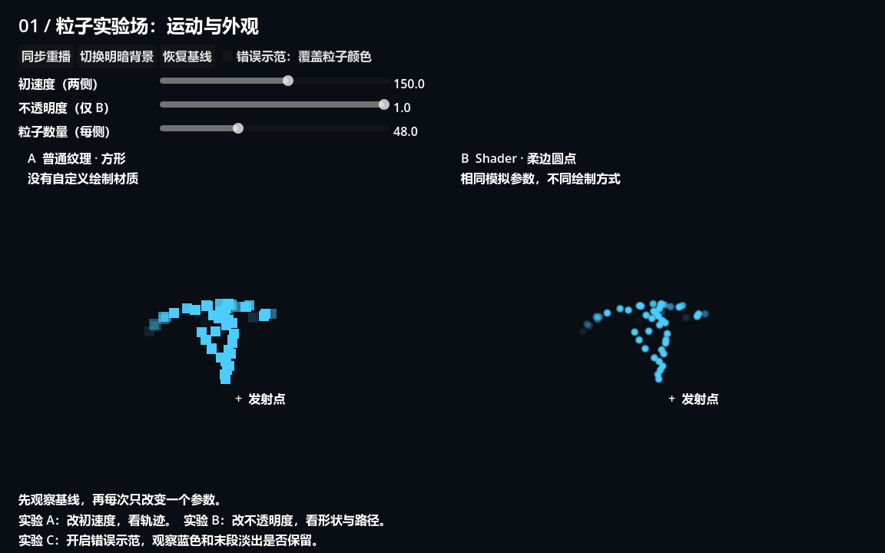
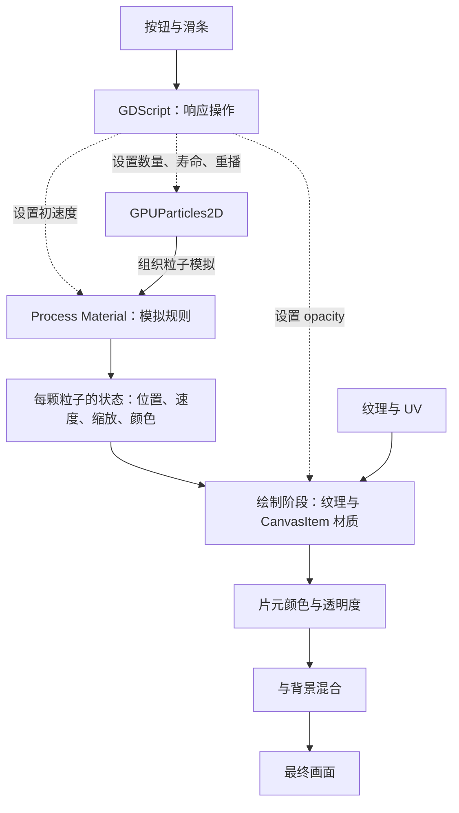
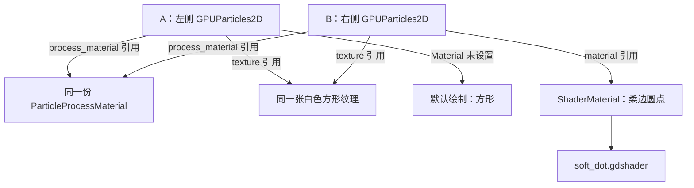
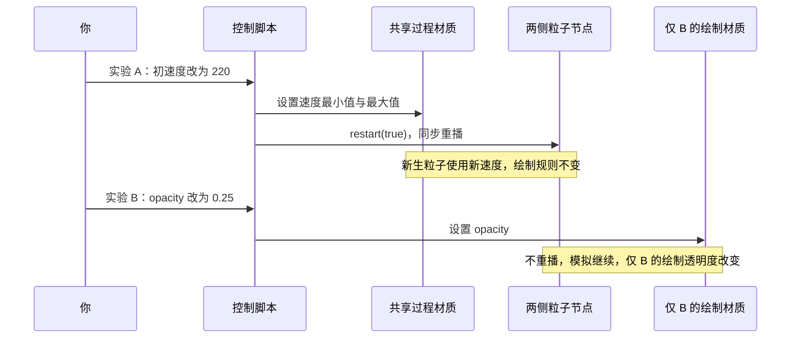
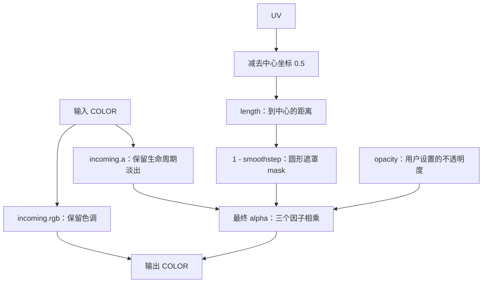
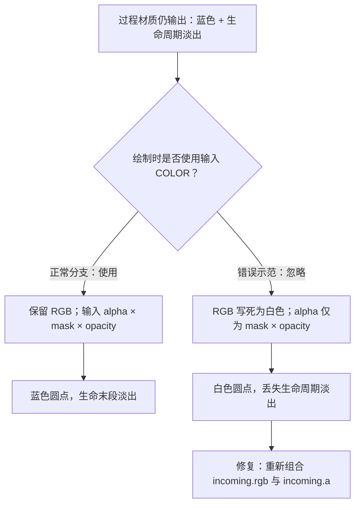
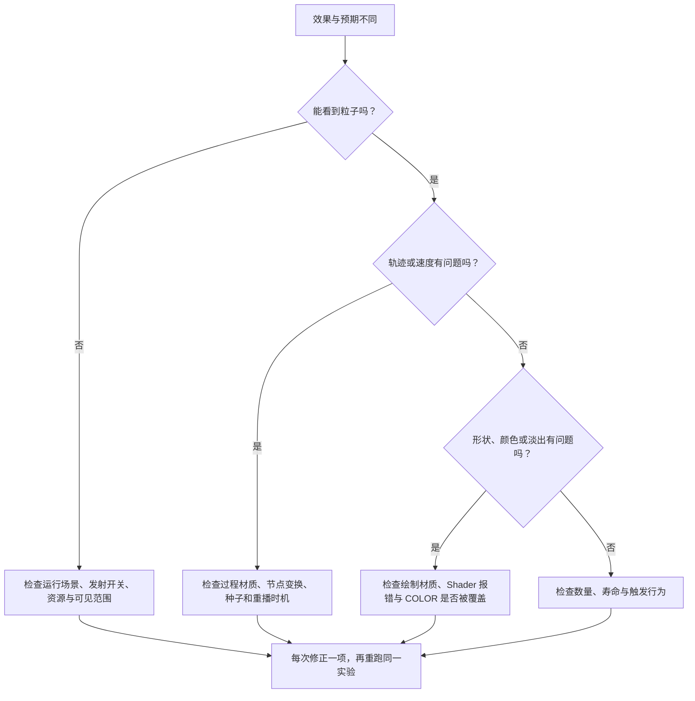

# 第一课：建立粒子实验场，分清模拟与绘制

[返回课程大纲](../../README.md) · [本课实验记录](WORKSHEET.md)

建议用时：90～150 分钟。你已经会创建粒子和简单 Shader，本课不重复界面入门，而是练习一种更重要的能力：看到一个变化，能判断是谁计算的、该修改哪里、如何验证。

## 1. 本课完成后，你应该能做到

1. 说明粒子节点、过程材质、绘制材质与脚本各自的职责。
2. 用两组对照实验证明：运动可以独立于绘制外观调整。
3. 解释为什么覆盖 `COLOR` 会使粒子颜色和生命周期淡出失效。
4. 不依赖演示脚本，自己搭建一个最小粒子场景。

本课不会要求你写自定义粒子模拟。先看懂内置模拟与绘制 Shader 的接口，后续才有依据替换它们。

## 2. 先运行配套实验场（10 分钟）

在 Godot 文件系统中打开本目录的 **`playground.tscn`**，按 **F6（运行当前场景）**。无需设置项目主场景。建议运行区域至少 1000 × 650；窗口太小时拖大窗口，避免标题和粒子轨迹被实验面板裁切。

你应看到：

- 左侧 A：蓝色方形粒子，使用普通白色纹理，没有自定义绘制材质。
- 右侧 B：蓝色柔边圆点，使用同一张纹理，并附加 `canvas_item` Shader。
- 两侧粒子向上发射，随后受向下重力影响；生命末段逐渐消失。
- 顶部可重播、切换背景、恢复基线，调整初速度、不透明度与数量。



两侧共享同一个 ParticleProcessMaterial，节点寿命、数量、随机种子相同，并同时重播。比较时以各自发射点为原点，观察相对运动；它们在窗口中的绝对位置当然不同。圆点较小、边缘较软，可能让你感觉它运动更快；请比较粒子中心而不是可见边缘。

先不要拖滑条。写下你的预测：

> 如果右侧不透明度变成 0，粒子会停止运动，还是继续运动但不可见？

## 3. 四层职责与数据流（15 分钟）



实线表示主要处理或数据流，虚线表示脚本控制参数。沿实线追踪，可以看到过程材质生成的数据如何影响最终画面。

这是一张职责示意图，并不表示 GDScript 在 CPU 上逐个推进粒子。示例脚本只管理控件、参数与节点，粒子模拟由引擎完成。

| 想改变什么 | 本课应修改哪里 | 示例 |
| --- | --- | --- |
| 数量、每颗粒子存在多久 | GPUParticles2D | `amount`、`lifetime` |
| 朝哪飞、初始多快、受什么加速度 | ParticleProcessMaterial | `direction`、初速度、`gravity` |
| 生命周期里的颜色/缩放状态 | ParticleProcessMaterial | `color_ramp`、缩放参数 |
| 单颗粒子的可见形状、柔边与最终透明度 | 节点的绘制 Material | `soft_dot.gdshader` |
| 用户何时重播、参数怎样关联 | GDScript | `restart()`、设置材质参数 |

“过程材质管运动、绘制材质管外观”是入门分工，但并不完整：**过程材质也会生成颜色与缩放，绘制阶段再使用这些数据。** 本课恰好利用这一点演示数据如何被保留或丢失。

此外，本课的 `fragment()` 不改位置；以后在绘制 Shader 的 `vertex()` 中也能移动顶点，但那不等于修改了粒子模拟状态。

## 4. 读懂基线，不背参数（10 分钟）

停止运行，在场景树中选中 `Stage/Left/Particles`。展开其 Process Material，再选中右侧对应节点，确认它们引用同一个过程材质。

| 参数 | 基线 | 设置理由 |
| --- | --- | --- |
| Amount | 每侧 48 | 数量足够观察，又不会挤成一团 |
| Lifetime | 2 秒 | 容易看到完整轨迹 |
| Direction | `(0, -1, 0)` | 2D 屏幕的向上方向 |
| Spread | 22° | 略微散开，便于看轨迹 |
| Initial Velocity Min/Max | 都是 150 | 暂时排除速度随机范围这个变量 |
| Gravity | `(0, 110, 0)` | 正 Y 向下，产生抛物线运动 |
| Scale Min/Max | 都是 0.55 | 24 × 24 纹理缩小至约 13 像素 |
| Color Ramp | 蓝色，寿命后 35% 淡出 | 给下一节的颜色覆盖实验提供证据 |
| Use Fixed Seed / Seed | 开启 / 137 | 减少随机差异对比较的干扰 |

固定种子用于当前环境中的对照，不承诺不同 GPU 或不同引擎版本逐像素一致。两侧共享材质是有意设置的；后续需要不同运动时，应让过程材质独立，而不是直接修改共享资源。

这张图表示**资源引用关系**，不表示两侧共用同一批粒子。它们各自模拟，只是读取相同的规则资源。



## 5. 实验 A：只改变模拟（15 分钟）

1. 点击“恢复基线”，观察两侧的顶点高度和散开范围。
2. 预测：初速度由 150 改为 220 后，哪几个可见特征会变化？
3. 拖动“初速度（两侧）”到 220。这个操作会同步重播，避免新旧粒子使用不同出生速度影响比较。
4. 再降到 60，记录对照。其他滑条保持不动。

**应观察到**：两侧的运动都改变了，左侧仍为方形，右侧仍为柔边圆点，颜色与柔边规则没有被修改。空间分布改变了，所以整团粒子的视觉密度也可能改变；这里“外观不变”指单颗粒子的绘制规则不变，并非最终整张画面不变。

在脚本中找到 `_set_speed()`，你只需理解这几行：

```gdscript
motion.initial_velocity_min = value
motion.initial_velocity_max = value
left.restart(true)
right.restart(true)
```

`true` 表示重播时保留种子。初速度影响出生时的状态，因此实验主动重播。不要把所有参数都理解成“修改后立刻作用于所有存活粒子”。

**通过标准**：指出实际修改的是哪份资源，并解释为什么两侧同时变化，为什么右侧不会变回方形。

## 6. 实验 B：只改变绘制（15 分钟）

1. 恢复基线。
2. 将“不透明度（仅 B）”从 1 调到 0.25，观察 A 是否改变。
3. 把 B 调到 0，等待约半秒，再调回 1。观察它是否从发射点重新开始。
4. 切换明暗背景，比较相同透明度在两种背景上的可见程度。

**应观察到**：A 不受影响；B 变淡但运动仍在继续。恢复不透明度时，B 的粒子分布已经推进，而不是全都重新出生。

对应操作只有：

```gdscript
appearance.set_shader_parameter("opacity", value)
```

这个回调没有修改过程材质，也没有调用重播。本课使用普通透明混合，降低 alpha 会增加背景在混合结果中的影响，不是在降低粒子速度。

**通过标准**：能用“谁被修改、谁没被修改”解释结果，而不只描述“右侧变淡了”。

把两个实验放在一起看，重点是：**写入目标不同，是否重播也不同。**



## 7. 读懂圆点 Shader（20 分钟）

打开 `soft_dot.gdshader`，先忽略错误示范分支，关注正常路径：

```glsl
shader_type canvas_item;
render_mode unshaded, blend_mix;

uniform float opacity : hint_range(0.0, 1.0) = 1.0;

void fragment() {
	vec4 incoming = COLOR;
	float distance_to_center = length(UV - vec2(0.5));
	float mask = 1.0 - smoothstep(0.20, 0.48, distance_to_center);
	COLOR = vec4(incoming.rgb, incoming.a * mask * opacity);
}
```

- `canvas_item`：这是 2D 绘制 Shader，挂在节点的 **Material**，不是 Process Material。
- `unshaded`：不受 2D 灯光影响，便于比较；`blend_mix` 使用普通透明混合。
- `UV - vec2(0.5)`：把坐标中心移到纹理中央。
- `length(...)`：得到当前片元离中心的距离。
- `smoothstep(0.20, 0.48, ...)`：在这段距离内平滑地从 0 过渡到 1，减去它得到中心可见、边缘透明的遮罩。
- `incoming.rgb`：保留传入的颜色；`incoming.a * mask * opacity`：同时保留原有透明度、圆形遮罩和用户控制。

本课不需要推导距离场，第三课再深入。你现在只需理解：**形状遮罩是一张由公式算出的灰度图，乘在透明度上决定哪里可见。**

在这个 CanvasItem Shader 的 `fragment()` 入口，`COLOR` 已含纹理采样及输入颜色的作用。本课纹理是纯白不透明方形，因此不会改变蓝色色调或提前裁掉圆点。不要再无理由乘一次 `texture(TEXTURE, UV)`；换成带透明度的纹理后，重复相乘可能让边缘变得更淡。

这里的半径单位是 UV，而不是像素；目前纹理是正方形，因此圆不会被宽高比例拉伸。

读下面的图时，先沿 UV 分支找到遮罩，再看三个透明度因子如何汇合。输入颜色中的 RGB 直接保留，alpha 则参与相乘。



例如，输入 alpha 为 0.5，当前片元的 mask 为 0.8，opacity 为 0.25，则最终 alpha 为 `0.5 × 0.8 × 0.25 = 0.1`。任意一个因子为 0，该片元就完全透明。

## 8. 实验 C：故意破坏，再解释修复（15 分钟）

1. 恢复基线，观察蓝色与寿命末段的淡出。
2. 勾选“错误示范：覆盖粒子颜色”。
3. 注意：B 变白，生命周期淡出丢失，死亡时可能突然消失；A 保持正常。
4. 关闭开关，确认颜色与淡出恢复。

错误分支：

```glsl
COLOR = vec4(vec3(1.0), mask * opacity);
```

这段代码本身合法，也可以用于有意忽略输入颜色的效果。但对本课需求来说，它舍弃了 `incoming.rgb` 和 `incoming.a`，所以过程材质仍在生成蓝色和淡出信息，绘制阶段却没有使用。

**关键区别**：模拟没有因为变白而失效；信息在最终绘制时被覆盖了。修复是保留并组合输入，而不是回到过程材质反复修改颜色渐变。



试着独立回答：为什么错误示范中，“不透明度”滑条仍然有效？答案见文末。

## 9. 独立重建：离开演示 UI（20～30 分钟）

新建你自己的 `my_first_lab.tscn`，保存在本目录或个人练习目录。不要复制整个成品场景。

1. 添加 Node2D 根节点与两个 GPUParticles2D，设置相同数量、寿命、固定种子和本地坐标。
2. 给左侧创建 ParticleProcessMaterial，参考基线表配置。将这份资源分配给右侧。
3. 两侧纹理都使用本目录的 `particle.svg`，把节点摆到窗口内不同位置。
4. 仅右侧的 Material 新建 ShaderMaterial，使用本课 Shader，或自己手写上节的正常版本。
5. 添加一个按钮，让两侧在同一回调中执行 `restart(true)`。
6. 将两个节点的初速度改为新的值，再将右侧 opacity 改为 0.4，证明你知道该访问哪个对象。

完成后再做一个变体：把右侧遮罩改成硬边圆或更小的圆，保持模拟完全不变。无需提前做噪声、发光或自定义粒子运动。

演示 UI 在 `playground.gd` 运行时创建，所以编辑器场景树中主要显示粒子和布局容器。这是为了将对照资源保留在可检查的场景中；学习时无需逐行研究 UI 构建函数。运行时修改不会自动保存成场景基线。

## 10. 排查顺序

先判断异常属于哪一类，再查看下面的具体检查项。每改一个地方就重新观察，避免多个改动互相掩盖。



| 现象 | 先查什么 |
| --- | --- |
| 完全看不到粒子 | 运行的是本课场景吗？Emitting、纹理、Process Material 是否存在？粒子是否在窗口内？ |
| 右侧也是方形 | ShaderMaterial 是否放在 Material 上？Shader 是否编译成功？ |
| 两侧轨迹不同 | 种子、重播时机、寿命、节点变换和过程材质是否一致？ |
| 只改一处却两侧速度都变了 | 是否共享过程材质？本课这是有意的对照设计 |
| 颜色渐变怎么调都无效 | 是否打开错误示范，或在 fragment 中覆盖了输入颜色？ |
| 粒子在边界消失 | 实验面板启用了裁切；检查窗口大小，同时区分面板裁切与粒子 visibility_rect |
| 改数量后突然重播 | 修改 amount 会重启粒子系统，本课又同步重播以保持两侧一致 |

## 11. 验收与自测

在 [WORKSHEET.md](WORKSHEET.md) 留下结果，再更新总进度；不要仅因为运行过场景就勾选完成。

- [ ] 我能画出“节点 → 过程材质 → 绘制数据 → 绘制材质 → 画面”的关系。
- [ ] 我完成初速度与不透明度两个对照实验，并说明各自保持了哪些条件。
- [ ] 我能解释初速度实验为何重播，不透明度实验为何不重播。
- [ ] 我能定位并修复覆盖 COLOR 导致的颜色/淡出丢失。
- [ ] 我独立重建了最小场景，并做出一个只改变绘制的变体。

**先回答，再看参考答案：**

1. 让粒子飞得更远，应该先改 opacity 还是初速度？
2. 把 opacity 设为 0，可以据此认定模拟停止、性能开销归零吗？
3. 错误示范中，不透明度滑条为什么仍然有效？
4. 想让左右两侧拥有不同的重力，是否应该继续共享同一份过程材质？

<details>
<summary>参考答案</summary>

1. 在本课条件下先调整初速度，并观察寿命与重力对轨迹的影响；opacity 只控制绘制透明度。
2. 不能。透明不代表停止模拟，也不能据此推断渲染或 GPU 成本为零。
3. 错误分支仍乘了 `opacity`，只是没有乘输入的 `incoming.a`，也没有保留输入 RGB。
4. 不应。应复制为独立资源，再分别设置；复制节点不一定会自动复制其所有资源。

</details>

## 官方资料与下一课

- [GPUParticles2D](https://docs.godotengine.org/en/stable/classes/class_gpuparticles2d.html)：本课对照 `restart`、固定种子、数量与寿命。
- [CanvasItem Shader](https://docs.godotengine.org/en/stable/tutorials/shaders/shader_reference/canvas_item_shader.html)：核对 COLOR、UV 及混合方式。
- [ParticleProcessMaterial](https://docs.godotengine.org/en/stable/classes/class_particleprocessmaterial.html)：查找初速度、重力和颜色渐变。

下一课将把本课的单一蓝色淡出扩展成完整的生命周期设计，用曲线与出生随机性做出火星、烟尘和命中爆点。

## 配套场景验证

已在本机 Godot 4.7.1、Forward+ / D3D12 上完成导入、运行时参数检查及实际渲染截图检查。参数检查覆盖共享过程材质、固定种子、速度、不透明度、数量、错误示范、背景切换和基线恢复。`preview.png` 为实际运行截图；`validation-*.log` 保留验证输出。这些检查用于确认示例可用，不替代你亲自完成对照实验。
