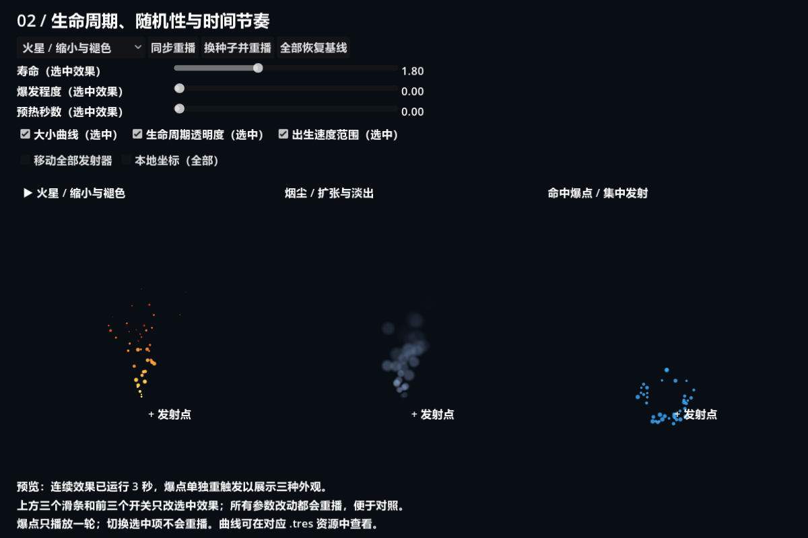
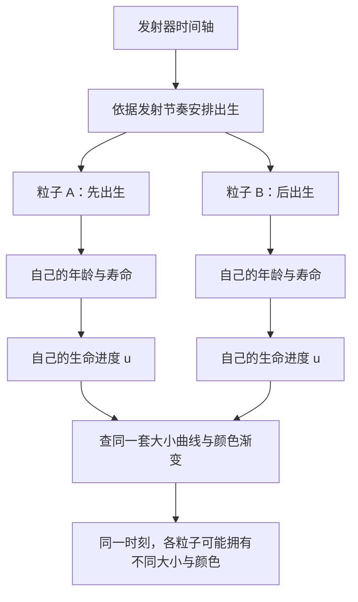
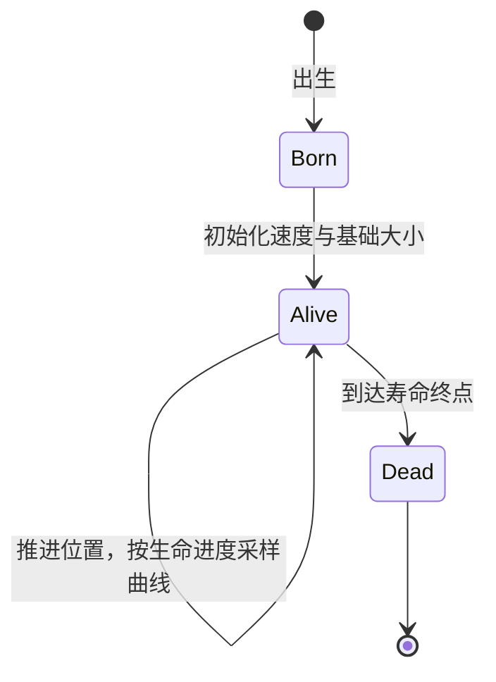
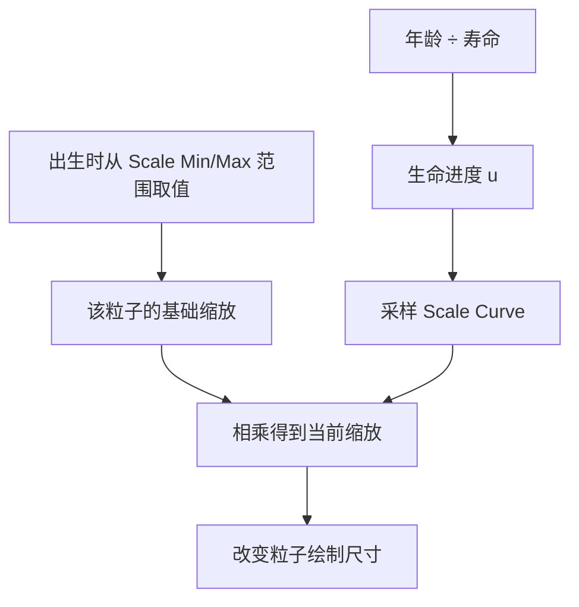
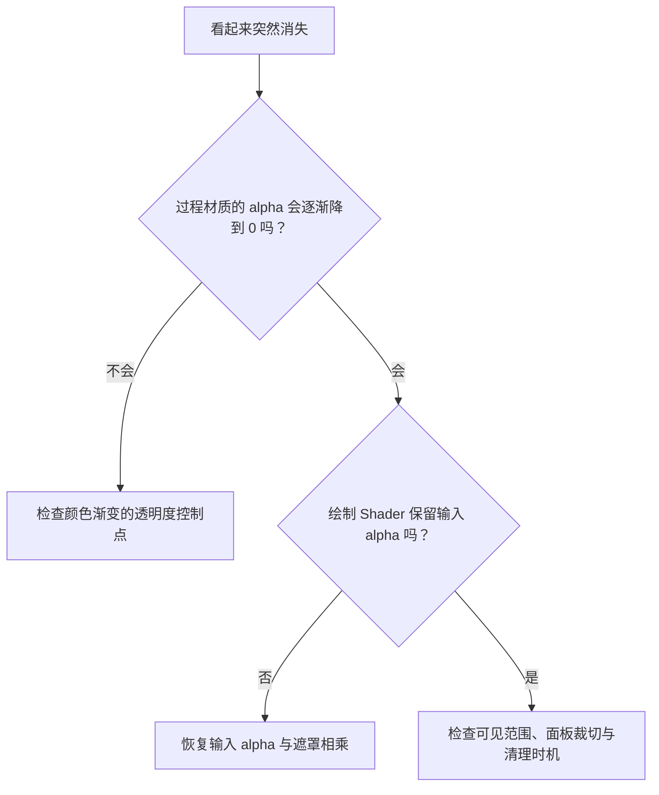
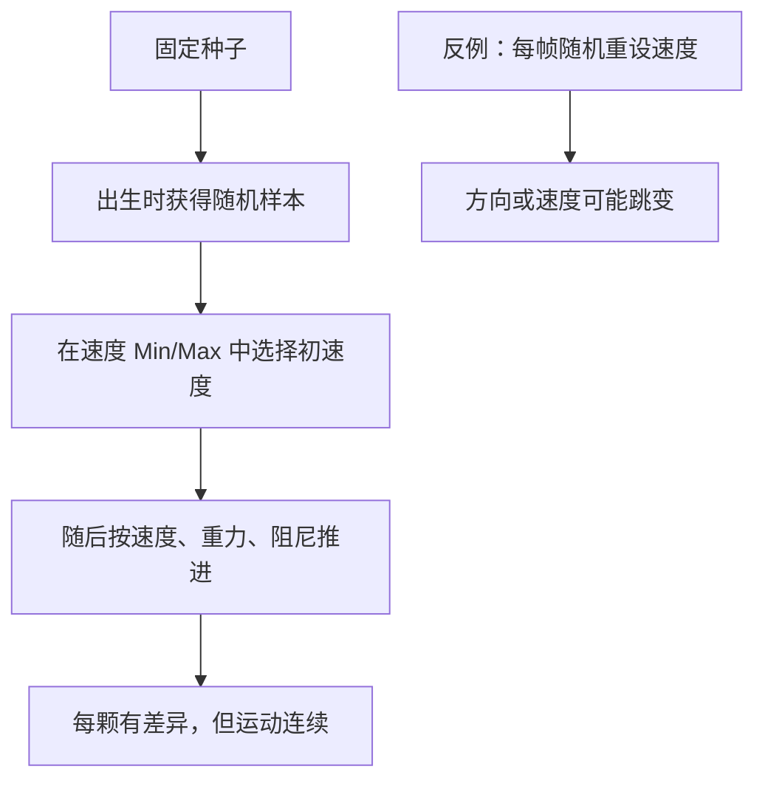
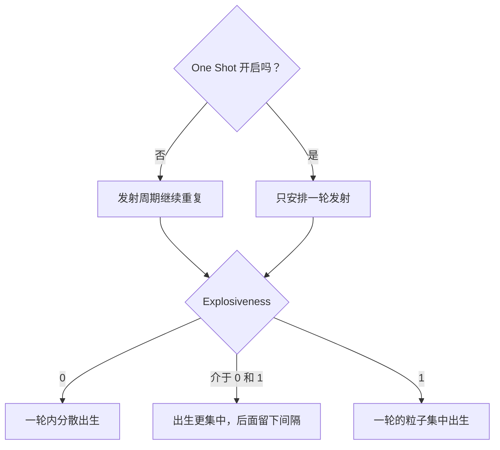
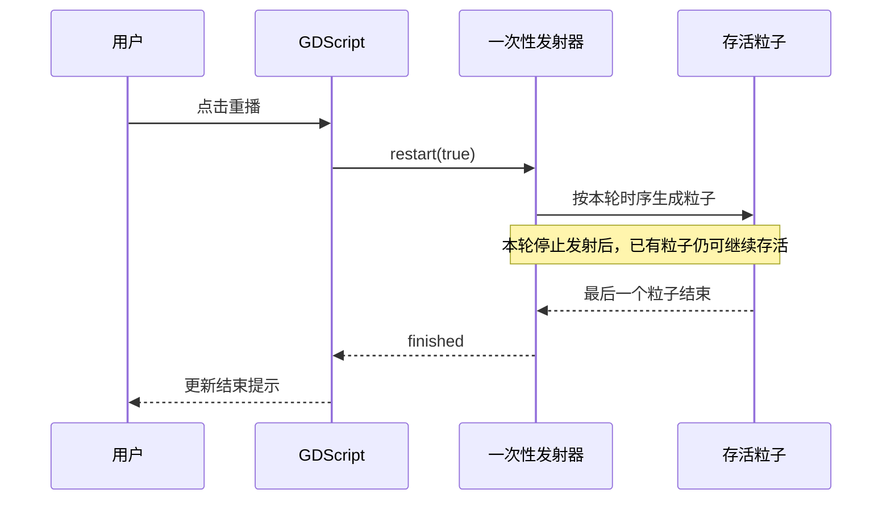
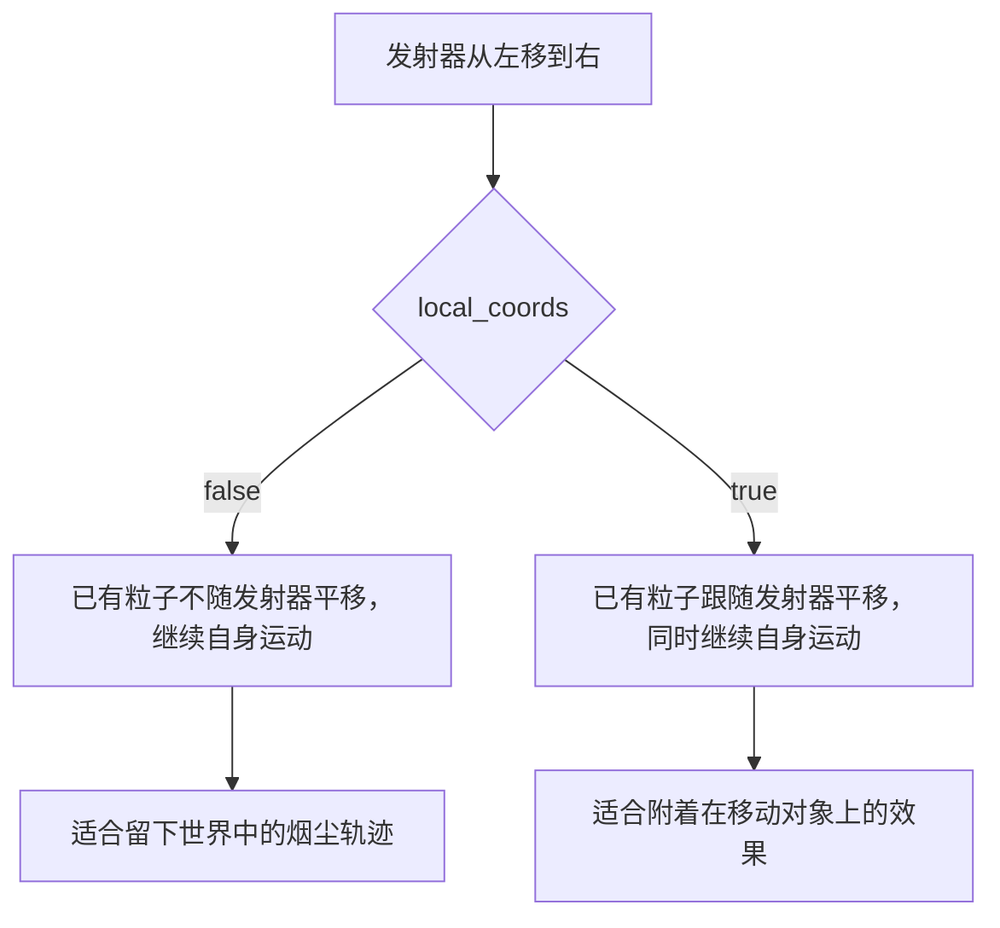

# 第二课：生命周期、随机性与时间节奏

[返回大纲](../../README.md) · [第一课](../01_playground/README.md) · [填写本课实验记录](WORKSHEET.md)

建议用时：2～3 小时。先修：能区分粒子模拟与绘制，知道过程材质产生的颜色和透明度如何传入绘制 Shader。

本课目标是：**用同一张简单纹理，设计出火星、烟尘和命中爆点，并能解释它们为什么呈现不同的时间节奏。** 不增加复杂绘制代码；绘制复用第一课柔边圆点 Shader，深入的是过程材质、曲线和发射器。

## 1. 运行与观察（10 分钟）

打开本目录的 `lifetime_lab.tscn`，按 **F6**。建议运行区域为 **1200 × 800**，较小窗口请放大，以免顶部控件或粒子轨迹被裁切。



左侧是向上飞、逐渐缩小和褪色的火星，中间是扩张并淡出的烟尘，右侧是向四周短促散开的爆点。火星与烟尘持续发射，爆点只播放一轮；右侧变空后点击“同步重播”。截图为了同时显示三个效果，在连续效果稳定后单独重触发了爆点，不能用它判断三个系统是否同时启动。

| 控件 | 作用范围 | 是否重播 |
| --- | --- | --- |
| 顶部下拉框 | 选择要修改的效果，列标题显示箭头 | 否 |
| 寿命、爆发程度、预热 | 只修改选中的效果 | 三侧同步重播 |
| 大小曲线、生命周期透明度、出生速度范围 | 只修改选中的效果 | 三侧同步重播 |
| 移动全部发射器、本地坐标 | 三侧 | 三侧同步重播 |
| 同步重播 | 保留当前参数和种子，重新开始 | 是 |
| 换种子并重播 | 三侧种子各加 1 | 是 |
| 全部恢复基线 | 恢复参数、曲线、种子和坐标开关，保留选中项 | 是 |

三个效果各自只有一个发射器，使用独立过程材质。它们共享同一张纹理和同一绘制 Shader，因此此处的差异来自模拟参数与发射时序。预设对比会同时改变多个参数，只用于感受效果；后面的实验才是控制变量对照。

## 2. 先分清两条时间轴（15 分钟）

**发射器的时间轴**回答“什么时候出生下一颗粒子”；**单颗粒子的时间轴**回答“出生后，颜色与大小怎样变化”。晚出生的粒子有自己的年龄，不会因为别的粒子接近死亡，就同步变老。



本课基线没有寿命随机，单颗粒子的归一化生命进度可写成：

```text
u = 出生后经过的秒数 / 该粒子的寿命
```

若寿命为 2 秒，出生 0.5 秒时 `u = 0.25`，出生 1.5 秒时 `u = 0.75`。**曲线横轴 0～1 是生命进度，不是固定的一秒。** 将寿命改为 4 秒后，同样的 0.75 进度要到出生 3 秒时才到达。

粒子死亡和发射器停止发射也不是同一件事：



这张状态图描述一颗粒子。发射器是否继续生成别的粒子，由它自己的设置决定。

## 3. 在编辑器中检查曲线（15 分钟）

停止运行，打开 `sparks.tres`、`smoke.tres` 或 `impact.tres`。在检查器中找到 `Scale Curve`，展开 CurveTexture，再展开其 Curve。查看横轴 0～1 的控制点；然后打开 `Color Ramp` 的 GradientTexture1D 与 Gradient，检查颜色点及 alpha。

可以通过编辑器属性搜索查找英文关键词，实际界面分组以安装版本为准。演示脚本启动时深复制三个预设，所以运行时按钮不会改写磁盘上的资源。要永久调整预设，应停止运行后修改 `.tres`，再次 F6。

本课大小曲线控制点采用线性连接，方便读懂参数；美术微调时可以再使用平滑切线。

| 参数 | 火星 | 烟尘 | 爆点 |
| --- | --- | --- | --- |
| Amount | 48 | 32 | 40 |
| Lifetime | 1.8 s | 3 s | 0.85 s |
| One Shot | 关闭 | 关闭 | 开启 |
| Explosiveness | 0 | 0 | 1 |
| 初速度范围 | 95～150 px/s | 20～40 px/s | 110～180 px/s |
| Direction / Spread | 向上 / 20° | 向上 / 30° | 向右 / 180°，覆盖四周 |
| Gravity Y | 50 px/s²，向下 | -8 px/s²，向上 | 0 |
| Damping | 0 | 0 | 100 |
| 基础 Scale 范围 | 0.22～0.38 | 1～1.5 | 0.25～0.5 |
| 颜色 | 黄 → 橙 → 暗红 | 蓝灰 | 浅蓝 → 蓝 |
| 预热 / 寿命随机 | 0 / 0 | 0 / 0 | 0 / 0 |

火星以较高初速度上升，向下重力使其减速；烟尘慢速向上并扩张；爆点通过集中出生、较短寿命和阻尼形成迅速散开又衰减的观感。这些是教学预设，不是物理准确的火焰或流体模拟。

## 4. 实验 A：用曲线设计“长大”和“缩小”（20 分钟）

对于本课的统一缩放，可按下面的方式理解：

```text
当前缩放 = 出生时选定的基础 Scale × Scale Curve(u)
```

例如烟尘基础 Scale 为 1.2，某进度的曲线值为 0.5，则当前缩放为 0.6。纹理是 24 × 24 像素，所以绘制四边形约为 14.4 × 14.4 像素；柔边遮罩的可见范围还会更小。



三个预设的曲线点如下，括号表示 `(生命进度, 大小倍率)`：

| 效果 | 控制点 | 设计意图 |
| --- | --- | --- |
| 火星 | (0, 0.5)、(0.12, 1)、(0.6, 0.6)、(1, 0.1) | 很快达到最大，然后缩小 |
| 烟尘 | (0, 0.25)、(0.25, 0.55)、(0.7, 0.85)、(1, 1) | 逐步扩散，晚期更大 |
| 爆点 | (0, 1)、(0.2, 0.8)、(0.65, 0.35)、(1, 0.1) | 出生最明显，随后衰减 |

操作：

1. 恢复基线，选中烟尘。预测取消大小曲线后会发生什么。
2. 关闭“大小曲线”，观察烟尘是否还随年龄扩张。
3. 打开开关确认恢复；再选中火星，做同样对照。
4. 保留所有开关，只把烟尘寿命从 3 秒改成 4 秒，观察扩张完成所需的时间和整体分布。

**预期**：关闭曲线后，保留出生时的基础缩放，不再按曲线扩张或缩小。各粒子基础缩放仍不同，所以整团粒子并不会完全一样大。

寿命实验有一个需要主动解释的关联：对于连续、均匀发射且本课 `amount_ratio = 1` 的基线，发射速率约为 `amount / lifetime`。固定数量时增加寿命，会同时降低出生速率、延长运动时间，不能把所有变化都归因于曲线本身。[节点属性说明](https://docs.godotengine.org/en/4.7/classes/class_gpuparticles2d.html)

**验收**：能根据烟尘曲线说明“先小后大”，并能指出寿命变化带来的额外影响。

## 5. 实验 B：淡出与死亡不是一回事（15 分钟）

本课正常绘制继续使用第一课的公式：

```text
最终 alpha = 过程材质传来的 alpha × 圆点遮罩 × opacity
```

其中 `opacity` 保持 1，本课改的是颜色渐变中的 alpha。

1. 恢复基线，选中烟尘，观察出生时的淡入和消散时的淡出。
2. 关闭“生命周期透明度”，预测并观察结果。
3. 保持大小曲线开启，确认烟尘仍在扩张，却会在寿命终点突然消失。
4. 再关闭大小曲线，对比“固定大小并突然消失”的机械感；之后恢复基线。

这个开关将 Gradient 所有控制点的 alpha 改为 1，保留 RGB，而不是把 Shader 写错。和第一课的错误示范相比，这次丢失淡出的原因位于**过程材质数据**。



**验收**：同样是“不淡出”，你能区分过程材质没有输出淡出，与绘制 Shader 没有使用淡出这两种原因。

## 6. 实验 C：出生随机性与可复现（20 分钟）

“随机”需要说明随机的对象与时机。初速度范围是在出生时选择每颗粒子的初始速度；重力等因素随后继续更新运动，它不等于每帧重新选择一个初速度。



操作：

1. 恢复基线，选中火星，连续点击两次同步重播，比较相同播放时刻的分布。
2. 关闭“出生速度范围”。本课会把 Min/Max 都设为原范围中点，即火星的 122.5。
3. 观察运动差异是否减小；方向散射和基础大小随机仍然保留。
4. 重新开启速度范围，再点击“换种子并重播”。大体风格应保留，具体分布改变。

不要期待每次重播后随手截的一帧完全相同：截图时间不同也会造成差异。固定种子用于同一环境、同一配置、相同模拟时刻的复现，不保证跨硬件或版本逐像素一致。

三个容易混淆的概念：

| 设置 | 改变什么 |
| --- | --- |
| Initial Velocity Min/Max | 出生时的速度取值范围 |
| 节点 Randomness | 发射时间安排的随机性 |
| 过程材质 Lifetime Randomness | 每颗粒子的实际寿命 |

本课后两项均保持 0，避免混入过多变量。加餐时可在自己的副本中实验寿命随机：4.7 的计算为 `L × (1 - r × lifetime_randomness)`，其中 `r` 为 0～1 的随机数；例如 L 为 2 秒、随机比例 0.25，实际寿命约为 1.5～2 秒，不是 1.5～2.5 秒。[过程材质说明](https://docs.godotengine.org/en/4.7/classes/class_particleprocessmaterial.html)

**验收**：能解释关闭本课的速度范围开关后，为什么粒子仍有其他随机差异。

## 7. 实验 D：连续发射、脉冲和一次性爆点（20 分钟）

`Explosiveness` 控制一轮内出生的集中程度；`One Shot` 控制只发射一轮还是继续循环。两个设置分别解决不同的问题。



1. 恢复基线，选中火星，将爆发程度从 0 调到 1，保持 One Shot 关闭。
2. 观察持续流变成重复喷发。**爆发程度为 1 不等于只喷发一次。**
3. 恢复基线，选中爆点，将爆发程度从 1 调到 0。
4. 点击重播，观察粒子分散出生；虽然 One Shot 开启，仍不是所有粒子瞬间出生。
5. 等待界面出现“爆点已全部结束”，然后再重播。

`finished` 表示一次性系统的粒子已全部结束；最后一颗的出生可能比第一颗晚，因此总效果时长不一定等于一个 Lifetime。连续发射系统不靠这个信号周期性通知结束。



本课直接用 `restart(true)` 重触发并保留种子，避免只设置 `emitting = true` 时的重启时机问题。信号图是行为说明，不表示 GPU 粒子逐个向 GDScript 发信号。[节点方法与信号](https://docs.godotengine.org/en/4.7/classes/class_gpuparticles2d.html)

**验收**：不用改数量，通过这两个设置区分“持续流”“重复脉冲”“一次性爆发”。

## 8. 实验 E：预热与移动发射器（20 分钟）

先做预热，再做坐标实验，中间恢复基线。

**预热：**选中烟尘，对比预热 0 与 2 秒后重播的第一眼。预热为 2 秒时，系统先推进一段模拟，所以开场已有不同年龄的粒子；它不是把每颗粒子的寿命增加 2 秒，也不是等待两秒后开始。

不要默认给所有效果加预热。将短命爆点预热设到 2 秒，事件可能在可见演示开始前就已经播放完，导致你以为没有发射。实验后恢复为 0。预热需要额外计算，本课范围限制在 0～2 秒。

**坐标：**

1. 恢复基线，开启“移动全部发射器”，保持本地坐标关闭。
2. 观察烟尘：旧粒子沿自己的轨迹继续运动，新粒子从移动后的发射点出生。
3. 开启“本地坐标（全部）”，重播后再观察：旧粒子随发射器一起横移。
4. 关闭本地坐标，确认区别，结束后恢复基线。



“世界坐标下旧粒子不跟随”不代表旧粒子静止。它们仍有速度和加速度。此处水平运动来自脚本移动发射器，不是噪声力场。改变开关会重播，避免将不同坐标约定的历史状态混在一起。

**验收**：能解释移动角色留下的烟尘应如何选择坐标模式，以及预热为什么可能隐藏一次性事件。

## 9. 关键实现与你需要阅读的部分

优先读 `.tres` 资源和以下几个回调；界面构建部分不是本课重点。

```gdscript
# 独立复制预设，避免修改一个效果影响其他效果或源资源。
emitter.process_material = MATERIALS[i].duplicate(true)

# 大小曲线开关：关闭时保留基础 Scale。
motion.scale_curve = original_curve if enabled else null

# 关闭速度范围时，以范围中点作为固定出生速度。
motion.initial_velocity_min = midpoint
motion.initial_velocity_max = midpoint

# 固定种子重播。
emitter.restart(true)
```

以上片段解释思路，`motion`、`original_curve` 等需对应实际资源变量；完整实现见 `lifetime_lab.gd` 的 `_set_curve()`、`_set_fade()`、`_set_random()` 与 `_replay()`。

界面同步使用 `syncing` 避免“切换选中效果 → 刷新滑条 → 误触发参数修改与重播”。这是辅助界面的处理，不是粒子模拟算法。

脚本中的 `_smoke_test()` 是参数验证入口，普通 F6 不执行。里面的 `assert` 检查预期是否成立，例如修改烟尘寿命后火星寿命应保持原值；断言用于发现开发错误，不代替效果逻辑或正式运行中的错误处理。

## 10. 独立重建与阶段作品（30 分钟，可另安排一次练习）

在本目录创建自己的 `my_lifetime_lab.tscn`，不要覆盖演示场景和预设。

1. 新建单个 GPUParticles2D，复用第一课纹理与绘制 Shader，但自己新建过程材质。
2. 制作一条大小曲线：出生较小、短时间扩张、末段缓慢变化。
3. 制作一条颜色渐变：开始清晰可见，后段逐渐透明。
4. 配置向外散开的初速度、适当阻尼、One Shot 和 Explosiveness。
5. 做出“先爆发、后缓慢消散”的效果；不靠增加大量粒子表现强度。
6. 添加重播按钮，保留固定种子，给出两个不同风格的参数变体。

先在资源检查器中制作曲线，无需为每个属性编写 UI。记录每次改动并先预测；不要只拿预设复制后换颜色作为完成标准。

## 11. 排查与自测

| 现象 | 优先检查 |
| --- | --- |
| 曲线到 1 却不是一秒结束 | 横轴是生命进度；确认 Lifetime |
| 关闭曲线后烟尘变大 | 曲线曾将基础大小乘以小于 1 的数；关闭后使用基础大小 |
| 改寿命后密度改变 | 数量不变时，连续出生速率也会改变 |
| 关闭速度范围仍不一致 | 方向散射、基础大小范围仍然保留 |
| 爆发程度为 1 仍重复播放 | 检查 One Shot |
| 爆点一开场看不到 | 是否已播完，或预热过长？先重播、预热归零 |
| 烟尘像粘在角色上 | 检查 local_coords |
| 一侧修改影响另一侧 | 检查过程材质及其子资源是否独立 |
| 轨迹在列边缘被截断 | 面板启用裁切；扩大窗口并区分裁切与死亡 |

先回答，再展开答案：

1. 寿命 4 秒，生命进度 0.75 对应出生后几秒？
2. 大小曲线恒为 1，与基础 Scale 为 1，是同一件事吗？
3. 连续系统只把爆发程度设为 1，为什么会反复爆发？
4. 粒子已经不可见，可以断定模拟结束了吗？
5. 本课关闭速度范围后，固定种子还有作用吗？

<details>
<summary>参考答案</summary>

1. 3 秒，本题不考虑寿命随机。
2. 不是。曲线值 1 表示不改变出生时的基础缩放；基础缩放本身可以是其他数值或随机范围。
3. Explosiveness 决定一轮内的集中程度，One Shot 决定是否只安排一轮。
4. 不能，alpha 为 0、裁切或预热等都可能使粒子不可见。
5. 有，方向、基础大小等仍可能使用随机值；只关闭了速度取值范围。

</details>

完成 [实验记录](WORKSHEET.md) 后按以下标准验收，再由你更新总进度：

- [ ] 我能解释生命进度和发射时序的区别。
- [ ] 我能从曲线控制点预测缩放、颜色和透明度变化。
- [ ] 我能区分出生随机值、发射时间随机性与寿命随机性。
- [ ] 我能独立配置持续流、重复脉冲和一次性爆点。
- [ ] 我能解释预热与坐标开关的作用及适用情况。
- [ ] 我完成了一个先爆发后缓慢消散的独立场景，并能解释每条曲线。

## 12. 参考资料与下一课

- [Godot 4.7 GPUParticles2D](https://docs.godotengine.org/en/4.7/classes/class_gpuparticles2d.html)：生命周期、种子、预热、坐标、重播与 finished。
- [Godot 4.7 ParticleProcessMaterial](https://docs.godotengine.org/en/4.7/classes/class_particleprocessmaterial.html)：曲线、出生参数和寿命随机。
- [Godot 4.7 Curve](https://docs.godotengine.org/en/4.7/classes/class_curve.html)：控制点与插值。
- [Godot 4.7 Gradient](https://docs.godotengine.org/en/4.7/classes/class_gradient.html)：颜色与透明度控制点。

第三课将暂时把粒子运动固定下来，集中研究 UV、距离、旋转和形状组合，开始自己设计圆环、扇形和其他程序图形。

配套场景的环境、检查范围与限制见 [验证记录](VALIDATION.md)。
