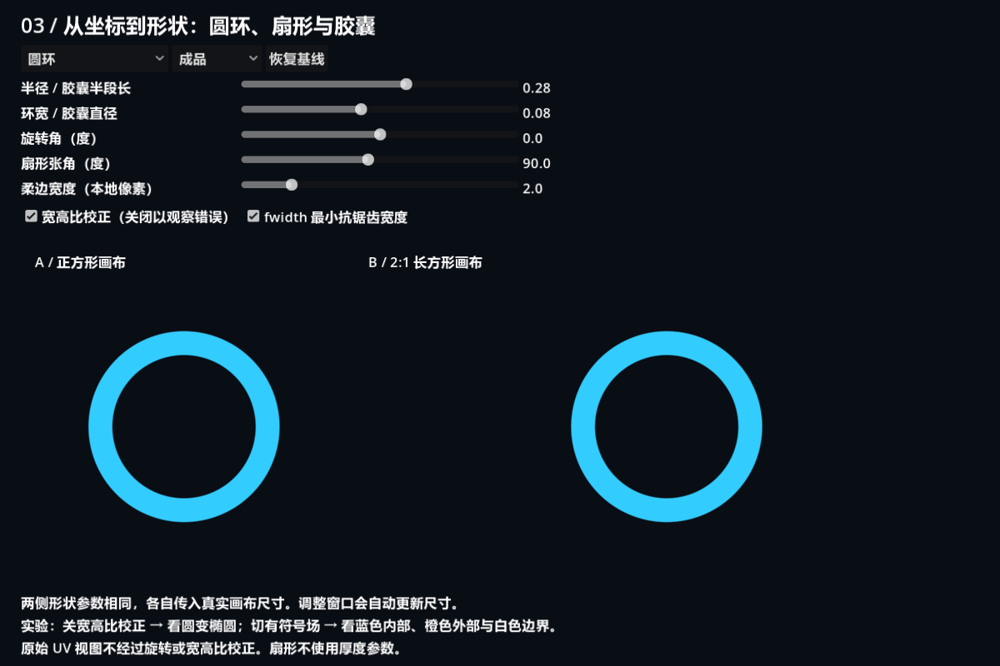
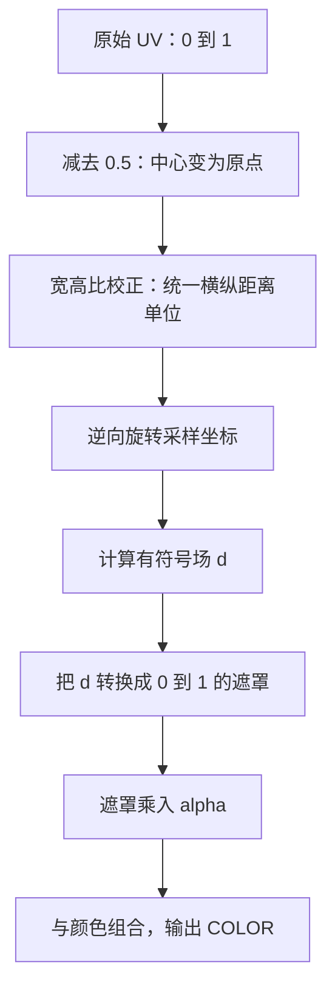
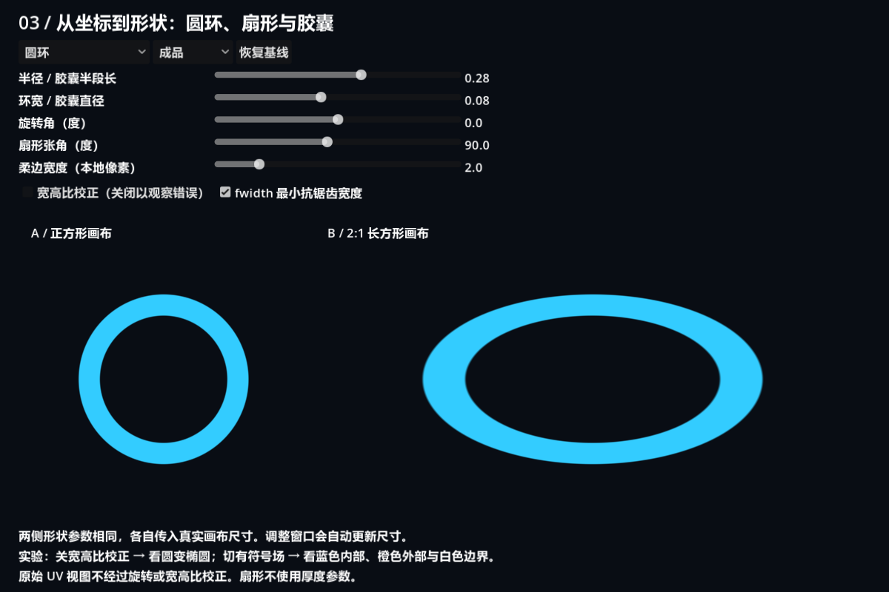
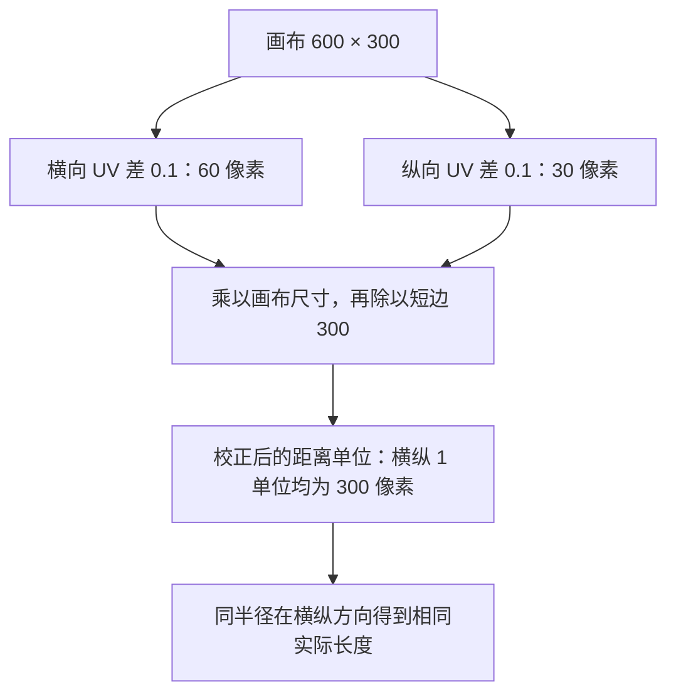
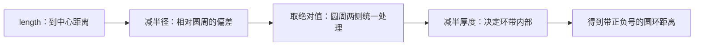
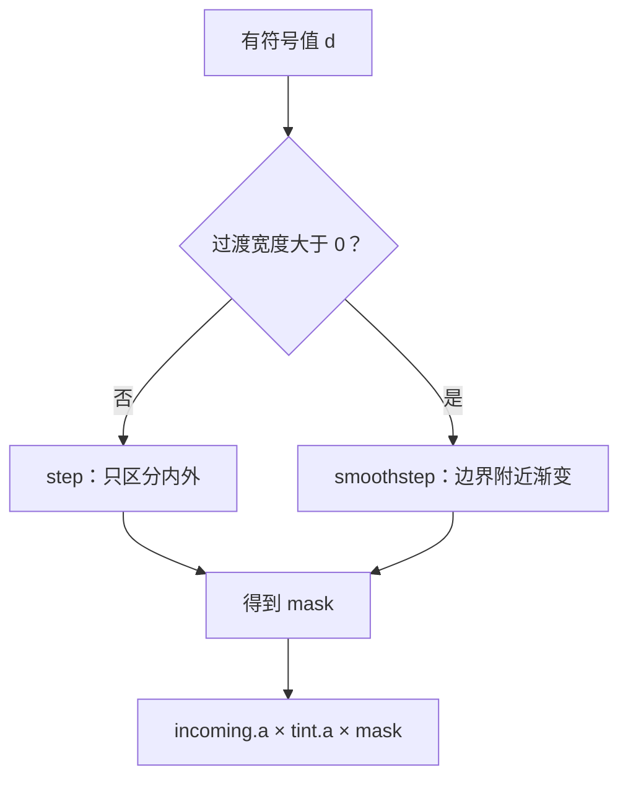
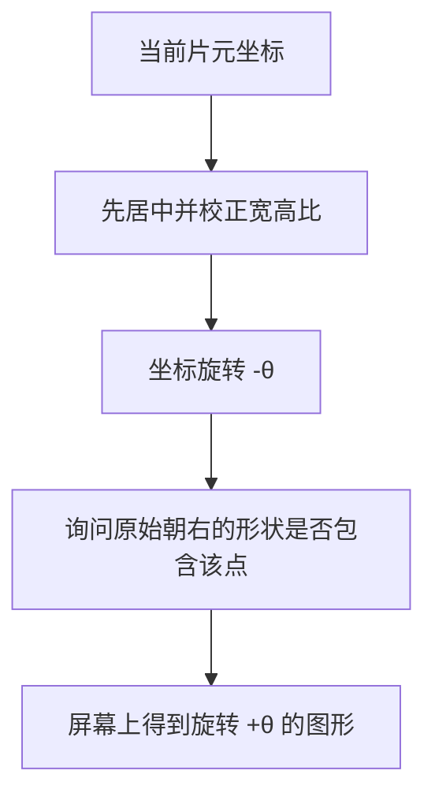
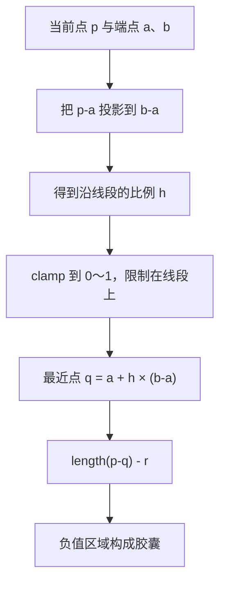
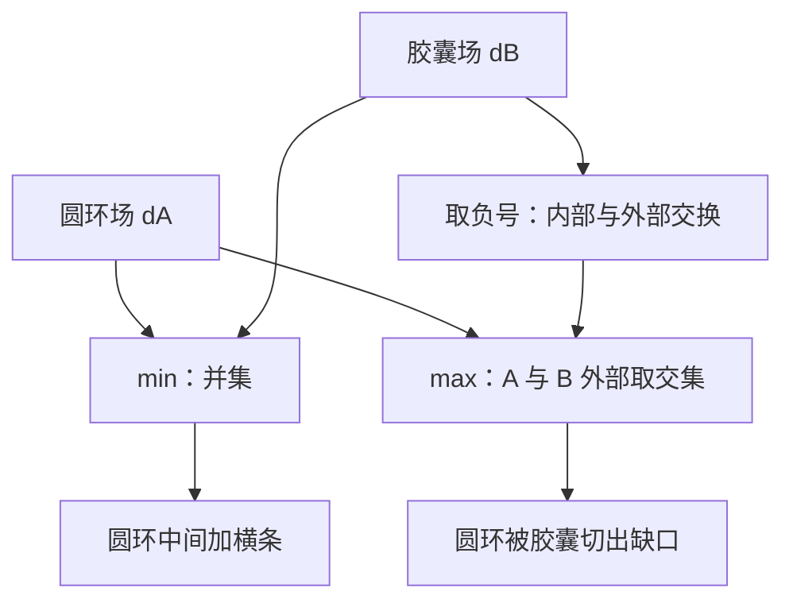

# 第三课：坐标、距离场与程序形状

[返回大纲](../../README.md) · [第二课](../02_lifetime/README.md) · [实验记录](WORKSHEET.md)

建议用时：2～3 小时，独立重建可另安排 30 分钟。先修：理解第一课中的 UV、COLOR 和遮罩作用，知道第二课的粒子生命周期独立于绘制图形。

本课暂时使用静止的 ColorRect，把注意力集中在**如何根据位置计算形状**。学完后，你应能自己写出圆环、扇形和胶囊形，并解释它们在不同宽高比下为什么保持形状或发生变形。这些 Shader 思路之后可以用于粒子贴片、技能范围指示与冲击波。

## 1. 先运行实验场（10 分钟）

打开 `shapes_lab.tscn`，按 **F6**。推荐运行区域 **1200 × 800**；小窗口请放大，避免控件与画布重叠。



左侧 A 是正方形画布，右侧 B 是 2:1 长方形画布，两者短边相同。初始显示大小一致的圆环。所有形状都由 Shader 计算，不需要图片纹理。

| 控件 | 作用 |
| --- | --- |
| 形状下拉框 | 圆环、扇形、胶囊、圆环与胶囊并集、圆环减胶囊 |
| 视图下拉框 | 成品、原始 UV、有符号场、灰度遮罩 |
| 半径 / 胶囊半段长 | 圆环中心线半径、扇形半径；胶囊中间线段的半长 |
| 环宽 / 胶囊直径 | 圆环总厚度、胶囊圆帽直径；扇形不使用此参数 |
| 旋转角 | 绕图形中心旋转，界面单位为度 |
| 扇形张角 | 扇形两条边之间的总角度，15°～180° |
| 柔边宽度 | 基于本地画布尺寸换算的过渡宽度 |
| 宽高比校正 | 关闭可故意让长方形中的圆变为椭圆 |
| fwidth 最小抗锯齿宽度 | 给过渡宽度设置一个基于片元导数的下限 |
| 恢复基线 | 恢复圆环、成品视图与所有参数 |

控件同时修改两侧参数，但两侧 ShaderMaterial 独立，因为 `rect_size` 不同。共享 Shader 程序不等于共享所有材质参数。窗口尺寸变化时脚本会重新布局并传入实际画布尺寸，无需重播。

## 2. 从坐标到颜色的完整路径（10 分钟）



把这条路径当作排查顺序。形状位置不对，先看坐标；轮廓不对，看距离公式；边缘不好看，看遮罩过渡；颜色丢失，才检查输出组合。

## 3. 实验 A：UV、居中和宽高比（20 分钟）

选择“原始 UV”视图，输出相当于：

```glsl
COLOR = vec4(UV, 0.0, 1.0);
```

红色表示 U，绿色表示 V。横向由 0 增至 1，纵向由 0 增至 1；两张画布都有相同的 UV 范围，但一个横向 UV 单位覆盖的像素数不同。

| 点 | 原始 UV | 居中后的 UV - 0.5 |
| --- | --- | --- |
| 左上 | (0, 0) | (-0.5, -0.5) |
| 中心 | (0.5, 0.5) | (0, 0) |
| 右下 | (1, 1) | (0.5, 0.5) |

现在切回成品，关闭“宽高比校正”。先预测哪侧会变形，再观察。



只有减去 0.5 还不够：对于宽 600、高 300 的画布，UV 横向差 0.1 对应 60 像素，纵向差 0.1 却对应 30 像素。直接用 `length(UV - 0.5)` 等于把这两段不同的实际距离当作相同距离。

本课统一使用“画布短边”作为一个距离单位：

```glsl
float short_side = max(min(rect_size.x, rect_size.y), 1.0);
vec2 p = (UV - vec2(0.5)) * rect_size / short_side;
```

600 × 300 的画布中，校正后的 p.x 范围为 -1～1，p.y 为 -0.5～0.5；横纵方向的 0.1 都对应 30 个本地像素。圆半径 0.28 表示短边长度的 28%，不是 0.28 像素。



重新开启校正，然后改变窗口大小，检查两个圆环是否仍为圆。原始 UV 调试视图不经过这些变换，所以切开关或旋转时它不改变，这是故意保留的输入观察点。

**验收**：能用 600 × 300 的数值解释变形原因。不要使用 `TEXTURE_PIXEL_SIZE` 代替这里的画布尺寸：它描述纹理像素尺寸，不能一般性地表示 ColorRect 的显示尺寸。[CanvasItem 变量参考](https://docs.godotengine.org/en/4.7/tutorials/shaders/shader_reference/canvas_item_shader.html)

## 4. 实验 B：距离如何变成圆环（20 分钟）

先理解一个圆的有符号距离：

```glsl
float d_circle = length(p) - radius;
```

- `d < 0`：内部。
- `d = 0`：边界。
- `d > 0`：外部。

对于圆，绝对值就是到边界的最短距离，单位与 p 一致。圆环则围绕一条半径为 R 的圆周，保留两侧一定厚度：

```glsl
float d_ring = abs(length(p) - radius) - thickness * 0.5;
```

基线 `radius = 0.28`、`thickness = 0.08`，内半径为 0.24，外半径为 0.32。因此圆心是圆环外部，即使它位于整个图案的中心。

| 到中心距离 | d_ring | 含义 |
| --- | --- | --- |
| 0 | 0.24 | 圆环中间的空洞 |
| 0.24 | 0 | 内边界 |
| 0.28 | -0.04 | 环带中央 |
| 0.32 | 0 | 外边界 |
| 0.40 | 0.08 | 环外 |

操作：切到“有符号场”，观察内部蓝色、外部橙色、零值附近白色边界。再切“灰度遮罩”，白色是可见区域，黑色是不可见区域；最后返回成品。

有符号场中的明暗条带只是可视化距离值变化，并不是纹理或额外几何体；组合形状中的这些数值也不一定是精确距离。



分别改变半径和厚度，保持另一个不动。**验收**：能计算内外半径，并解释为什么只把圆的半径调大不会自动形成圆环。

## 5. 从距离到柔边：step 与 smoothstep（20 分钟）

硬边只判断是否在内部：

```glsl
float mask = 1.0 - step(0.0, d);
```

`step(0, d)` 在 d 小于 0 时返回 0，否则返回 1；减去它就得到内部可见。它没有过渡带，放大斜边可能看到锯齿。

柔边则让边界附近逐渐过渡：

```glsl
float mask = 1.0 - smoothstep(-width * 0.5, width * 0.5, d);
```

这条过渡带以边界为中心，内外各占一半宽度。d 为 0 时 mask 为 0.5；width 越大，边缘越柔。



操作：先关闭 fwidth，把柔边宽度设为 0，再依次设为 2、8。先用圆环看模糊范围，再用旋转 35° 的胶囊观察斜边。

本课把柔边像素值除以短边得到场的单位，例如短边 300，6 像素对应 0.02。这个换算在**宽高比校正开启、没有额外节点缩放**时有明确的本地像素含义。关闭校正时横纵尺度不一致，柔边也可能被拉伸。

不要写 `smoothstep(0.0, 0.0, d)` 或把两个边界颠倒；实现中 width 为 0 时单独使用 step。[内置函数参考](https://docs.godotengine.org/en/4.7/tutorials/shaders/shader_reference/shader_functions.html)

**加餐：fwidth。** 它估计 d 在相邻屏幕片元之间的变化量。本课使用 `max(用户柔边宽度, fwidth(d))` 设置过渡下限，防止边缘比一个片元尺度还窄。它不会把所有边缘固定成精确的一像素，也不是多重采样或完整的抗锯齿方案。

将用户柔边设为 0，比较 fwidth 开关；改变窗口大小再次观察。分辨率高时差异可能细微。注意：开启 fwidth 后，柔边滑条为 0 仍可能有过渡，这不是滑条失效。

## 6. 实验 C：坐标旋转与扇形（25 分钟）

圆环绕中心旋转后看起来一样，先切到扇形再研究旋转。默认扇形朝右，张角为 90°。

Shader 不是拿一个已经画好的物体转动，而是对每个片元问：“如果将当前位置逆向旋转，它是否落在原来的形状里面？”

```glsl
p = rotate_point(p, -radians(angle_degrees));
```

旋转函数内部：

```text
x' = cos(a) × x - sin(a) × y
y' = sin(a) × x + cos(a) × y
```



本课屏幕 Y 向下，所以图形正角度的可见旋转为顺时针；界面使用度，三角函数使用弧度。把旋转设为 90°，扇形应朝下；设为 -90°，应朝上。

扇形可以理解成“半径以内，而且夹在两条射线之间”。极坐标能帮助理解：`length(p)` 是半径，`atan(p.y, p.x)` 表示方位角；实际代码采用两个半平面限制，避免对中心点求角度。

令半张角为 h，取两个单位法向量：

```glsl
vec2 n1 = vec2(-sin(h),  cos(h));
vec2 n2 = vec2(-sin(h), -cos(h));
float wedge = max(dot(p, n1), dot(p, n2));
float sector = max(length(p) - radius, wedge);
```

`dot(p, n)` 是点在法向量方向上的投影。两个投影都不大于 0 时，点位于两条直线限定的夹角内；再与圆内部取交集，就得到扇形。

本实现将总张角限制在 15°～180°。超过 180°时不能直接沿用这两个半平面求交的方式，需另做形状构造。它生成正确的内外符号与边界，但扇形角点外侧的数值**不保证等于到边界的最短欧氏距离**。

操作：张角依次设为 30°、90°、180°，然后独立调整旋转角；保持半径不变。**验收**：能区分“展开更宽”和“朝向改变”，并解释为什么先减去 0.5 再旋转。若直接旋转原始 UV，旋转原点会落在左上角。

## 7. 实验 D：点到线段的距离与胶囊（20 分钟）

胶囊形是“距离某条线段不超过 r 的所有点”。离线段中间最近时形成直边，离端点最近时形成半圆帽。



核心代码：

```glsl
vec2 ab = b - a;
float h = clamp(dot(p - a, ab) / max(dot(ab, ab), 0.000001), 0.0, 1.0);
float d = length(p - (a + h * ab)) - r;
```

为什么有两个保护？`clamp` 防止最近点跑到线段延长线上；分母下限防止端点重合时除零。没有 clamp，形状会趋向无限长条带，无法产生正确端帽。

本课端点为 `(-radius, 0)` 与 `(radius, 0)`，圆帽半径为 `thickness / 2`。因此胶囊总长为 `2 × radius + thickness`，不是简单的 `2 × radius`。

切到胶囊，依次调整半段长、厚度和旋转，每次只改一个值。回到基线 0.28 与 0.08，算出总长度 0.64；在短边 300 像素的画布中约为 192 像素。

**验收**：能解释两端为什么是圆的，以及为什么厚度同时影响总长度。

## 8. 实验 E：组合形状（15 分钟）

负值代表内部时，可以用以下规则组合：

| 运算 | 表达式 | 内部条件 |
| --- | --- | --- |
| 并集 A ∪ B | `min(dA, dB)` | 至少在其中一个内部 |
| 交集 A ∩ B | `max(dA, dB)` | 同时在两个内部 |
| 差集 A - B | `max(dA, -dB)` | 在 A 内，并且不在 B 内 |



先预测“并集”和“差集”的画面，再选择对应模式观察。切“有符号场”确认蓝色内部如何改变。差集产生的端部会带胶囊圆帽轮廓，不是用直线简单裁断。

这些 min/max 规则可靠表达集合内外，但组合后的场不一定处处保留精确最短距离性质，尤其是交界与角点。用于本课遮罩很实用；不能直接假设它适合精确测距或所有步进算法。

## 9. 独立重建与常见错误（30 分钟）

新建自己的 `my_shape.tscn`，使用 ColorRect 与独立 ShaderMaterial，不复制整个演示场景。

1. 先输出 UV 渐变，确认坐标方向。
2. 手写居中、宽高比校正与圆距离函数，显示一个实心圆。
3. 改成圆环，暴露半径、厚度与柔边参数。
4. 再增加一个胶囊，用差集得到有缺口的圆环。
5. 添加旋转参数，把缺口朝向改为任意角度。
6. 在正方形与长方形画布中使用同一 Shader，分别传入各自的尺寸。

最小圆形起点（rect_size 需要脚本传入或在检查器中正确填写）：

```glsl
shader_type canvas_item;
render_mode unshaded;
uniform vec2 rect_size = vec2(300.0);
uniform float radius = 0.28;

void fragment() {
    float s = max(min(rect_size.x, rect_size.y), 1.0);
    vec2 p = (UV - vec2(0.5)) * rect_size / s;
    float d = length(p) - radius;
    float mask = 1.0 - smoothstep(-1.0 / s, 1.0 / s, d);
    COLOR = vec4(COLOR.rgb, COLOR.a * mask);
}
```

本课画布均为白色 ColorRect，正常输出会保留输入 COLOR；调试视图则故意使用不透明颜色展示数据，不是最终透明绘制方式。`shapes_lab.gd` 主要管理控件与尺寸，核心学习对象是 `shapes.gdshader`。

| 现象 | 检查与修复 |
| --- | --- |
| 圆变椭圆 | rect_size 是否正确，宽高比校正是否开启？ |
| 旋转后图案跑出画布 | 是否先居中，再做旋转？ |
| 圆环调旋转看不出变化 | 圆环对称，换扇形或胶囊观察 |
| 柔边为 0 仍有过渡 | fwidth 是否开启？ |
| 原始 UV 视图不随旋转变化 | 该模式专门观察未变换的输入 UV |
| 胶囊成为无限长条 | 点到线段的投影比例是否 clamp？ |
| 图形边缘突然被切断 | ColorRect 只覆盖有限区域；公式不能让 fragment 画到几何边界外 |
| 扇形超过 180°不符合预期 | 超出本课两个半平面求交构造的适用范围 |
| 改右侧尺寸影响左侧形状 | 两侧是否错误地共享同一个 ShaderMaterial 的 rect_size？ |

## 10. 验收与参考答案

- [ ] 我能解释 UV 单位与本地像素单位的区别。
- [ ] 我能用数值说明圆环的内半径、外半径和厚度。
- [ ] 我能解释坐标逆向旋转与图案正向旋转的关系。
- [ ] 我能解释扇形的交集与胶囊的点到线段距离。
- [ ] 我完成一个形状组合，并在两种画布尺寸下验证。
- [ ] 我能区分精确 SDF、组合有符号场和最终遮罩。

先回答，再看答案：

1. 画布 800 × 400，半径 0.25，对应多少本地像素？
2. `d > 0` 的点是否一定看不见？
3. 并集为什么用 min，而不是 max？
4. 想绘制超出 ColorRect 的大圆，只改半径足够吗？

<details>
<summary>参考答案</summary>

1. 校正开启时为 100 像素，短边 400 乘以 0.25。
2. 不一定。柔边过渡可能延伸到边界外，所以略大于 0 的点仍有部分透明度。
3. 只要任意一个值为负，min 就为负，正好表示至少处于一个形状内部。
4. 不够。需要扩大绘制几何区域，再更新坐标/参数；fragment 不会凭空在覆盖范围外执行。

</details>

将实验与独立作品记录在 [WORKSHEET.md](WORKSHEET.md)，验收后再更新总学习进度。

## 11. 官方参考与下一课

- [Godot 4.7 CanvasItem Shader](https://docs.godotengine.org/en/4.7/tutorials/shaders/shader_reference/canvas_item_shader.html)：UV、COLOR 与绘制阶段。
- [Godot 4.7 内置 Shader 函数](https://docs.godotengine.org/en/4.7/tutorials/shaders/shader_reference/shader_functions.html)：length、dot、clamp、step、smoothstep、三角函数与 fwidth。

图形公式和实验组合是本课教学实现。下一课将在这些规则形状上加入噪声、UV 扭曲与溶解，理解如何从干净的几何图形得到自然变化。验证范围见 [VALIDATION.md](VALIDATION.md)。
