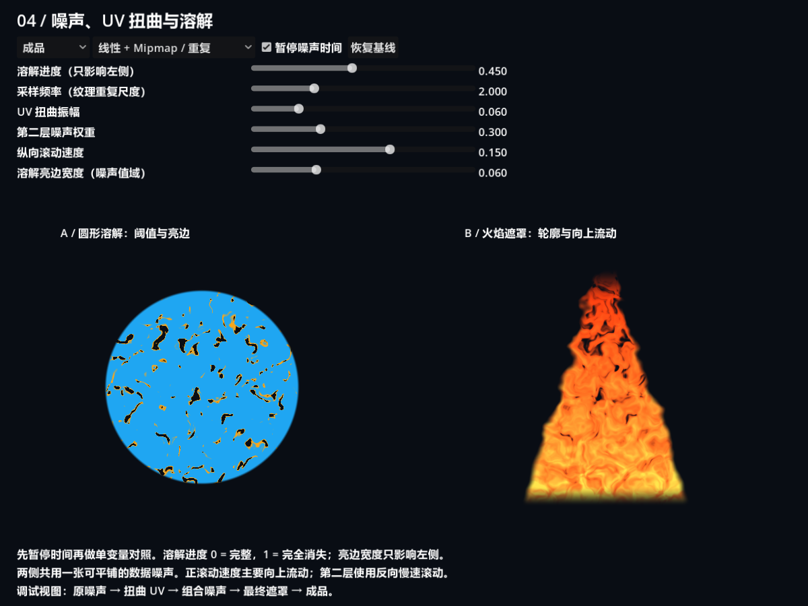
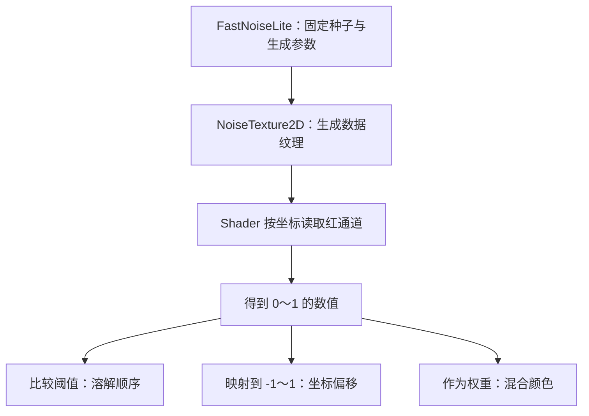
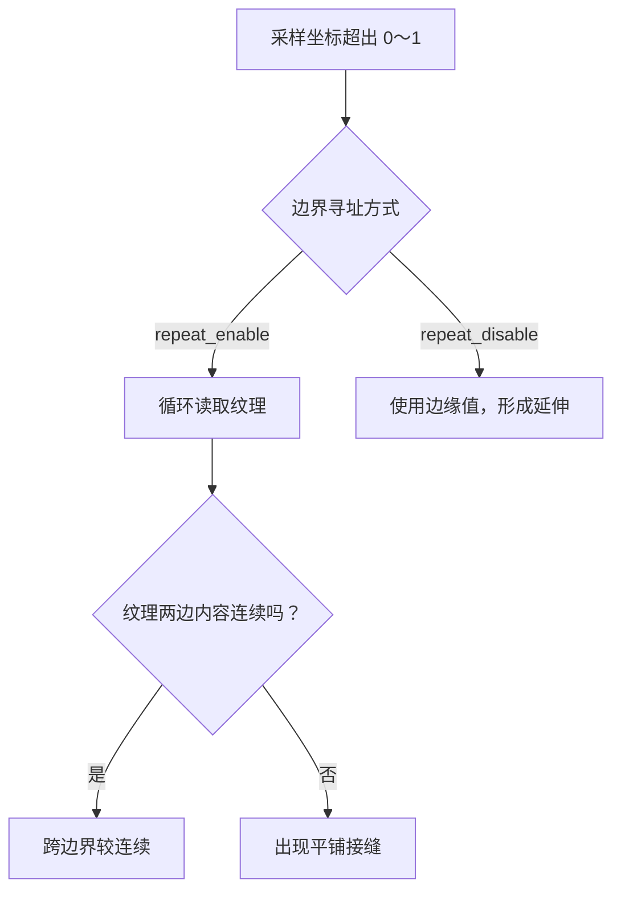
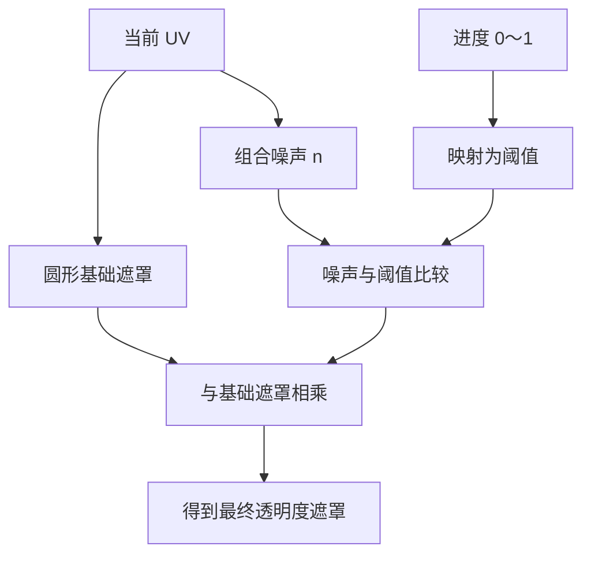
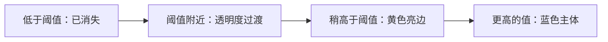
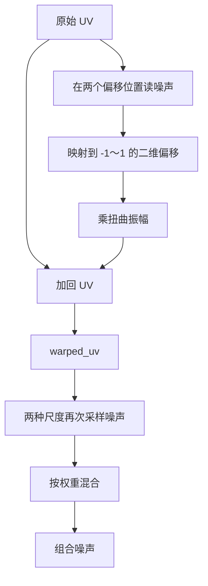
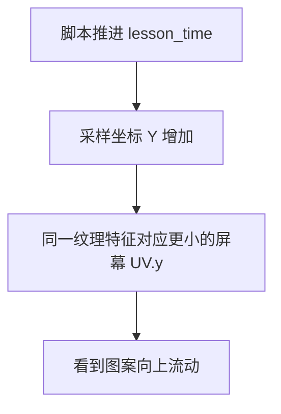
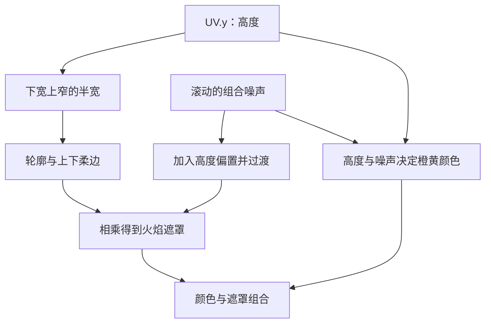

# 第四课：噪声、纹理采样与溶解

[返回大纲](../../README.md) · [第三课](../03_shapes/README.md) · [实验记录](WORKSHEET.md)

建议用时：2～3 小时。先修：能将坐标转换成形状遮罩，理解第三课的 smoothstep、alpha 与调试视图。

本课目标：**把噪声当作可读取的数据，用它控制溶解顺序、边缘颜色和图案流动。** 完成一个带亮边的溶解和一个向上流动的火焰遮罩。这里仍使用静止 ColorRect，粒子生命周期与每颗粒子独立动画将在第五课连接起来。

## 1. 运行与观察（10 分钟）

打开 `noise_lab.tscn`，按 **F6**，推荐运行区域 **1200 × 900**。两侧始终为正方形，缩放窗口会自动布局。小窗口请放大，避免控件重叠。



左侧是蓝色圆形逐块溶解，保留区域的边界呈黄色；右侧是具有流动细节的火焰形状。亮边只是颜色变化，本课没有启用辉光后处理，也没有流体模拟。

| 控件 | 作用 |
| --- | --- |
| 溶解进度 | 只影响左侧；0 完整显示，1 完全消失 |
| 采样频率 | 改变纹理在 UV 空间中的重复尺度，影响两侧 |
| UV 扭曲振幅 | 改变坐标偏移幅度，影响两侧 |
| 第二层噪声权重 | 在两种不同尺度、速度的噪声采样之间混合 |
| 纵向滚动速度 | 主层正值向上、负值向下；第二层慢速反向 |
| 溶解亮边宽度 | 只影响左侧，单位是噪声值差，不是像素 |
| 采样方式 | 线性加 mipmap 重复、最近邻重复、线性加 mipmap 边缘夹取 |
| 暂停噪声时间 | 冻结动画，便于单变量比较，仍可拖动参数 |
| 调试视图 | 原噪声、扭曲 UV、组合噪声、最终遮罩、成品 |
| 恢复基线 | 恢复参数、视图、采样方式，并将时间归零、继续播放 |

**每次做参数对照前先暂停时间。** 否则噪声图案自己在移动，很容易把时间变化误认为参数变化。截图在时间 1 秒处暂停。

## 2. 噪声是数据，不只是灰色图片（15 分钟）

`noise.tres` 是一张 256 × 256 的 NoiseTexture2D，使用固定种子 137 的 FastNoiseLite 生成，开启 seamless 与 mipmap。读取红通道得到一个 0～1 的数值：

```glsl
uniform sampler2D noise_linear : repeat_enable, filter_linear_mipmap;
float n = texture(noise_linear, UV).r;
```

灰度只是一种显示方式。同一个数值可以用于透明度、阈值判断、位移或颜色混合。



本课将生成器 frequency 固定为 0.025，只用界面修改 Shader 的采样频率。两者不要混淆：生成器参数改变纹理内容；采样频率改变读取这张纹理的尺度。本课纹理本身已含三层生成器分形细节，后面的“两层混合”指再次对同一纹理做两次采样，不是两个独立文件。

NoiseTexture2D 在后台生成，脚本确认图像就绪后才推进时间。刚启动的一瞬间不要把尚未生成的图像当作采样错误。[NoiseTexture2D 官方说明](https://docs.godotengine.org/en/4.7/classes/class_noisetexture2d.html)

## 3. 实验 A：采样尺度、过滤和重复（20 分钟）

1. 恢复基线、暂停时间，切“原噪声”。
2. 将采样频率依次设为 0.5、2、6，保持扭曲等其他值不动。
3. 预测：频率增大是出现更多小块，还是图案整体变大？
4. 对照最近邻与线性采样；低频率放大噪声时，更容易看到最近邻的像素格。
5. 高频率下切换“边缘夹取”，观察超出 UV 0～1 的区域是否变成延伸条带。

```glsl
vec2 sample_uv = UV * frequency;
float n = texture(noise_linear, sample_uv).r;
```

frequency 为 2 时，横纵各跨越两次纹理范围，所以块更小、重复更多。它不意味着原纹理分辨率变高。



**重复寻址不会自动让纹理内容无缝。** 本课 seamless 负责生成适合平铺的内容，repeat_enable 负责越界时如何读取。

最近邻选择邻近纹素；线性过滤在邻近纹素间插值。mipmap 使用预先缩小的层级帮助缩小时稳定采样。本课两个菜单项同时比较“最近邻无 mipmap”与“线性有 mipmap”，因此不是对过滤与 mipmap 的完全独立实验；若要单独研究线性过滤，复制 Shader 并把 filter_linear_mipmap 改为 filter_linear。

**验收**：能分别解释“接缝”“像素块”“边缘拖长”各来自什么设置。

## 4. 实验 B：从噪声到溶解（20 分钟）

左侧先有第三课学过的圆形遮罩 base，再根据噪声判断每个位置是否保留：

```text
最终遮罩 = 圆形遮罩 × 溶解保留比例
```

直观的硬阈值版本是 `step(threshold, n)`：噪声低于阈值的位置先消失，较高的位置后消失。实际版本使用一个很窄的 smoothstep 过渡，减少生硬跳变。



操作：恢复、暂停、切“最终遮罩”，缓慢将进度从 0 拖到 1，再返回成品重复操作。右侧火焰不受这个进度影响。

代码的阈值由 `mix(-0.21, 1.01, progress)` 得到，并对 progress 为 0 和 1 显式处理。这样不要求噪声图一定包含精确的最小值 0 或最大值 1，也避免端点残留。扩大阈值范围的代价是开始或结束的一段进度可能看不出变化。

**溶解进度不是消失面积百分比。** progress 为 0.5 不保证恰好消失一半；面积取决于噪声值分布、基础形状与阈值映射。

**验收**：进度 0 时基础圆完整，进度 1 时完全消失；能指出圆外一直透明的原因。

## 5. 实验 C：亮边宽度与颜色（15 分钟）

溶解边缘不是给整个圆描边，而是给“刚刚超过阈值、仍被保留”的窄带着色。

```glsl
float remaining = smoothstep(threshold, threshold + 0.015, n);
float edge = 1.0 - smoothstep(threshold + 0.015,
                            threshold + 0.015 + edge_width, n);
vec3 color = mix(base_color, edge_color, edge);
float alpha = base * remaining;
```

低于阈值的区域即使 edge 很大，最后也会因 alpha 接近 0 而不可见；亮边必须与剩余遮罩一起使用。



暂停后保持进度 0.45，只修改 edge_width，从 0.02 到 0.12。剩余遮罩不应随亮边宽度变化，变的是颜色分配。阈值映射独立于 edge_width，避免改亮边时连溶解范围一起改变。

亮边宽度的单位是噪声数值差，不是像素；噪声梯度陡的地方亮边窄，平缓处亮边宽。因此它不是第三课按像素控制的等宽描边。

**验收**：切成品能看到亮边宽度改变，切最终遮罩则看不到这项改变。

## 6. 实验 D：两层噪声与 UV 扭曲（25 分钟）

先把第二层权重、扭曲振幅和滚动速度都设为 0，暂停时间归零后比较。原噪声与组合噪声此时应该相同。

两层采样的基本结构：

```glsl
float low = noise_at(warped_uv * frequency + flow);
float high = noise_at(warped_uv * frequency * 2.0 - flow * 0.7 + offset);
float n = mix(low, high, detail_weight);
```

权重 0 只用第一层，1 只用第二层，0.3 为 70% 第一层加 30% 第二层。权重有界、两层值在 0～1 时，混合仍在该范围内。直接相加则可能超过 1，需要重新考虑阈值范围。

再理解扭曲：噪声值从 0～1 映射成 -1～1，乘振幅后作为坐标偏移。两个不同偏移位置的采样分别产生 x、y 方向的变化。

```glsl
vec2 displacement = vec2(nx, ny) * 2.0 - 1.0;
vec2 warped_uv = UV + displacement * warp_amount;
```



操作顺序：

1. 第二层权重保持 0，振幅从 0 调到 0.06、0.2，切换“扭曲 UV”和“组合噪声”观察。
2. 振幅固定，再把第二层权重从 0 调到 0.3、1。
3. 回到成品，解释形状边缘破碎程度如何变化。

“扭曲 UV”视图把坐标显示成红绿颜色，并 clamp 到 0～1 便于显示；显示被截断不等于真正采样坐标也被 clamp。原噪声视图不使用扭曲和第二层，所以调整这两项时它不会改变。

频率影响块的尺度；振幅影响采样坐标移动多远；权重影响两次采样如何混合。振幅太大可能拉伸、折叠局部图案，并非数值越大越自然。

## 7. 实验 E：让火焰向上流动（20 分钟）

用 `UV + vec2(0, time * speed)` 读取纹理时，采样坐标向下增加，图案特征会向上移动：固定特征满足 `UV.y + time × speed = 常数`，时间越大，对应 UV.y 越小。



先将第二层权重与振幅设为 0，解除暂停，比较 speed 为 0、0.2、-0.2。确认主层方向后恢复两层混合；第二层采用反向慢速滚动，因此整个组合并非纯粹向上平移。

火焰遮罩由三件事组成：下宽上窄的轮廓、上下淡入淡出的限制、随噪声改变的内部可见区域。侧边还会随扭曲偏移摆动，越靠上越明显。



切“最终遮罩”应先看到轮廓和内部变化，再回到成品理解配色。这里没有热力学、速度场或真实火焰发光；它是用于学习的风格化图形。

## 8. 颜色纹理和数据纹理（10 分钟）

噪声用于阈值与偏移，数值必须按数据读取，因此采样器不声明 `source_color`。颜色贴图或颜色参数通常需要正确的颜色空间处理；不要因为噪声“看起来像图片”就把它当颜色数据转换。相关提示见 [Shader 语言文档](https://docs.godotengine.org/en/4.7/tutorials/shaders/shader_reference/shading_language.html)。

| 内容 | 本课用途 | 注意点 |
| --- | --- | --- |
| 灰度噪声 | 阈值、位移 | 作为数据，避免不必要的颜色空间转换 |
| 主体和亮边颜色 | 输出 RGB | 与阈值数据分开理解 |
| 遮罩 | 输出 alpha | 灰度显示是调试方式，不是最终颜色 |

## 9. 故意制造错误并修复

先复制资源或 Shader 到个人练习目录，保留可恢复的原版。

| 错误实验 | 可见现象 | 修复与解释 |
| --- | --- | --- |
| 高频率使用边缘夹取 | 图案边缘拉成长条 | 需要循环采样时使用 repeat_enable |
| 副本关闭 seamless，并保持重复 | 平铺边界可能出现接缝 | 内容本身需要适合平铺；重复开关不修内容 |
| 振幅调到 0.3 | 细节扭曲过强 | 降低振幅，分别检查原始与扭曲坐标 |
| 仅用 progress 直接当阈值，不处理端点 | 某些纹理或过渡设置下残留 | 显式保证 0 和 1 的产品语义 |
| 改亮边时连阈值一起改 | 剩余形状也变了 | 分离几何保留条件与边缘配色 |

纹理参数修改后可能需要等待重新生成；别在数据尚未就绪时立刻下结论。若要定位问题，按“纹理 → 坐标 → 组合值 → 遮罩 → 颜色”的顺序检查。

## 10. 独立重建与验收（30 分钟，可单独安排）

新建 `my_dissolve.tscn`，自己创建 ColorRect、ShaderMaterial 与噪声资源，不复制整个演示脚本。

1. 先显示原噪声，确认能采样并重复。
2. 接入第三课自制的圆环或胶囊遮罩。
3. 添加溶解进度与亮边宽度，保证进度两端完整。
4. 添加单层滚动、再加入可关闭的第二层混合。
5. 最后增加 UV 扭曲，并制作克制与强烈两个变体。
6. 保留至少原噪声、组合噪声、最终遮罩三种调试输出。

每次只增加一个阶段。先得到正确遮罩，再调整颜色；不要用亮色掩盖遮罩错误。

- [ ] 能解释重复寻址与无缝内容的区别。
- [ ] 能分别预测采样频率、扭曲振幅和第二层权重的影响。
- [ ] 溶解进度 0 完整、1 全部消失，亮边宽度可独立调整。
- [ ] 能解释滚动采样坐标与画面运动方向为何相反。
- [ ] 独立做出带亮边的溶解和可解释的火焰变体。

自测：为什么进度 0.5 不代表消失 50%？为什么暂停后仍可拖动溶解？为什么扭曲 UV 的红色饱和不一定代表采样夹取？

<details>
<summary>参考答案</summary>

噪声分布与阈值映射决定面积，进度没有面积线性保证。暂停只冻结自定义时间，其他 uniform 仍可修改。UV 调试输出为了显示而 clamp，真正采样坐标保持原值，寻址行为由采样器决定。

</details>

记录结果到 [WORKSHEET.md](WORKSHEET.md)，通过后由你更新总进度。

## 11. 文件与后续课程

- `noise_lab.tscn`：两侧独立材质与共同噪声资源。
- `noise_effect.gdshader`：采样、扭曲、溶解与火焰公式。
- `noise.tres`：可在检查器中修改的噪声生成参数。
- `noise_lab.gd`：控件、自定义时间、后台纹理等待及验证入口。

脚本不用 TIME，而由 `lesson_time` 驱动，方便冻结比较。第五课会进一步区分全局动画时间与每颗粒子的生命周期，让每颗粒子独立播放溶解。验证范围见 [VALIDATION.md](VALIDATION.md)。
