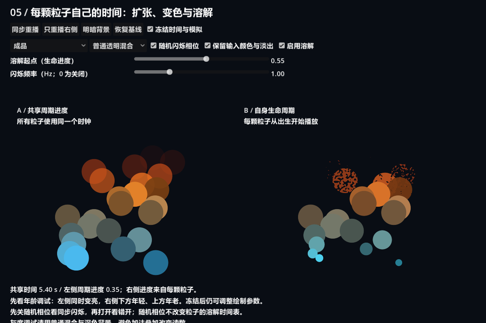
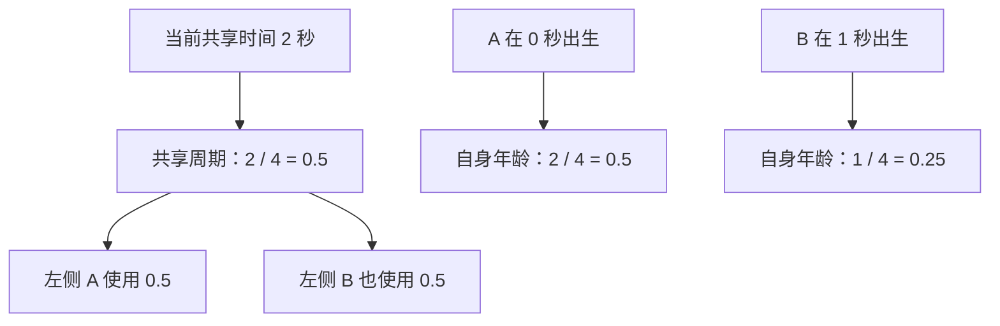
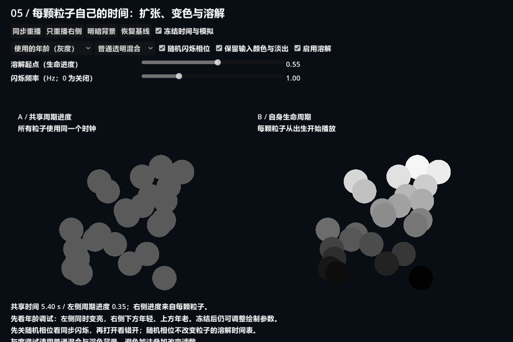
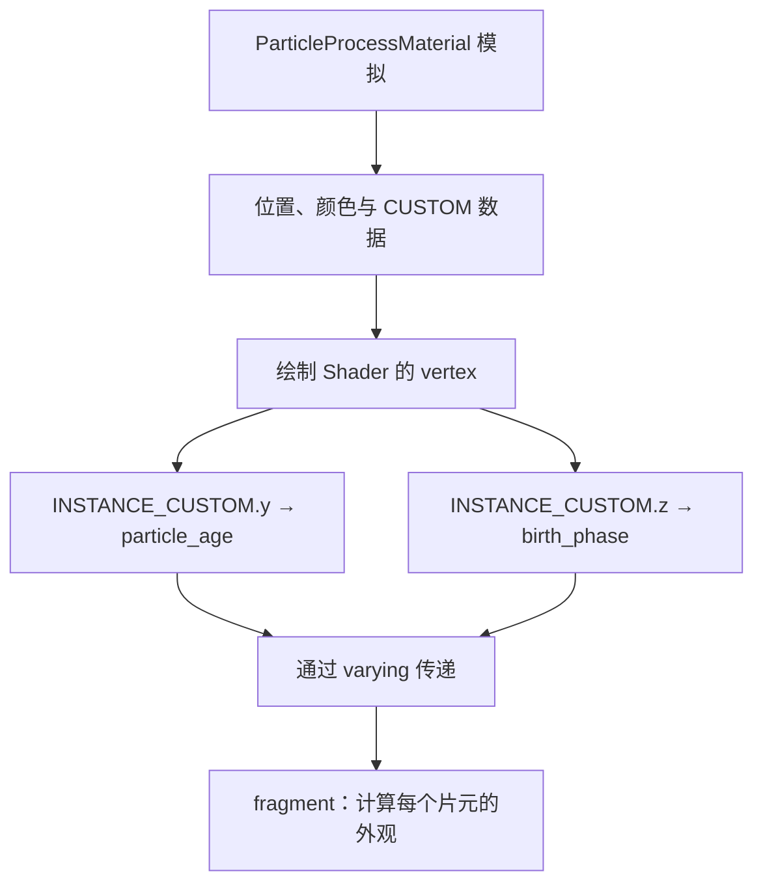
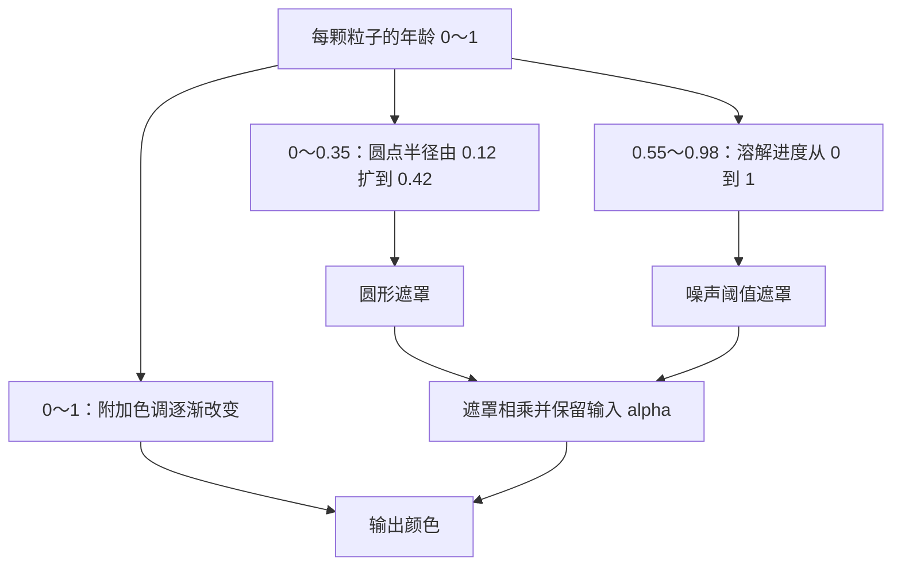
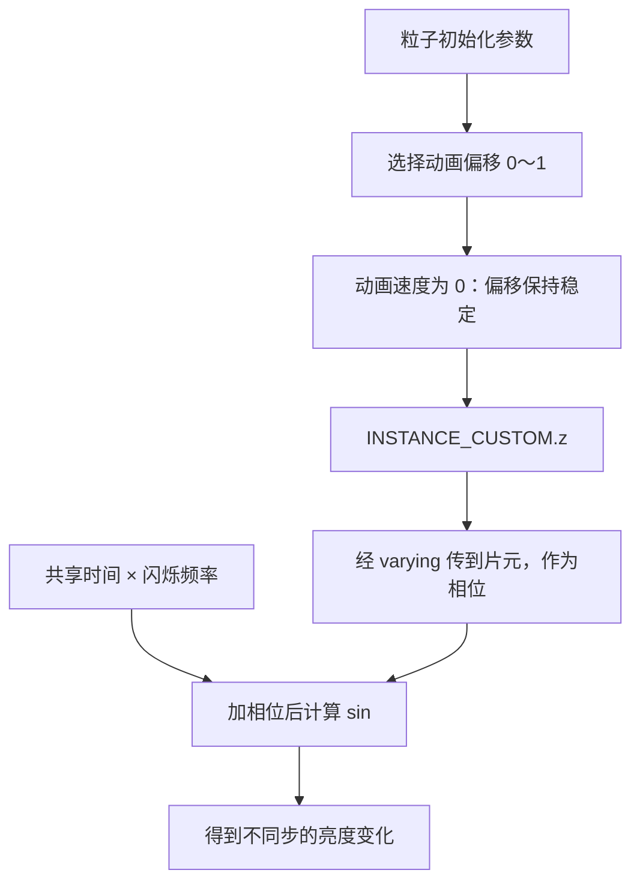
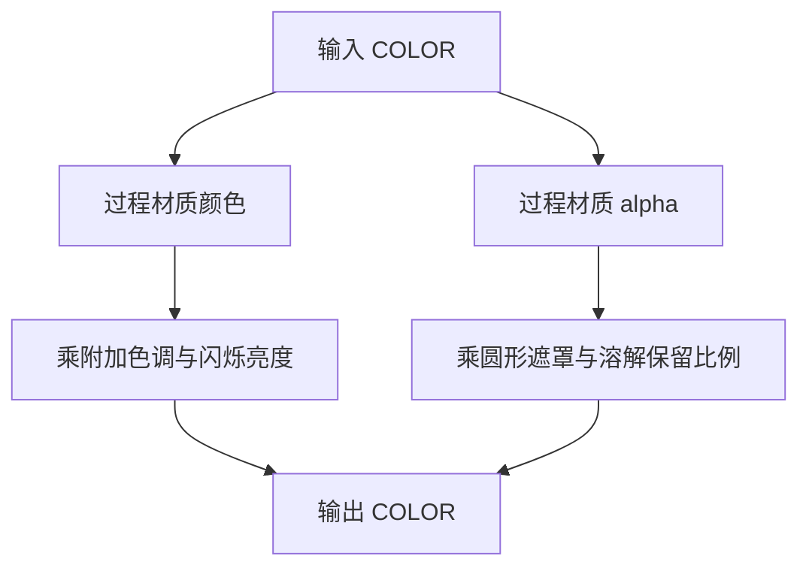
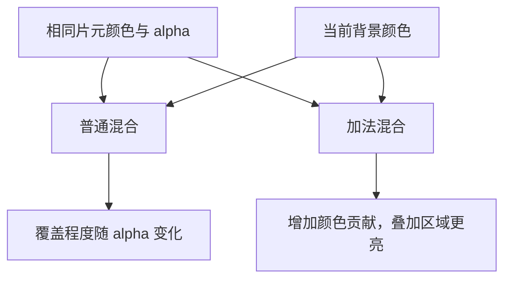
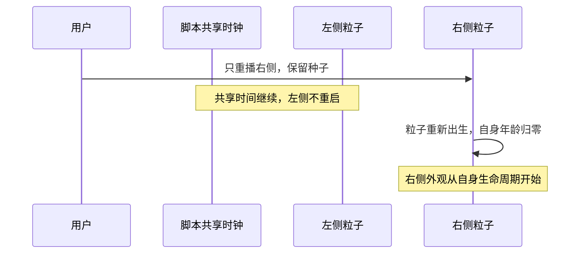

# 第五课：让每个粒子拥有自己的外观进度

[返回大纲](../../README.md) · [第四课](../04_noise/README.md) · [实验记录](WORKSHEET.md)

建议用时：2～3 小时。先修：第二课的生命周期、第三课的程序遮罩、第四课的噪声溶解。

本课把前面的技能连接起来：**让每颗粒子从自己的出生开始扩张、变色、溶解，并保留过程材质传来的颜色和淡出。** 重点是模拟与绘制之间的数据传递，不要求提前编写自定义粒子模拟。

## 1. 运行与观察（10 分钟）

打开 `age_lab.tscn`，按 **F6**，推荐运行区域 **1200 × 800**。本课粒子向上移动，窗口过小时可能与标题重叠，请放大运行区域。



两侧共享过程材质、固定种子与运动参数，各自使用独立绘制材质。左侧用共享周期控制外观，右侧用每颗粒子的年龄。截图在运行约 5.4 秒时冻结。

| 控件 | 行为 |
| --- | --- |
| 同步重播 | 两侧重生、保留种子，共享时钟归零 |
| 只重播右侧 | 右侧重生，左侧和共享时钟继续 |
| 冻结时间与模拟 | 停止脚本时钟，将两侧 speed_scale 设为 0；绘制控件仍有效 |
| 使用的年龄（灰度） | 左侧输出共享周期进度，右侧输出自身年龄；越亮越接近 1 |
| 出生相位（灰度） | 输出每颗粒子稳定的随机相位，不受相位应用开关影响 |
| 普通透明 / 加法混合 | 只更换绘制方式，保留参数与模拟状态 |
| 随机闪烁相位 | 决定闪烁是否使用每颗粒子的不同相位 |
| 保留输入颜色与淡出 | 关闭以演示丢失过程材质颜色和 alpha 的错误 |
| 启用溶解 | 关闭便于单独观察输入淡出或闪烁 |
| 溶解起点 | 生命进度到达多少时开始溶解，两侧分别使用各自的时间来源 |
| 闪烁频率 | 每秒周期数，0 完全关闭闪烁 |
| 明暗背景 / 恢复基线 | 检查背景依赖或恢复初始状态 |

先选择普通混合、深色背景。灰度调试故意忽略输入颜色、淡出和溶解，使用固定大小的圆形标记，便于读数；它不是成品绘制路径。

## 2. 为什么共享时间不能代表每颗粒子的年龄（15 分钟）

左侧使用：

```glsl
float age = fract(lesson_time / lifetime);
```

这是每隔 4 秒重复一次的统一进度。即使粒子刚出生，它也会接到当前全局进度；周期结束时，尚未死亡的旧粒子会突然回到外观起点。

右侧读取由粒子模拟传来的生命进度。例：寿命 4 秒，A 在 0 秒出生，B 在 1 秒出生，则在第 2 秒，A 的进度约为 0.5，B 约为 0.25。



与直接使用 `fract(TIME / lifetime)` 相比，本课用脚本维护的 `lesson_time`，便于归零和冻结；它仍是所有粒子共享的时间，不会自动变成单粒子年龄。Godot 的 TIME 不随场景暂停自动停止，不能直接假定暂停按钮也会冻结它。[官方 TIME 说明](https://docs.godotengine.org/en/4.7/tutorials/shaders/shader_reference/canvas_item_shader.html)

**实验 A**：恢复基线，切年龄调试，等待系统填满后冻结。左侧同灰度，右侧下方年轻较暗，上方年老较亮。恢复运行，观察左侧每 4 秒整体回暗，右侧每颗分别重生。



**直接使用 TIME 的加餐**：在个人副本中，把年龄选择语句的共享分支 `fract(lesson_time / lifetime)` 改为 `fract(TIME / lifetime)`，运行后再冻结。粒子位置停止，但左侧年龄灰度仍变化，因为 TIME 没有被本课按钮冻结；然后恢复原实现。此实验只替换共享年龄分支，闪烁仍使用 lesson_time，避免同时改变多个来源。

注意：成品左侧仍有不同颜色，因为过程材质的颜色渐变仍按各自年龄工作；只有绘制 Shader 内的扩张、附加调色和溶解使用错误的共享进度。年龄调试能隔离这个区别。

## 3. INSTANCE_CUSTOM 与 varying：数据怎样传过来（20 分钟）



在 CanvasItem Shader 中，INSTANCE_CUSTOM 属于顶点阶段可用数据。要在片元阶段使用，先通过 varying 接过去：

```glsl
varying float particle_age;
void vertex() {
    particle_age = clamp(INSTANCE_CUSTOM.y, 0.0, 1.0);
}
void fragment() {
    // 在这里使用 particle_age，而不是直接读取 INSTANCE_CUSTOM。
}
```

varying 会在图元内部插值；同一颗粒子的各个顶点拿到相同年龄，所以整颗粒子得到同一个进度，不会从左边年轻到右边年老。

本课明确采用以下约定：

| 通道 | 内置过程材质常见含义 | 本课处理 |
| --- | --- | --- |
| x | 旋转角度 | 不占用、不改写 |
| y | 随模拟推进的生命阶段 | 寿命随机为 0，直接作为 0～1 年龄 |
| z | 动画进度 / 偏移 | 禁用序列帧与动画速度，读取固定随机偏移作为相位 |
| w | 引擎内部使用的寿命相关数据 | 不假设空闲，不占用 |

**适用范围必须记住：本课 `lifetime_randomness = 0`。** Godot 4.7 的生成代码中 y 按 DELTA/LIFETIME 增长；有寿命随机时，不能继续盲目把 y 当作相对于实际随机寿命的完整 0～1 进度。以后改过程材质或写自定义模拟时，应重新核对协议，而不是照搬当前读法。[CanvasItem 约定](https://docs.godotengine.org/en/4.7/tutorials/shaders/shader_reference/canvas_item_shader.html)、[4.7 过程材质实现](https://raw.githubusercontent.com/godotengine/godot/4.7-stable/scene/resources/particle_process_material.cpp)

## 4. 用年龄驱动扩张、颜色与溶解（20 分钟）

同一个年龄可以映射到不同时间段：



主要公式：

```glsl
float radius = mix(0.12, 0.42, smoothstep(0.0, 0.35, age));
float progress = smoothstep(dissolve_start, 0.98, age);
```

本课让可见圆在固定绘制四边形内长大，不修改粒子速度或四边形顶点。基础纹理为第一课的 24 × 24 白色方形，过程材质 Scale 固定为 3，因此贴片约为 72 × 72 本地像素，圆形半径是 UV 单位。

**实验 B**：恢复成品，闪烁频率设为 0。观察右侧从小到大再溶解的过程。把溶解起点从 0.55 改为 0.8，预测可完整保留的阶段是否更长。

起点为 0.55、寿命 4 秒时，名义上从约 2.2 秒开始溶解，约 3.92 秒时完成。实际可见消失时间还受噪声分布与输入淡出影响。

年龄只应该向前推进到终点，不要写 `fract(particle_age + random_phase)` 来驱动一次性溶解；这样会让它中途回到起点。

## 5. 随机闪烁相位：随机的是节奏偏移（20 分钟）

为了不提前进入自定义粒子 Shader，本课利用内置动画偏移：`anim_offset_min = 0`、`anim_offset_max = 1`，动画速度最小值和最大值均为 0，不设置动画曲线，也不播放序列帧。这样 z 中的动画偏移在该粒子存活期间保持稳定。

这不是宣称 z 天生是随机数，更不能在需要序列帧时直接占用。它是本课明确选择的一种数据使用约定。以后若要同时控制序列帧和随机相位，需要另行设计通道协议。



```glsl
float pulse = 0.75 + 0.25 * sin(TAU * (lesson_time * pulse_hz + phase));
```

结果范围是 0.5～1；它乘在 RGB 上控制亮度，不改年龄、不改运动，也不让粒子反复重生。

**实验 C**：关闭溶解，设置频率 1 Hz，先关随机相位，再打开。关闭时闪烁节拍相同，但因输入颜色不同，绝对亮度仍有差异；打开后节拍错开。切“出生相位”视图，观察灰度跟随粒子移动且不随年龄逐渐变亮。

相位视图显示原始数据，所以关闭“随机闪烁相位”后它仍有不同灰度。关闭的是数据的应用，不是重新生成数据。

实现中随机参数可能由固定种子重复计算获得相同值，并不要求实际只执行一次随机函数；关键是同一次生命中保持稳定，不能每帧取新的随机结果。

## 6. 保留颜色和淡出，而不是覆盖它们（15 分钟）

过程材质颜色渐变从青色到橙色再到淡出的红色。绘制阶段继续在它上面乘色调与亮度：

```glsl
vec4 incoming = COLOR;
COLOR = vec4(incoming.rgb * tint * pulse,
             incoming.a * disk * remaining);
```



**实验 D**：关溶解、闪烁频率设为 0，然后关闭“保留输入颜色与淡出”。比较颜色是否丢失、生命终点是否更突然。这个开关用白色不透明值替代 incoming；恢复后再次验证。

要先关闭溶解，是因为它可能已经让粒子在死亡前不可见，从而掩盖输入淡出丢失的错误。本课输入 COLOR 已包含白色纹理采样的作用，不重复乘一次 TEXTURE。

## 7. 普通透明与加法混合（15 分钟）

同一份 `appearance.gdshaderinc` 被两个 Shader 入口引用，区别只是 render_mode。这样比较混合方式时不会混入两套不同外观公式。

| 模式 | 在本课中的观察 |
| --- | --- |
| blend_mix | 按透明度与背景混合，保持有色圆点的轮廓 |
| blend_add | 在背景上增加颜色贡献，重叠处更亮，浅背景容易趋白 |

**实验 E**：冻结后依次比较普通混合深背景、加法深背景、加法浅背景、普通混合浅背景。保持粒子状态和所有参数不变。



加法不等于开启后处理辉光，也不适合所有烟尘。灰度调试应使用普通混合与深色背景，否则重叠区域的结果不再能直接作为年龄读数。

## 8. 重播与冻结的对照（10 分钟）

**实验 F**：恢复基线、等待 2 秒，点击“只重播右侧”。右侧新粒子应从自己的外观起点开始，左侧和共享时间继续。先不要冻结，否则重播后粒子可能需要解除冻结才推进到可见状态。



随机闪烁仍使用共享时钟，所以只重播右侧不会保证闪烁波形也从相同值开始。生命周期动画与周期亮度调制是两个独立选择。

冻结按钮同时停止脚本时钟和粒子模拟；只停其中一者会产生另一种效果，可以在个人副本中实验。绘制参数仍可改，所以冻结后可以比较混合、颜色保留与溶解起点。

## 9. 独立重建与排查（30 分钟，可另安排）

新建 `my_particle_age.tscn`，使用自己的 GPUParticles2D 和 ShaderMaterial：

1. 设置恒定寿命、寿命随机为 0、连续发射；先只输出年龄灰度。
2. 用 varying 把 y 从 vertex 传给 fragment，确认每颗不同。
3. 接入第三课的形状，让它随年龄扩张。
4. 接入第四课的溶解，让晚期粒子消失，保留输入 COLOR。
5. 在明确无序列帧的前提下，添加本课稳定相位方案；记录通道用途。
6. 制作一个“先扩张、再闪烁、后溶解”的变体，并检查明暗背景。

| 问题 | 优先检查 |
| --- | --- |
| 全部粒子同时溶解 | 是否用了共享时间或共享 uniform 进度？ |
| fragment 中读取 INSTANCE_CUSTOM 报错 | 是否先在 vertex 读取并用 varying 传递？ |
| 新生粒子直接处于晚期 | 是否错误使用全局周期或对年龄加随机相位后取 fract？ |
| 相位不断变化 | 动画速度、动画偏移曲线是否仍开启？ |
| 加寿命随机后提前死亡却未溶解完 | 原先直接读取 y 的约定已不满足，应核对实际寿命归一化 |
| 开序列帧后外观相位异常 | z 的用途发生冲突，重新设计数据协议 |
| 看不到过程材质淡出丢失 | 溶解可能先遮住了结果，关闭溶解隔离实验 |
| 暂停后仍闪烁 | 是否仍直接用 TIME，或未停脚本共享时间？ |

## 10. 自测与验收

1. 两颗寿命 4 秒的粒子在 0 秒和 1.5 秒出生，第 2 秒各自进度是多少？
2. 随机相位能否直接加到一次性溶解年龄再取 fract？
3. z 是否可以在任何粒子材质中当成空闲随机通道？
4. 为什么左侧年龄相同，但成品颜色仍可能不同？

<details>
<summary>参考答案</summary>

1. 0.5 与 0.125，假定寿命随机为 0。
2. 不宜，会改变起点并造成中途循环。周期闪烁可以使用相位偏移，一次性生命过程应保持单调。
3. 不可以。它通常承载动画数据，本课限定动画速度为 0且不用序列帧才采用此约定。
4. 过程材质的颜色仍按真实年龄变化；共享的是绘制阶段所选择的外观进度。

</details>

- [ ] 能用年龄视图证明两种时间来源不同。
- [ ] 能说明 CUSTOM 数据到绘制片元的传递路径。
- [ ] 保留输入颜色和淡出，完成独立扩张、调色、溶解。
- [ ] 相位在单次生命内稳定，且不破坏生命周期进度。
- [ ] 明暗背景和两种混合方式都做过对照。
- [ ] 完成自己的单粒子生命周期变体并填写 [实验记录](WORKSHEET.md)。

## 11. 参考与文件入口

- `age_lab.tscn` / `motion.tres`：粒子节点与共享模拟规则。
- `appearance.gdshaderinc`：核心绘制逻辑；`age_mix.gdshader` 与 `age_add.gdshader` 仅选择混合方式并包含它。
- `age_lab.gd`：UI、时钟、重播和验证入口。普通 F6 不执行 `_smoke_test()`。
- [CanvasItem Shader 官方参考](https://docs.godotengine.org/en/4.7/tutorials/shaders/shader_reference/canvas_item_shader.html)：INSTANCE_CUSTOM、varying、COLOR、TIME 与混合。
- [ParticleProcessMaterial 4.7 生成代码](https://raw.githubusercontent.com/godotengine/godot/4.7-stable/scene/resources/particle_process_material.cpp)：核对年龄及动画偏移，后续版本需重新确认。

下一课将使用屏幕纹理制作冲击波，让粒子效果与背景画面发生视觉互动。当前检查范围见 [VALIDATION.md](VALIDATION.md)。
