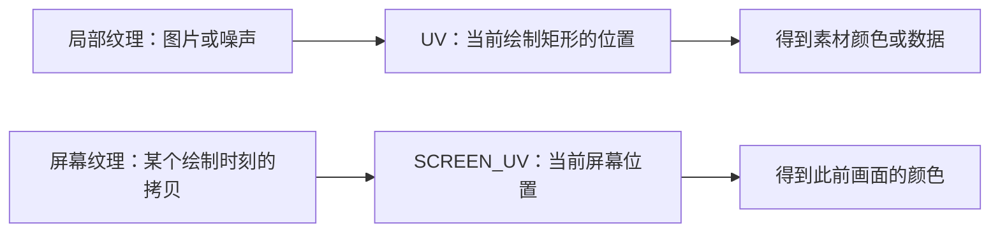
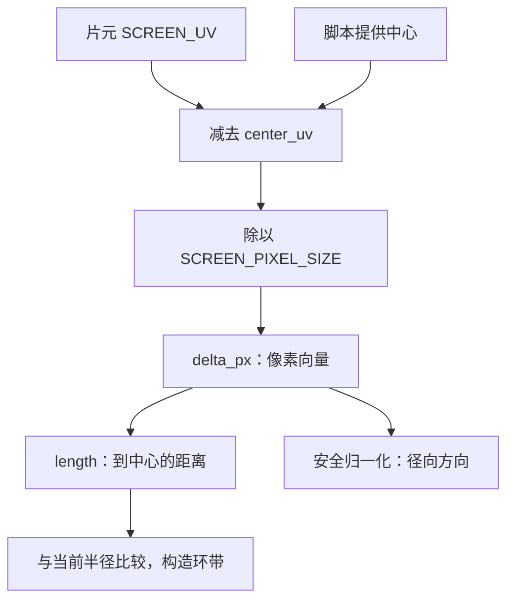
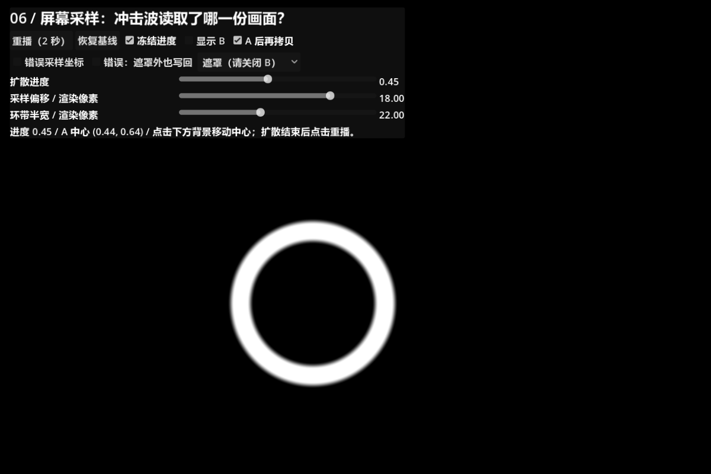
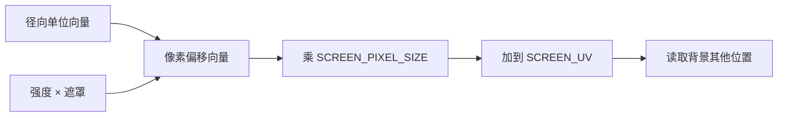
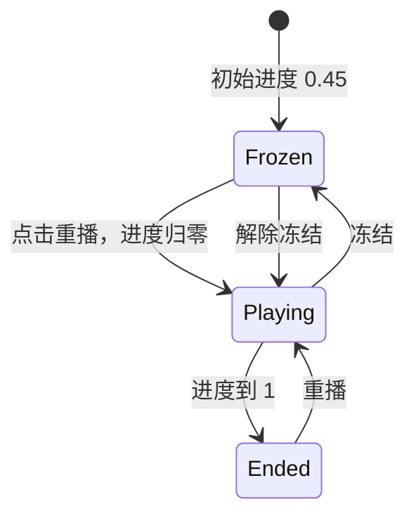
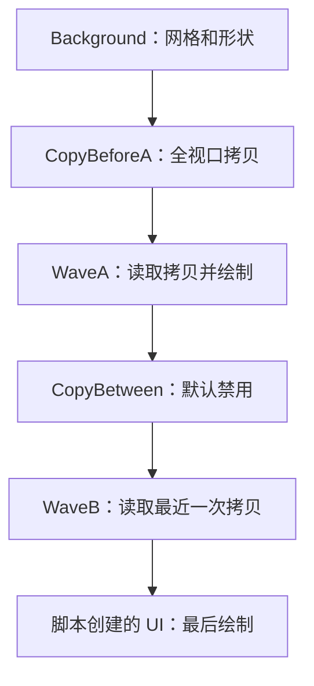
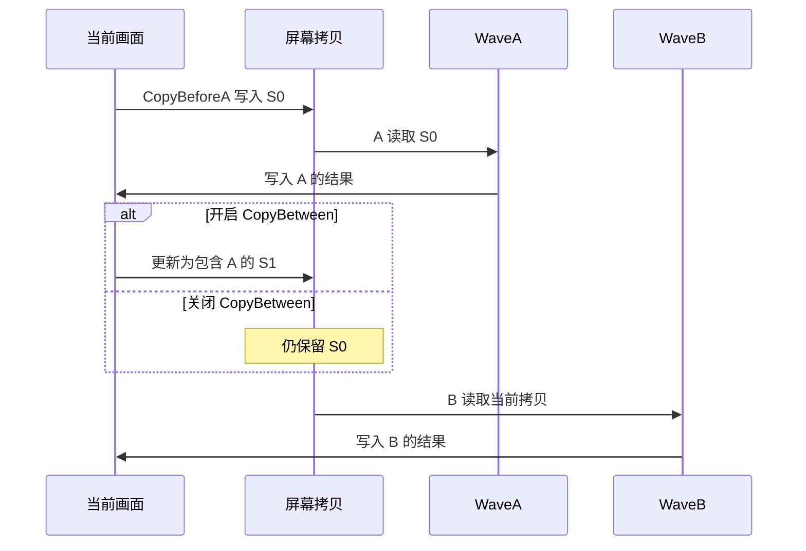
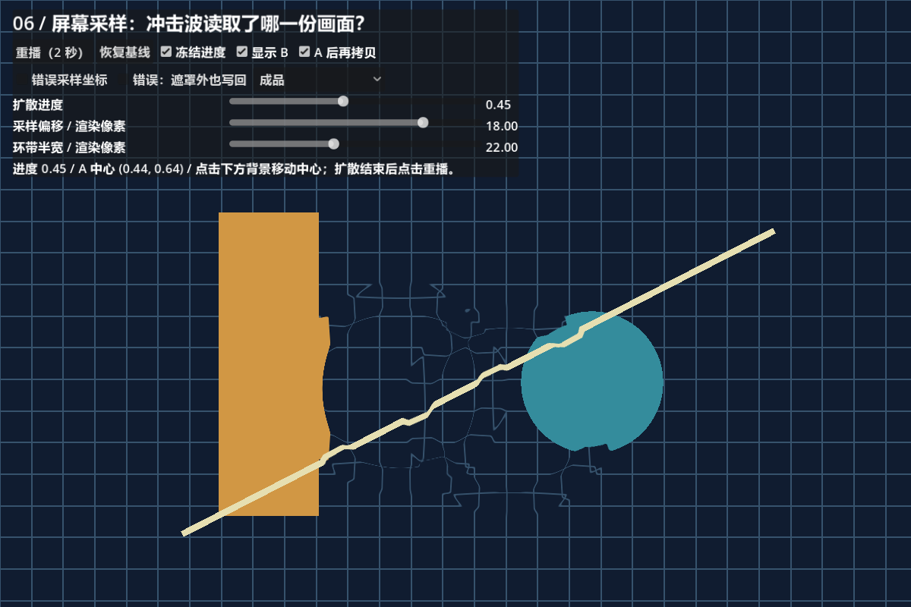
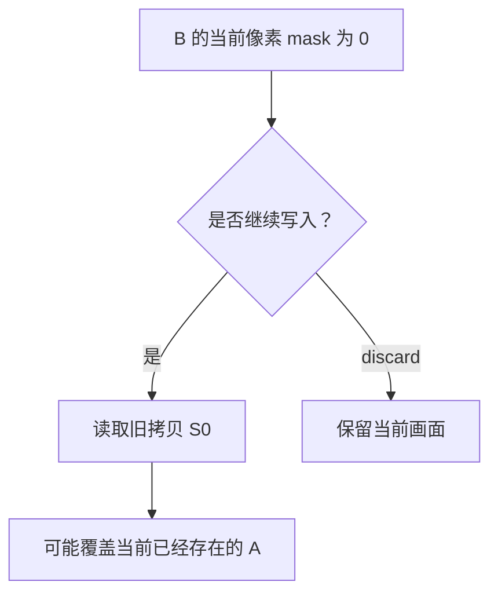
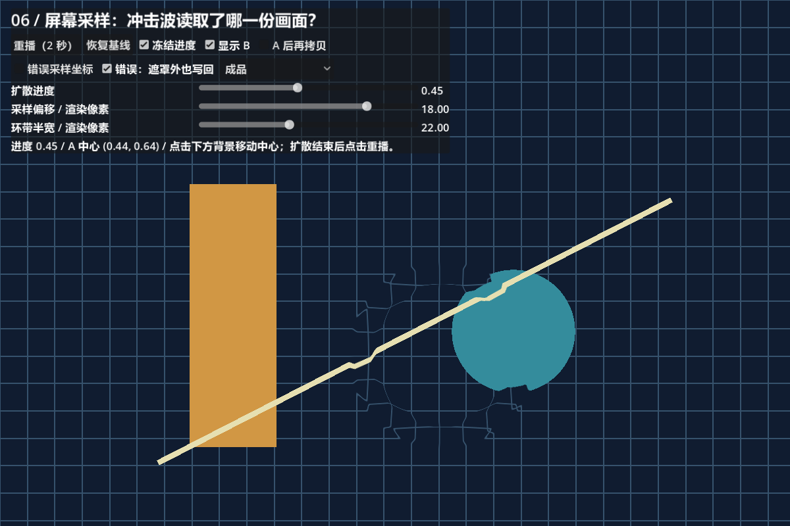

# 第六课：屏幕采样与冲击波

[返回大纲](../../README.md) · [第五课](../05_particle_age/README.md) · [实验记录](WORKSHEET.md)

建议用时：2～3 小时。先修：第三课的圆环与坐标、第四课的采样偏移、第五课的外观时间与混合。

本课成果：**做出向外扩散、自然结束的屏幕扭曲，并解释两个冲击波重叠时各自读取什么。** 本课仍使用 `canvas_item` 绘制 Shader；不修改粒子模拟，也不需要新的图片素材。

## 1. 先运行，再提出预测（10 分钟）

打开 `screen_lab.tscn`，按 **F6**。推荐 1200 × 800 或更大的运行区域。初始画面冻结在进度 0.45，两个圆环将背景网格扭曲；点击“重播”观察 2 秒扩散动画。


场景中的黄色矩形、青色圆形、斜线和网格都是背景参照物。冲击波没有移动这些节点，而是显示背景其他位置的像素。界面最后绘制，因此保持清晰。

| 控件 | 修改对象与作用 |
| --- | --- |
| 重播 | 脚本将 progress 归零并解除冻结，2 秒后停在 1 |
| 冻结进度 | 停止脚本推进 progress；其他参数仍可修改 |
| 扩散进度 | 两份独立 ShaderMaterial 的 progress；冻结时可手动检查任意时刻 |
| 采样偏移 | strength_px；正负决定向外还是向内读取像素，0 关闭位移 |
| 环带半宽 | width_px；决定环形影响范围，含柔边 |
| 显示 B | 后绘制的 WaveB 可见性；关闭后研究单个效果 |
| A 后再拷贝 | CopyBetween 在 Disabled 和 Viewport 之间切换 |
| 错误采样坐标 | 将正确屏幕坐标换成一组故意错误的坐标 |
| 错误：遮罩外也写回 | 故意取消零遮罩区域的 discard |
| 调试视图 | 成品、遮罩灰度、方向 RG 与遮罩 B；调试时先关闭 B |
| 点击下方背景 | 移动 A 中心，B 保持相对偏移；不自动重播 |
| 恢复基线 | 恢复两个波纹、冻结 0.45、偏移 18、半宽 22、关闭中间拷贝及错误开关 |

**先预测**：不增加中间拷贝，只让 B 晚于 A 绘制，B 会读取 A 已扭曲的画面吗？把答案写入实验记录，稍后验证。

## 2. 局部纹理与屏幕纹理（15 分钟）

第四课改变噪声纹理的采样位置；本课改变屏幕拷贝的采样位置。采样函数相似，但纹理来源和坐标含义不同。



最小屏幕读取：

```glsl
uniform sampler2D screen_texture : hint_screen_texture, repeat_disable, filter_linear;

void fragment() {
    COLOR = vec4(textureLod(screen_texture, SCREEN_UV, 0.0).rgb, 1.0);
}
```

`hint_screen_texture` 指定屏幕拷贝为来源；`SCREEN_UV` 表示当前片元在视口里的归一化位置。这里选择线性过滤、LOD 0，不生成模糊用的 mipmap。本课背景不透明，所以输出 alpha 为 1；这不是透明 SubViewport 的通用合成方案。[CanvasItem 变量说明](https://docs.godotengine.org/en/4.7/tutorials/shaders/shader_reference/canvas_item_shader.html)

| 名称 | 本课含义 | 单位 |
| --- | --- | --- |
| UV | 当前 ColorRect 内的位置 | 0～1 |
| SCREEN_UV | 当前片元在视口中的位置 | 0～1 |
| SCREEN_PIXEL_SIZE | 渲染目标宽、高的倒数 | 每个渲染像素占多少 UV |
| center_uv | 脚本传入的冲击中心 | 归一化视口坐标 |
| strength_px / width_px | 位移强度 / 环带半宽 | 渲染目标像素 |

本课 ColorRect 恰好铺满视口，因此正常情况下 UV 和 SCREEN_UV 看起来相同。**不能据此认定二者通用。** 如果将矩形缩到屏幕一角，它的 UV 仍覆盖 0～1，而 SCREEN_UV 只覆盖所在的屏幕区域。

“错误采样坐标”用 `UV * 0.65 + vec2(0.15, 0.05)` 人为制造不同映射，保证在全屏实验中也能观察错位；它是诊断演示，不声称全屏矩形直接使用 UV 必然错误。

**实验 A**：冻结、关闭 B，打开错误坐标。环带内出现与周围接不上的背景片段；关闭错误后恢复。进度设为 1 时错误也不可见，因为效果已经完全不绘制。加餐：在副本中缩小 WaveA，分别直接使用 UV 和 SCREEN_UV 采样，观察区别。

## 3. 用像素空间构造圆环（20 分钟）

直接计算 `length(SCREEN_UV - center_uv)` 会把横纵方向相同的 UV 长度当作相同距离。在宽屏上，0.1 个横向 UV 与 0.1 个纵向 UV 对应不同像素数。

本课先转换到渲染目标像素：

```glsl
vec2 delta_px = (SCREEN_UV - center_uv) / SCREEN_PIXEL_SIZE;
float distance_px = length(delta_px);
vec2 direction = delta_px / max(distance_px, 0.001);
```

例如 1200 × 800 渲染目标中，横向 UV 差 0.1 对应 120 像素，纵向差 0.1 对应 80 像素。先换算再求长度，圆就不会被视口宽高比拉伸。分母至少为 0.001，中心处不会除零。



圆环公式接续第三课：

```glsl
float ring = 1.0 - smoothstep(width_px * 0.5, width_px,
                             abs(distance_px - radius_px));
```

当距离与半径相差不超过半个 width_px 时，遮罩为 1；相差到 width_px 时变为 0，中间平滑过渡。因此 UI 中的“环带半宽”指**包括柔边的支持范围半宽**，不是白色核心的半宽。总影响厚度为约 `2 * width_px`。

**实验 B**：单个波纹、遮罩视图。改变窗口宽高比，确认遮罩仍为圆形；点击背景移动中心，确认圆心跟随。把半宽从 22 改为 40，半径不应随之改变。



本实验根 Control 铺满视口，没有 Camera2D、旋转或 CanvasLayer 变换；鼠标局部位置除以根尺寸即可得到中心 UV。resize 后保留归一化位置，中心相对窗口的位置保持不变。迁移到游戏世界时，要先把目标转换到对应视口坐标，再除以视口尺寸；不要把 Node2D 的世界 position 直接当 center_uv。嵌套 SubViewport 也要使用实际绘制该效果的视口。

渲染像素、Control 的逻辑单位和显示器物理像素不一定相同。本课半径按渲染目标短边比例变化，半宽与位移则保持渲染像素数；改变分辨率后，相对厚度因此可能变化。

## 4. 遮罩怎样控制扭曲和结束（20 分钟）

从中心向外查找颜色：

```glsl
vec2 offset_uv = direction * strength_px * mask * SCREEN_PIXEL_SIZE;
vec2 sample_uv = SCREEN_UV + offset_uv;
```

例如水平径向、偏移 18 像素、mask 为 1，在 1200 宽目标上偏移 UV 为 `18 / 1200 = 0.015`。强度为正表示读取更外侧的背景；因此一个固定背景特征可能显示到更内侧。**采样方向和画面特征的视觉移动方向不能直接等同。**



最终代码将 sample_uv 限制在边缘像素中心之间，避免越出整个纹理边界。中心靠边、强度很大时，仍可能出现边缘拉伸；clamp 不能凭空生成屏幕外画面。

时间由 GDScript 每帧推进 `progress += delta / 2.0`，最大为 1。它不是 TIME，因此重播和冻结可以精确控制。半径从 12 像素增长到短边的 32%，包络则负责起止衰减：

```glsl
float envelope = smoothstep(0.0, 0.08, progress)
               * (1.0 - smoothstep(0.7, 1.0, progress));
float mask = ring * envelope;
```



**实验 C**：关闭 B、成品视图。冻结在 0.45，将强度改为 0、18、-18，观察斜线和网格弯曲方向；恢复 18，拖动进度到 0、0.5、0.9、1。两个端点必须完全恢复背景，0.9 时仍可有很弱的残余扭曲。

## 5. 一帧中的拷贝时间表（25 分钟）

屏幕纹理是**拷贝时刻的快照**。本课的“前一份画面”通常仍属于同一帧，不是上一帧历史。Godot 2D 中首次屏幕读取可以触发自动全屏拷贝，但后续读取材质不会自动各复制一次；此前已经执行的 BackBufferCopy 会影响这项自动行为。本课主动放置 CopyBeforeA，使来源容易追踪。[官方屏幕读取与拷贝逻辑](https://docs.godotengine.org/en/4.7/tutorials/shaders/screen-reading_shaders.html)

节点使用同一画布、相同默认 z_index，无 Y-sort；本课按以下兄弟节点顺序绘制：



| 模式 | A 读取 | B 读取 | 重叠位置 |
| --- | --- | --- | --- |
| 中间拷贝关闭 | 原始背景 S0 | 同一份 S0 | B 不包含 A 的扭曲 |
| 中间拷贝打开 | 原始背景 S0 | 已绘制 A 的 S1 | B 再扭曲一次包含 A 的画面 |



**实验 D**：恢复基线，反复切换“A 后再拷贝”。重点看两个环带相交处的网格，不要只看圆心。差异主要出现在采样涉及 A 的区域；没有明显背景细节的位置本来就不容易看出扭曲。将进度固定在 0.45，避免把时间变化误认为拷贝差异。



在个人副本中，将 CopyBetween 移到 A 前面，两次拷贝都只能得到 A 绘制前的画面；移到 B 后面，它对已经绘制的 B 来不及生效。再试着把 CopyBeforeA 也禁用：在本课没有其他屏幕读取节点的前提下，首次自动拷贝应给 A 提供原背景。一次只改变一个条件。

串行叠加不是简单相加强度；B 在改变采样位置后读取 S1，顺序互换通常会改变结果。多个全屏拷贝也有成本，不能把每个粒子都独立做一次拷贝当作默认方案。成本测量留到第十三课。

## 6. 常见陷阱：零位移仍可能覆盖前面的效果（15 分钟）

假设 B 读取 S0，即使 B 的 mask 为 0，下面这种写法仍会把 S0 写回当前像素：

```glsl
COLOR = vec4(textureLod(screen_texture, SCREEN_UV + offset_uv, 0.0).rgb, 1.0);
```

offset_uv 为零只意味着“读取原位置”，并不意味着“不写入”。由于 B 是全屏矩形，它会擦掉不在自身环带内的 A。本课成品在 mask 等于零时执行 `discard`，让当前位置已有的画面保留。



**实验 E**：恢复基线，中间拷贝保持关闭。打开“错误：遮罩外也写回”，A 的独有部分消失，B 留下；关闭恢复。再开启中间拷贝，错误不那么明显，因为拷贝已经包含 A，但这并不改变“全屏写回”的行为。



本课使用硬性的“零遮罩不写入”，环带内部由位移包络平滑衰减。调试视图故意输出不透明全屏颜色，以便读数，因此不遵循成品的 discard 路径。调试时关闭 B，否则 B 的调试背景会盖住 A。

## 7. 拷贝区域与绘制区域不是同一件事（10 分钟）

当前两个 BackBufferCopy 均使用 Viewport 模式。Rect 模式只拷贝矩形范围，Shader 读取范围必须落在有效拷贝区域内；读取未拷贝区域的结果未定义，不能依赖它碰巧显示的旧内容。[BackBufferCopy 属性](https://docs.godotengine.org/en/4.7/classes/class_backbuffercopy.html)

对于局部优化，需要覆盖的是**所有可能的采样位置**，不能只包住圆环当前绘制边界。一个保守估计是在环带外边界之外再留出最大绝对偏移和过滤所需边距。本课全屏 clamp 只限制整个纹理边界，不能保证采样落在某个局部拷贝矩形内。

不要直接把当前例子切到 Rect 然后缩小矩形：两个波纹可能读取不同区域，错误开关还会改变映射。先在副本中只保留 A、关闭错误开关，计算覆盖范围，再尝试局部拷贝。BackBufferCopy 继承 Node2D，不要把依赖 anchors 的全屏 Control 放到它下面；本例将它们设为兄弟节点。

## 8. 独立重建与阶段练习（30～45 分钟）

先在个人目录新建最小场景，不复制辅助 UI：

1. 添加有明显线条的背景、BackBufferCopy、一个 ColorRect。
2. 先实现无偏移屏幕读取，确认背景对齐。
3. 增加中心、像素距离和圆环灰度输出，调整窗口确认仍为圆。
4. 增加径向偏移，把强度 0 作为基线；添加 0～1 进度及衰减。
5. 增加第二个独立 ShaderMaterial 和中间拷贝；画出 B 实际读取的来源。

阶段练习：结合第二课的命中爆点与第三课的发光圆环，制作一次完整命中。建议绘制顺序为：背景 → 拷贝 → 扭曲 → 普通发光圆环 → 粒子爆点 → UI。这样圆环和爆点保持清晰；如希望它们也被扭曲，则把它们放到拷贝前面，并解释这个设计选择。这里的发光可以只用颜色与加法混合，不要求启用辉光后处理。

先让三个层都从同一个点击位置播放，再决定持续时间，例如爆点 0.3 秒、圆环 0.6 秒、扭曲 0.4 秒。每层说明用途；不要通过增加数量掩盖时间不协调。此综合变体由你独立完成，本课配套场景聚焦屏幕读取对照。

## 9. 排查、验收与自测

| 现象 | 优先检查 |
| --- | --- |
| 整片背景与周围接不上 | 是否使用了局部 UV，是否开启错误坐标 |
| 圆变椭圆 | 距离计算是否先换算像素 |
| 拖动世界目标后中心错误 | 目标是否已转换到本效果所在视口 |
| A 部分消失 | B 是否在零遮罩位置写回旧拷贝 |
| B 没有再次扭曲 A | 中间拷贝是否在 A 后、B 前且已启用 |
| UI 也扭曲 | UI 是否被放在拷贝之前 |
| 边缘拉伸或重复旧画面 | 区分屏幕边界 clamp 与局部拷贝范围不足 |
| 重播后不动 | 冻结状态、progress 传参、是否已经到 1 |

通过以下检查后，再自行更新 [学习进度](../../progress.md)：

- [ ] 能不用代码解释 UV 与 SCREEN_UV 的不同。
- [ ] 点击改变中心、调整窗口后圆心正确，圆形不被拉伸。
- [ ] 能分别展示强度 0、正值、负值，解释采样方向。
- [ ] 单波纹的零遮罩区域不改背景，两个时间端点完全消失。
- [ ] 能画出两种拷贝模式的数据来源，修复 A 被覆盖的问题。
- [ ] 能解释为什么 Rect 拷贝要覆盖采样范围。
- [ ] 不看成品独立重建，并完成包含爆点、圆环、扭曲的阶段变体。

**自测题**：

1. B 晚于 A 绘制，为什么不一定能读取 A？
2. 令偏移为零，是否就不会影响已有画面？
3. 为什么中心除法需要保护？
4. progress 为 1 后，节点仍然存在，为什么看不到波纹？
5. A 与 B 能共享 Shader 资源吗？能默认共享同一个 ShaderMaterial 吗？

<details>
<summary>参考答案：先完成自己的解释</summary>

1. B 读取最近一次屏幕拷贝；没有 A 后的拷贝时，来源仍是 A 前的画面。
2. 不一定。输出旧拷贝的不透明颜色仍会覆盖当前位置；需要按设计跳过写入或正确合成。
3. 中心到自身距离为零，直接归一化会发生除零；本课用最小分母保护。
4. 包络为零，成品路径 discard；绘制不可见不代表节点被释放，也不保证 GPU 成本归零。
5. 可以共享同一份 Shader 代码。两者中心不同，因此本课使用两份 ShaderMaterial，避免修改中心时串扰。

</details>

## 10. 文件与下一课

| 文件 | 用途 |
| --- | --- |
| screen_lab.tscn | 可检查的绘制顺序、两份绘制材质和两个拷贝节点 |
| shockwave.gdshader | 坐标、环带、扭曲、调试和错误开关 |
| screen_lab.gd | UI、参数传递、播放、点击中心及开发验证入口 |
| background.gd | 绘制观察用的网格和简单形状 |
| WORKSHEET.md | 预测、实验结果与独立练习记录 |
| VALIDATION.md | 已实际完成的验证及限制 |

本课所有屏幕拷贝结论限定在本例的 2D 画布配置，不直接套用到 3D 的透明渲染流程。第七课将回到模拟层：编写 `shader_type particles`，用 `start()` 初始化、用 `process()` 更新粒子运动。
