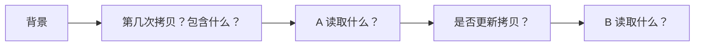

# 第六课实验记录

[讲义](README.md) · [课程进度](../../progress.md)

日期：
Godot 版本 / 渲染器：
运行分辨率 / 窗口比例：

每次先恢复基线，冻结相同进度，只改变本行指定条件。截图请另存，避免覆盖课程配图。

| 实验 | 先写预测 | 实际现象 | 数据或坐标原因 |
| --- | --- | --- | --- |
| A：单波纹，错误采样坐标开/关 | | | |
| B：遮罩视图，改变窗口比例 | | | |
| B：点击移动中心 | | | |
| C：偏移 0、18、-18 | | | |
| C：进度 0、0.5、0.9、1 | | | |
| D：两个波纹，中间拷贝开/关 | | | |
| D：在副本中移动拷贝节点 | | | |
| E：零遮罩仍写回旧拷贝 | | | |

## 画出一帧的数据来源

请补全标签，分别画出 CopyBetween 关闭和开启的版本：

- 为什么这里的拷贝通常不是“上一帧”？
- 哪些像素会被 B 写入？哪些位置保留 A？
- UI 放到拷贝前后各有什么结果？
- Rect 拷贝需要比绘制区域多留多少范围？你的假设是什么？

## 独立练习

- 新场景路径：
- 无参考重建时卡住的一步：
- 爆点、发光圆环、扭曲分别承担什么作用：
- 三层的持续时间和绘制顺序：
- 两个命中同时播放时，材质是否独立：
- 调整窗口与靠近屏幕边缘时的观察：
- 截图路径：

## 复盘

- 我能解释的三个概念：
- 一个错误、定位证据与修复方法：
- 我尚未验证的情况：
- 验收通过项与待补项：
