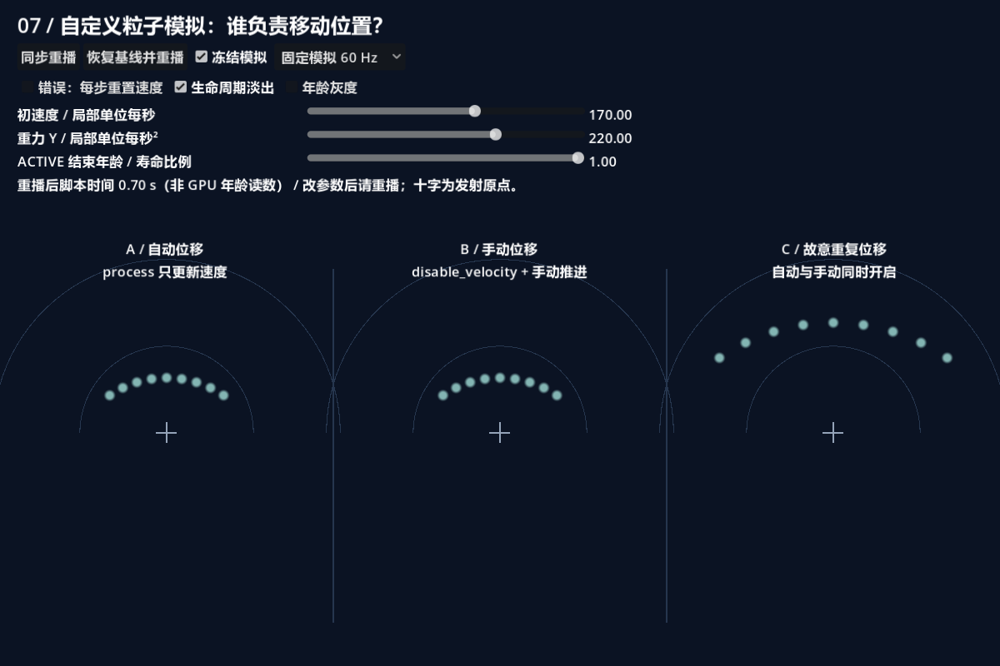
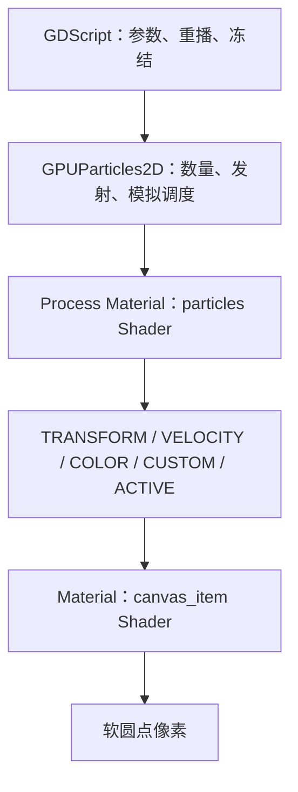
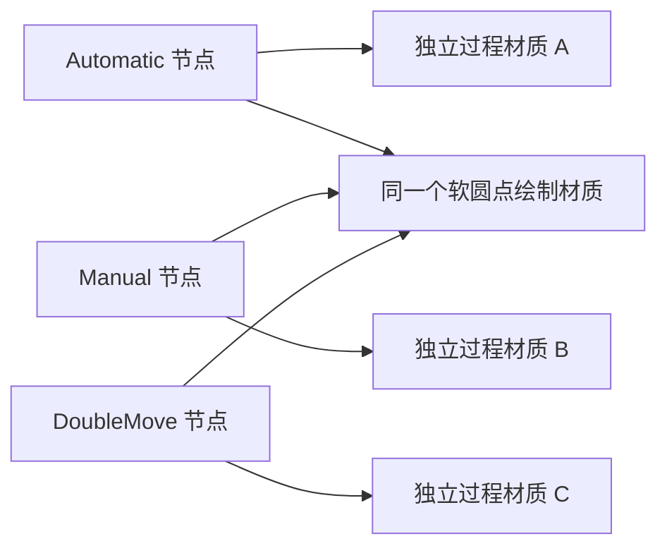
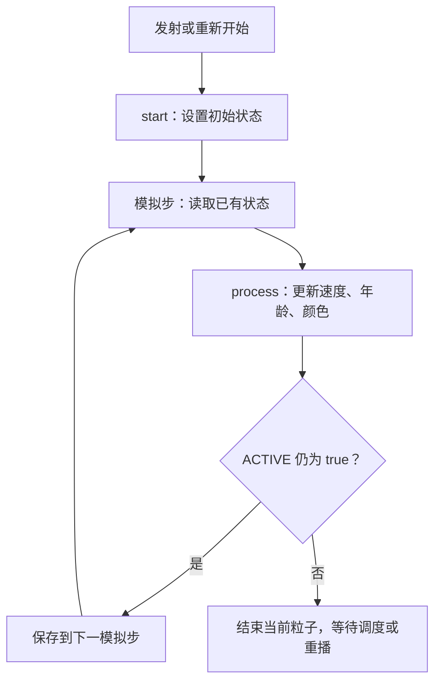
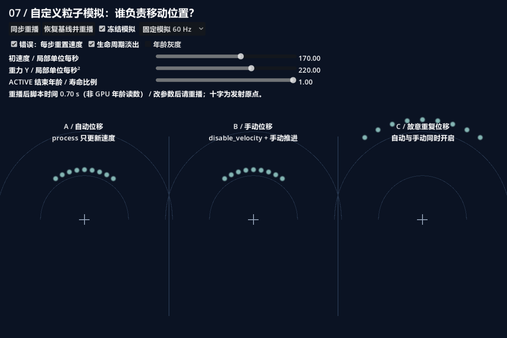
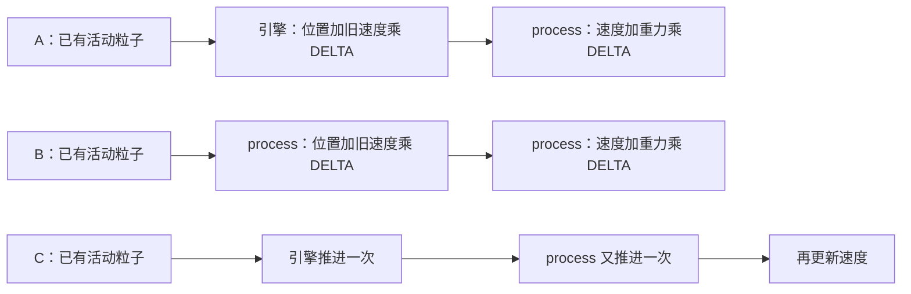
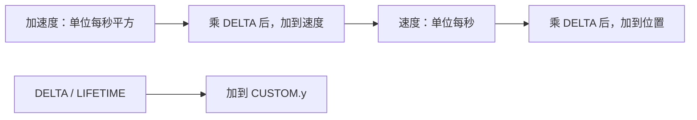
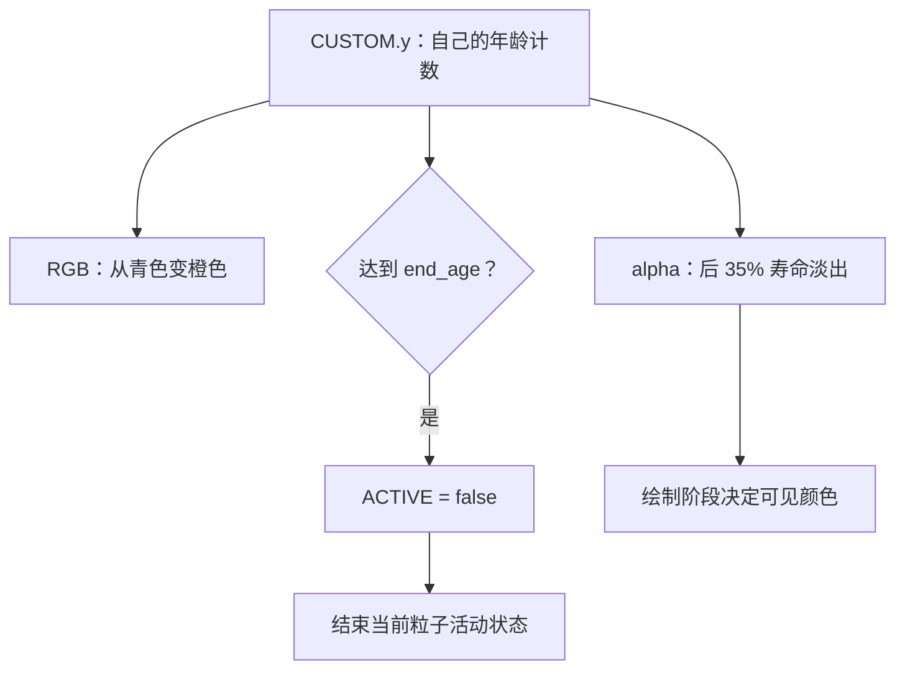
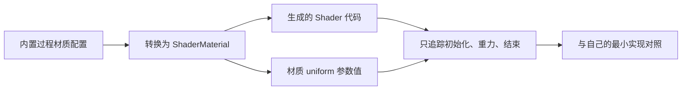

# 第七课：第一个自定义粒子 Shader

[返回大纲](../../README.md) · [第六课](../06_screen/README.md) · [实验记录](WORKSHEET.md)

建议用时：2～3 小时。先修：第一课的模拟与绘制分工、第二课的寿命和重播、第五课的粒子数据传递。

本课目标：**自己初始化粒子、积累速度与年龄，并明确位置究竟由谁推进。** 最终做出一个有重力、会变色淡出、可以重播的扇形爆发。暂不引入随机算法、碰撞或复杂力场。

## 1. 三组粒子，先看谁走得更远（10 分钟）

打开 `simulation_lab.tscn`，按 **F6**。推荐 1200 × 800 或更大的运行区域。三组同时发射九颗粒子，约两秒结束；点击“同步重播”再次观察。十字为发射原点，半圆参照线半径为 100、200 个局部单位。



| 区域 | 引擎自动推进位置 | Shader 手动推进位置 | 预期 |
| --- | --- | --- | --- |
| A 自动位移 | 开启 | 无 | 基线运动 |
| B 手动位移 | `disable_velocity` 关闭自动推进 | 每步一次 | 与 A 对齐 |
| C 故意重复位移 | 开启 | 每步一次 | 同一时间偏离原点更多 |

三组使用相同初始方向、速度、重力、寿命与绘制材质，只改变位置更新方式。截图通过固定模拟时间推进到约 0.7 秒，不依赖手动按下冻结的时机。

**先预测**：如果 B 加了 `disable_velocity`，但没有修改 TRANSFORM，它会怎样？如果 C 同时做两次位移，它的颜色和年龄会不会也快两倍？记录答案后再读后文。

| 控件 | 修改内容及重播要求 |
| --- | --- |
| 同步重播 | 三组调用 `restart(true)`、脚本计时归零、解除冻结 |
| 冻结模拟 | speed_scale 设为 0，脚本计时也停止；材质参数可以修改，模拟输出要恢复后才更新 |
| 初速度 | start 中读取 launch_speed；正常模式下需重播才作用于现有粒子 |
| 重力 Y | process 每步读取 gravity_y；立即影响后续速度，公平对照请重播 |
| ACTIVE 结束年龄 | end_age；0.5 表示约半个节点寿命后主动结束，建议重播观察 |
| 生命周期淡出 | 只控制模拟输出 COLOR.a，不改变 ACTIVE |
| 年龄灰度 | 用本课 CUSTOM.y 输出灰度；要排除 alpha 影响可关闭淡出 |
| 错误：每步重置速度 | 故意破坏速度积累；切换后重播比较 |
| 固定模拟频率 | 设置 fixed_fps 为 60、30、15，自动同步重播 |
| 恢复基线并重播 | 恢复本课初始参数、关闭错误和年龄视图 |

注意界面的“脚本时间”不是从 GPU 回读的单粒子年龄，也不是保证与模拟完全一致的秒表。第五课已经说明，动画和生命周期应该使用它们各自真实的数据来源。

## 2. 自定义模拟接在哪一层（15 分钟）

之前用 ParticleProcessMaterial 配置发射方向、重力与颜色曲线。本课将它替换为装有 `shader_type particles` 的 ShaderMaterial，放在节点的 **Process Material** 上。原来的绘制 Shader 仍放在节点的 **Material** 上。



`start()` 和 `process()` 操作粒子状态；它们不执行 `fragment()`，也不直接绘制圆点。粒子模拟可保留上一步输出的数据，所以本步更新的速度能够在下一步继续使用。该 Shader 用于 GPU 粒子节点。[官方粒子 Shader 说明](https://docs.godotengine.org/en/4.7/tutorials/shaders/shader_reference/particle_shader.html)

本课继续复用第一课的 `soft_dot.gdshader` 与白色纹理。三组共享绘制材质，因为绘制规则完全相同；三份过程材质分别引用不同入口 Shader，避免对照版本互相覆盖。



箭头表示资源引用。运行时脚本创建共享绘制材质；过程材质与三个 Shader 入口在 `.tscn` 中可直接查看。

## 3. 先独立写一个最小版本（20 分钟）

在个人练习目录创建 GPUParticles2D：`amount = 1`、`lifetime = 2`、`one_shot = true`、`local_coords = true`，设置足够大的 visibility_rect，使用本课的白色纹理。新建 Process Material → ShaderMaterial → Shader，写入：

```glsl
shader_type particles;

void start() {
    TRANSFORM = mat4(1.0);
    VELOCITY = vec3(0.0, -170.0, 0.0);
    COLOR = vec4(0.25, 0.85, 1.0, 1.0);
    CUSTOM = vec4(0.0);
    ACTIVE = true;
}

void process() {
    VELOCITY += vec3(0.0, 220.0, 0.0) * DELTA;
    CUSTOM.y += DELTA / LIFETIME;
    COLOR.a = 1.0 - smoothstep(0.65, 1.0, CUSTOM.y);
    if (CUSTOM.y >= 1.0) {
        ACTIVE = false;
    }
}
```

这段代码可以独立作为过程 Shader 使用。它没有写位置更新，却会移动，因为引擎默认使用 VELOCITY 自动推进位置。不要为了“代码完整”再随手补上一行位移。

这里使用局部坐标：X 向右、Y 向下。初速度 Y 为负，粒子向上；重力 Y 为正，速度逐渐转向下方。Z 保持零。没有缩放的本课场景中，局部单位可按画布单位理解；它不等于任意显示缩放下的物理屏幕像素。

## 4. start 初始化，process 积累（20 分钟）

| 内置变量 | 本课用途 | 单位或约定 |
| --- | --- | --- |
| TRANSFORM | 粒子变换；`TRANSFORM[3].xyz` 为平移 | 本课使用发射器局部空间 |
| VELOCITY | 保存当前速度 | 局部单位 / 秒 |
| COLOR | 传给绘制阶段的颜色和 alpha | 颜色数据 |
| CUSTOM.y | 本课自己累加的归一化年龄 | 0～1，非引擎自动计时字段 |
| ACTIVE | 当前粒子是否参与活动状态 | bool |
| DELTA | 当前模拟步时间 | 秒，不直接等同渲染帧时间 |
| LIFETIME | 节点设置的寿命 | 秒，本课为 2 |
| INDEX | 粒子槽位编号 | 本课为 0～8 |
| RESTART | 当前是否为该粒子的首个处理步 | bool |

本课每次 start 都重设变换、速度、颜色和 CUSTOM，保证重播不继承旧状态。TRANSFORM 是矩阵，索引指列：把第 0、1 列的对角元素设为 0.65 是缩小卡片；第 3 列的 xyz 才是位置。不要把整个矩阵每步恢复单位矩阵，否则位置也会被清零。



这张图强调跨步数据保存，暂不展开引擎与 Shader 的位置更新顺序；下一节单独解释。

九个发射方向来自一段**确定性排列**：

```glsl
float angle = mix(-0.6, 0.6, float(INDEX % uint(9)) / 8.0);
vec3 velocity = vec3(sin(angle), -cos(angle), 0.0) * launch_speed;
```

角度为弧度，范围约 ±34.4°。INDEX 决定一条固定方向，不是随机数。amount 固定为 9；如果改成 18，方向会两轮重复，产生重叠，这不是随机分布失效。第八课再讨论随机种子和出生数据协议。

**实验 A**：恢复基线，重播，观察弧形弹道。打开“错误：每步重置速度”并重播，粒子几乎持续沿初始方向前进，因为每一步都丢掉了之前累积的重力影响。重力仍加了一小步，所以不能描述为“完全没有重力”。关闭错误并重播修复。



## 5. 自动与手动位移：一次模拟只推进一次（25 分钟）

本课三个入口很短，差异在顶部：

```glsl
// automatic.gdshader
shader_type particles;
#include "simulation.gdshaderinc"
```

```glsl
// manual.gdshader
shader_type particles;
render_mode disable_velocity;
#define MANUAL_MOVE
#include "simulation.gdshaderinc"
```

公共代码在 `simulation.gdshaderinc` 中；`#define MANUAL_MOVE` 让手动位移那段代码参与编译。`double_move.gdshader` 则故意保留 MANUAL_MOVE，却漏掉 `disable_velocity`。这里的预处理仅用于减少重复，让三组其余行为保持一致。

`disable_velocity` 关闭的是引擎根据 VELOCITY 自动推进位置的步骤。变量本身仍可读写，本课继续用它存储速度，再手动执行：

```glsl
if (!RESTART) {
    TRANSFORM[3].xyz += VELOCITY * DELTA;
}
VELOCITY += vec3(0.0, gravity_y, 0.0) * DELTA;
```

**为什么先位移后加重力，而且跳过首步？** 当前 Forward+ 的引擎实现先对已有活动粒子做自动位移，再运行用户的模拟代码；新生粒子本步先初始化。本课手动版选择匹配该顺序，所以首步不额外推进位置，随后先用保存的速度位移，再更新速度。该细节已核对 Godot 4.7 的[粒子渲染实现](https://github.com/godotengine/godot/blob/4.7-stable/servers/rendering/renderer_rd/shaders/particles.glsl)，不是对所有引擎版本与其他后端的永恒顺序保证。



B 也可以设计成“先加速度后移动”，这是另一种常见数值积分顺序，但会与 A 产生离散步长差异。**合法的另一种积分顺序，不等于重复位移错误。** 本课先统一顺序以隔离变量；第九课再讨论更复杂运动的稳定性。

**实验 B**：基线冻结在飞行中，比较 A 与 B 相对各自十字的位置；应对齐。C 离原点更远，但颜色和年龄没有翻倍，因为只有位置多更新一次。在自己的副本中为 C 增加 `render_mode disable_velocity;`，重播后应与 B 对齐。反过来，删除 B 的手动位移语句后，它应该留在原地变色并结束。

这里“约两倍”指 C 相对原点的位移，不代表把 launch_speed 加倍可以复现它：重复位移还把重力引起的位移贡献一起放大，且不是所有复杂力场都保持简单倍数关系。

## 6. DELTA 和模拟频率（15 分钟）

量纲能帮助定位错误：

- `220 单位/秒² × 1/60 秒 ≈ 3.67 单位/秒`，这是一个模拟步增加的速度。
- `170 单位/秒 × 1/60 秒 ≈ 2.83 单位`，这是一个模拟步的位移量级。
- `DELTA / 2 秒` 是本步增加的归一化年龄，没有长度单位。



如果写成 `VELOCITY += gravity`，相当于每步都增加整整一秒的速度变化。更新次数越多，错误累积越快。反之，也不能把 DELTA 乘两次当作普通速度更新。

本课 `fixed_fps = 60`，关闭粒子插值和 fractional delta，方便看离散更新。模拟频率与屏幕渲染帧率不是同一设置；一个渲染帧可能包含多个模拟步。[GPUParticles2D 属性与方法](https://docs.godotengine.org/en/4.7/classes/class_gpuparticles2d.html)

**实验 C**：先恢复基线，再将重力设为 0，切换 60、30、15 Hz，观察同样时间的大致飞行距离。接着恢复重力 220，再比较弹道与运动平滑程度。正确乘 DELTA 能保持合理时间尺度，但有限步长、发射首步和积分误差仍会带来差异，不能要求不同频率下每个像素完全一致。

加餐仅在个人副本中进行：去掉重力更新的 DELTA，用较低重力数值避免粒子立即飞出画面；比较模拟频率，然后恢复正确公式。若屏幕上消失，先排除粒子移出视口，而不是马上判断 ACTIVE 已结束。

## 7. 年龄、淡出与 ACTIVE 是三件事（20 分钟）

第五课读取内置过程材质产生的年龄；这里由我们负责写它：

```glsl
CUSTOM.y += DELTA / LIFETIME;
float age = clamp(CUSTOM.y, 0.0, 1.0);
COLOR.a = 1.0 - smoothstep(0.65, 1.0, age);
if (CUSTOM.y >= end_age) {
    ACTIVE = false;
}
```

CUSTOM.y 的“年龄”含义是本课约定，不是自定义粒子 Shader 自动获得的计时器。我们将其他通道初始化为零，并且不使用旋转、序列帧或外部发射数据；第八课会正式整理模拟与绘制之间的通道协议。



alpha 为零只让画面透明，不等于停止模拟。ACTIVE 为 false 结束当前粒子，也不等于销毁 GPUParticles2D 节点。`one_shot` 决定节点发射安排；未来是否重新发射仍由节点调度或重播决定。不能把它们混为一个“消失开关”。

**实验 D**：恢复基线、关闭淡出、end_age 设为 0.5，重播。粒子约在 1 秒时直接消失，此时没有 alpha 淡出帮助，说明结束来自 ACTIVE。将 end_age 恢复为 1，再打开淡出，观察完整的 2 秒生命周期。离散步长会使结束落在某个模拟步上。

**实验 E**：打开年龄灰度，关闭淡出，重播。九颗粒子同时出生，所以同一时刻同灰度，这是正确结果；与第五课的错开出生场景不同。C 也应该同灰度。恢复正常颜色后可看到模拟输出的颜色被第一课绘制材质保留。

## 8. 读一份内置材质转换结果（20 分钟）

提供的 `builtin_reference.tres` 是一个简单 ParticleProcessMaterial：向上发射、固定速度 170、重力 220、大小 0.65。**它仍是内置材质原件，转换与另存是本节的动手练习。** 它的方向分布由内置随机逻辑控制，与本课九个固定方向不逐粒子对应。

1. 将 `builtin_reference.tres` 复制到个人练习目录，保留原件。
2. 在 Godot 的 FileSystem 中右键个人副本，选择 **Convert to ShaderMaterial**；菜单中文随编辑器翻译而异。
3. 将转换后的 ShaderMaterial 保存为个人目录下的 `converted_reference.tres`；展开其 Shader，将代码资源另存为 `converted_reference.gdshader`。
4. 在独立的小场景中，将转换结果赋给 GPUParticles2D 的 Process Material。保留 ShaderMaterial 的参数与 Shader 文件，不能只复制代码后假定默认 uniform 值等于原配置。
5. 找到 `start()`、`process()`，搜索 `VELOCITY`、`DELTA`、`CUSTOM`、`ACTIVE`，只追踪初始化、速度更新和寿命结束三条路径。

操作依据[官方 ParticleProcessMaterial 转换说明](https://docs.godotengine.org/en/4.7/tutorials/2d/particle_process_material_2d.html)。不要把 **Inspect Native Shader Code** 当成这一步；它显示的是更底层的生成代码，不是本练习要另存和编辑的 GDShader。



你可能看到比本课多得多的随机、曲线和运动辅助逻辑。不要要求自己本节逐行理解，也不要把转换结果中的 CUSTOM 通道含义直接移植到自定义协议。记录：哪些代码服务于通用功能？哪些是你当前效果真正需要的？

## 9. 独立重建与变体（30 分钟）

先脱离实验场 UI，在新场景重建一组自定义粒子：

1. 只用 start 初始化向上速度，观察自动位移。
2. 添加重力、归一化年龄与 ACTIVE 结束。
3. 加入九个固定方向和颜色变化，确认重播后状态干净。
4. 切到 `disable_velocity` 并手动推进位置，确保只有一条位移路径。
5. 做一个“侧向喷射后下落”的变体，修改初始方向，保留单位正确的速度与重力。

进阶练习：给手动版本增加一条**局部坐标中的虚拟地面**，例如 `TRANSFORM[3].y > 150.0` 时令 ACTIVE 为 false。它只是 GPU 上的位置条件，不是 Godot 物理碰撞，也不产生伤害判定。观察先到地面和先耗尽寿命的粒子分别由哪个条件结束。

空间约束：本课明确固定 local_coords=true，不在 start 应用 EMISSION_TRANSFORM。若迁移到非本地系统，需要一致地转换初始位置和速度方向；不要只关闭 local_coords 就假定零位置仍代表发射器当前位置。外部 `emit_particle()`、子发射器和 RESTART_* 标志保留外部数据的写法不在本课范围内。

## 10. 排查与验收

| 现象 | 优先排查 |
| --- | --- |
| 加了 disable_velocity 后不移动 | 是否忘记手动更新 TRANSFORM[3].xyz |
| 粒子移动明显过远 | 是否自动和手动推进同时启用 |
| 粒子不断回到原点 | 是否每步覆盖整个 TRANSFORM |
| 重力无法持续改变方向 | 是否每步重设 VELOCITY |
| 模拟频率改变后速度夸张变化 | DELTA 是否漏乘或乘错位置 |
| 透明后还在模拟 | 是否只改 alpha，没有 ACTIVE 结束逻辑 |
| 重播后继承旧状态 | start 是否完整初始化本课使用的数据 |
| 粒子飞到边缘就不见 | 区分移出视口、可见范围裁剪、淡出与 ACTIVE |
| 改初速度没有立即改变旧粒子 | 正常模式仅在 start 读取初速度，需要重播 |
| 冻结时改颜色开关画面不更新 | 颜色由模拟阶段写入；恢复模拟后才计算 |

完成以下项目后，再自行勾选 [学习进度](../../progress.md)：

- [ ] 能解释 particles Shader 与 canvas_item Shader 的分工及材质槽位。
- [ ] 能不看成品写出初始化、重力、年龄和结束逻辑。
- [ ] 自动与手动版本一致，能制造并修复重复位移错误。
- [ ] 能指出速度、加速度、DELTA、LIFETIME 的单位。
- [ ] 在关闭淡出的情况下演示 ACTIVE 主动结束。
- [ ] 修改参数后可重播，不遗留上一次的速度与年龄。
- [ ] 独立完成内置材质转换，保存代码和材质参数，找出三条关键路径。
- [ ] 完成侧向喷射或虚拟地面变体，并说明空间假设。

**自测题**：

1. `disable_velocity` 是否意味着不能使用 VELOCITY 变量？
2. 为什么本课 B 的手动位移放在重力更新之前？
3. CUSTOM.y 会自动随时间增长吗？
4. 将 COLOR.a 设为零与 ACTIVE=false 有何不同？
5. 为什么三组可以共享绘制材质，过程材质却独立？
6. 九颗粒子的年龄灰度一致，是否说明用了错误的全局时间？

<details>
<summary>参考答案：先完成自己的解释</summary>

1. 不意味着。它关闭引擎自动位移，变量仍可作为速度状态读写。
2. 为匹配本版本自动路径“先移动、后更新速度”的顺序；首步用 RESTART 跳过额外位移。
3. 不会。该含义和累加逻辑由本课自定义 Shader 提供。
4. 前者控制可见性，后者结束当前粒子的活动状态；都不等于删除节点。
5. 绘制规则完全一致且不被控件修改；三个过程材质引用不同模拟入口。
6. 不一定。本课爆发式同时出生，使用各自年龄也会得到相同数值。

</details>

## 11. 文件导航与下一课

| 文件 | 用途 |
| --- | --- |
| simulation_lab.tscn | 三组 GPU 粒子及各自过程材质 |
| simulation.gdshaderinc | 初始化、重力、年龄、颜色和结束的公共实现 |
| automatic.gdshader | 自动位移入口 |
| manual.gdshader | 关闭自动位移、手动推进的入口 |
| double_move.gdshader | 故意重复位移的入口 |
| simulation_lab.gd | UI、参数、重播与开发检查 |
| builtin_reference.tres | 转换练习的内置过程材质原件 |
| WORKSHEET.md | 预测、观察、转换阅读与变体记录 |
| VALIDATION.md | 实际验证范围与限制 |

第八课会在此基础上设计随机种子与 CUSTOM 通道协议，让粒子不仅运动不同，还能把出生时确定的大小、相位和类型可靠地传给绘制阶段。
