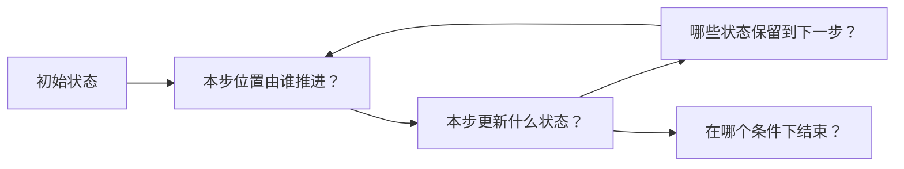

# 第七课实验记录

[讲义](README.md) · [课程进度](../../progress.md)

日期：
Godot 版本 / 渲染器：
窗口尺寸 / 固定模拟频率：

每次先预测，再操作，再写解释。修改初速度后重播，比较运动时尽量冻结在同一年龄附近。

| 实验 | 预测 | 实际观察 | 解释与证据 |
| --- | --- | --- | --- |
| A：正常重力与每步重设速度 | | | |
| B：自动与手动位移 | | | |
| B：重复位移，年龄是否也变快 | | | |
| B：在副本中修复 C | | | |
| C：无重力下比较 60 / 30 / 15 Hz | | | |
| C：恢复重力后比较频率 | | | |
| D：关闭淡出，end_age=0.5 | | | |
| E：年龄灰度与同时出生 | | | |

## 状态与单位

- 在 start 初始化的变量：
- 在 process 跨步积累的变量：
- 速度、重力、位置的单位：
- 本次轨迹的位置由谁更新：
- DELTA 与渲染帧时间有什么区别：
- 改哪些参数需要重播，为什么：

补全你自己的数据流：

## 内置材质转换阅读

- 个人原始材质副本路径：
- 转换后的 ShaderMaterial 路径：
- 另存的 GDShader 路径：
- 初始化速度的位置和作用：
- 重力如何乘 DELTA：
- 年龄与 ACTIVE 结束的路径：
- 除 Shader 代码外，哪些 uniform 值保存在材质中：
- 哪些通用功能本次可以暂不阅读：
- 与本课最小实现的一个共同点、一个差异：

## 独立变体与复盘

- 新场景路径：
- 侧向喷射或虚拟地面规则：
- 使用的坐标空间：
- 重播是否清除旧状态：
- 曾遇到的错误、证据与修复：
- 验收通过项：
- 仍未理解的问题：
