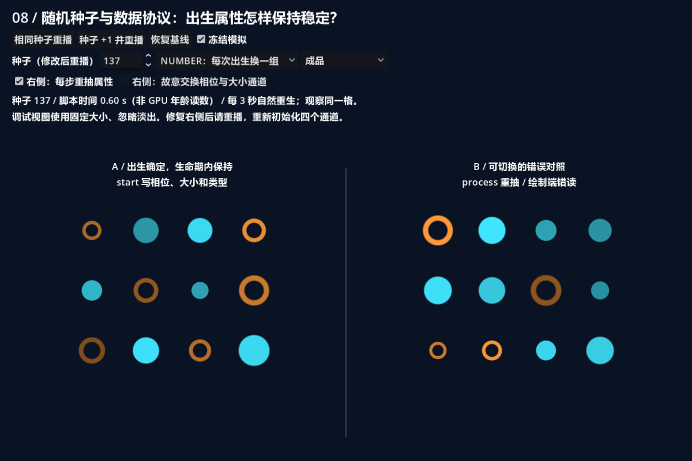
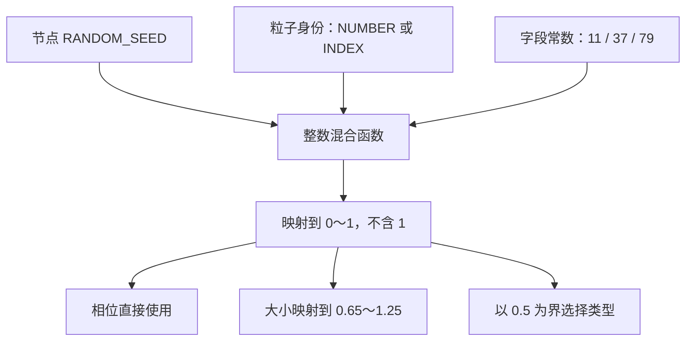
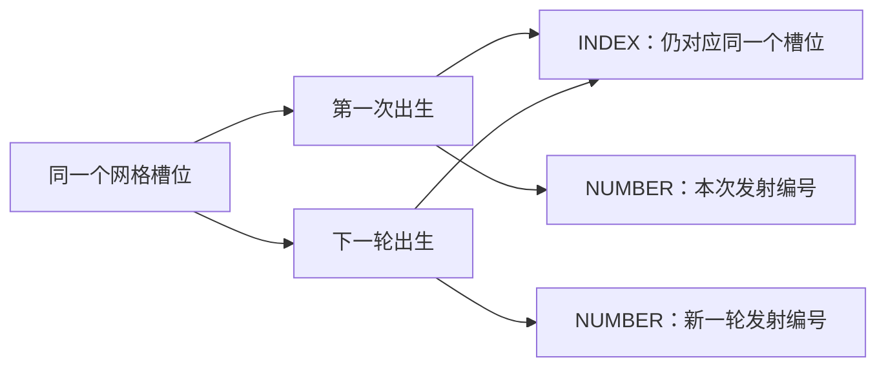
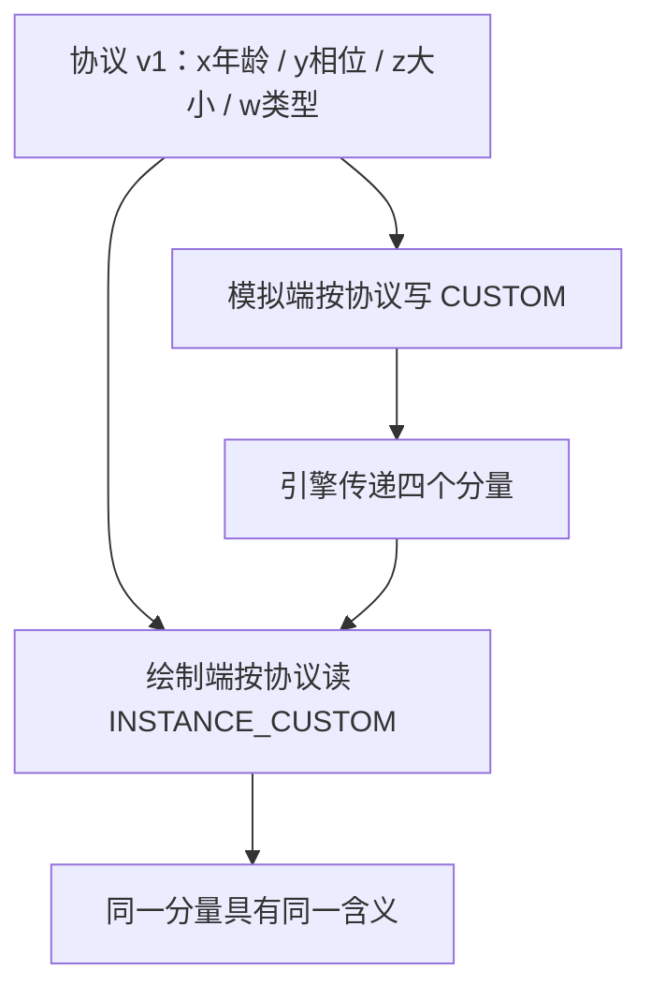
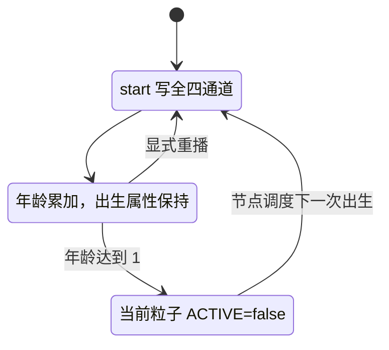
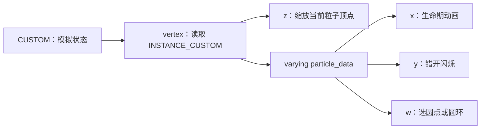
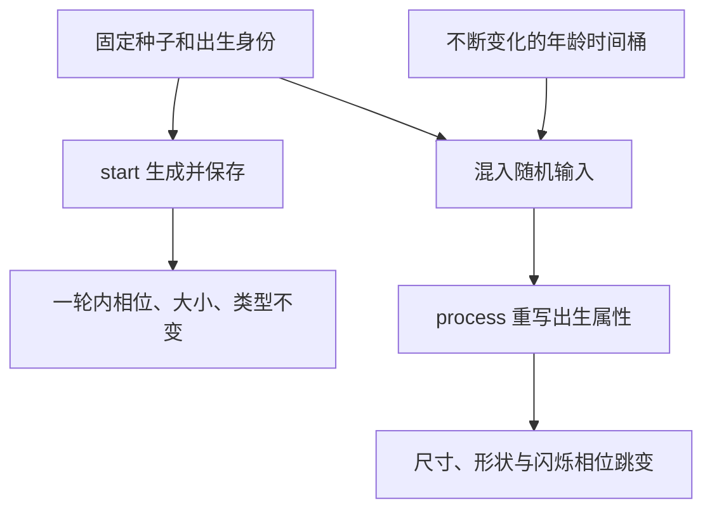
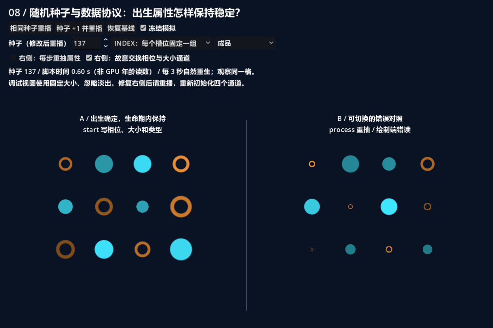
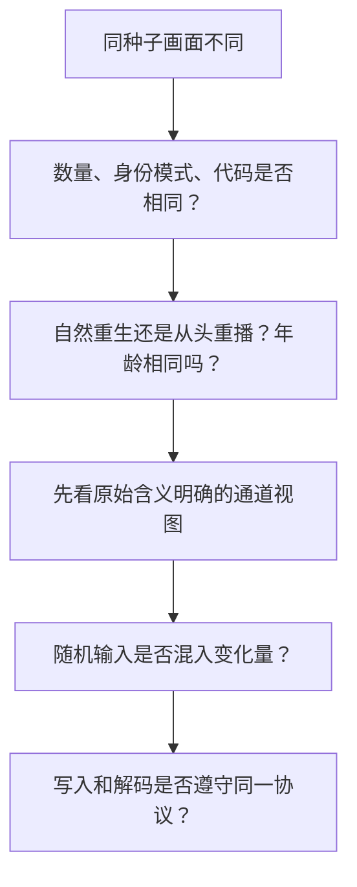

# 第八课：随机种子、自定义数据与生命周期协议

[返回大纲](../../README.md) · [第七课](../07_simulation/README.md) · [数据协议](PROTOCOL.md) · [实验记录](WORKSHEET.md)

建议用时：2～3 小时。先修：第五课的 INSTANCE_CUSTOM 与 varying、第七课的 start/process 与状态保存。

本课目标：**让每次出生拥有可复现的相位、大小和类型，并让模拟端与绘制端准确理解同一份数据。** 学完后，应能区分“同一颗粒子保持个性”“下一次出生换个个性”和“整个效果按种子重播”。

## 1. 两组静止粒子，把随机问题单独看清（10 分钟）

打开 `data_lab.tscn`，按 **F6**，建议运行区域 1200 × 800。左右各有四列三行，共 12 颗粒子，每 3 秒自然重生一次。位置固定，以便追踪同一格。



左侧 A 只在 start 中生成相位、大小、类型。右侧 B 默认在 process 中不断重抽，圆点与圆环、尺寸和亮度会跳变。两侧节点种子相同，但右侧故意将变化的时间量混入随机输入，所以不能期待成品相同。

| 控件 | 操作效果 |
| --- | --- |
| 相同种子重播 | 应用种子输入，调用两侧 restart(true)，回到发射序列起点 |
| 种子 +1 并重播 | 改变两侧节点种子，然后从头播放 |
| 种子输入 | 先编辑，再点重播才应用到节点 |
| 冻结模拟 | speed_scale=0，停止年龄、重抽和由年龄驱动的闪烁 |
| NUMBER / INDEX | 选择随机身份来源，并自动重播 |
| 通道视图 | 成品、x 年龄、y 相位、z 大小、w 类型；切换无需重播 |
| 右侧：每步重抽属性 | 改模拟写入；关闭后需重播，才能取回正确出生属性 |
| 右侧：交换相位与大小 | 改绘制解码；冻结时也可观察，无需重播 |
| 恢复基线 | 种子 137、NUMBER、右侧重抽开启、解码正确、成品视图，并重播 |

调试视图固定粒子尺寸并忽略淡出，所以可以看清数据。类型图用青色表示 0、橙色表示 1，并都画成实心圆；成品则同时用形状区分圆点与圆环。颜色不是唯一线索。

**先预测**：同种子条件下，等到三秒后自然重生，与点击“相同种子重播”，会得到同一组属性吗？先写答案，再用 NUMBER 和 INDEX 分别验证。

## 2. 随机函数是确定性映射，不是每次调用都变（20 分钟）

本课使用的随机值可以概括为：

```text
随机值 = F(节点种子, 粒子身份, 字段区分常数)
```

输入相同，这个纯函数的输出就相同。产生外观差异，需要不同粒子的身份不同；自然重生后要换属性，则要让新出生的身份不同。函数没有暗中保留一个全局随机序列状态。



图中三种用途各调用一次函数，使用不同字段常数。若把同一个随机值同时用于大小与相位，会人为制造“越大相位越靠后”的相关性。分开输入能避免这种直接绑定，但本课没有证明它们统计独立。

`random_spawn.gdshader` 中的 `mix_bits()` 使用 uint 乘法、异或与移位打散输入。现在不要求背下常数，也不把它用于密码学；你需要能解释它接收什么、返回什么、何时调用。

```glsl
float random01(uint identity, uint salt, uint emitter_seed) {
    uint bits = mix_bits(identity ^ mix_bits(emitter_seed + salt));
    return float(bits & uint(16777215)) / 16777216.0;
}
```

最后保留 24 位，结果为 `0 / 2²⁴` 到 `(2²⁴-1) / 2²⁴`，因此不包含 1。这也避免直接把完整 32 位整数转 float 后在上端舍入到 1。类型 0/1 由阈值选出；12 颗粒子里不保证刚好六颗圆点、六颗圆环，随机不是数量配平。

实现细节：本课使用可表示的整数字面量再显式转换 uint。不要随意粘贴超出有符号整数范围的十进制常数并假定转换一定按预期工作；更换算法后应先看分布。内置变量 `RANDOM_SEED` 从 start/process 作为参数传给辅助函数，辅助函数不直接访问该处理阶段变量。[Godot 类型与转换说明](https://docs.godotengine.org/en/4.7/tutorials/shaders/shader_reference/shading_language.html)

## 3. INDEX、NUMBER 与种子各负责什么（20 分钟）

| 输入 | 回答的问题 | 本课用途 |
| --- | --- | --- |
| INDEX | 当前粒子使用哪个槽位？ | 固定网格位置；可作为稳定的槽位身份 |
| NUMBER | 这是发射序列中的哪个粒子编号？ | 区分不同次出生 |
| RANDOM_SEED | 这套随机映射使用哪个基础种子？ | 让整个效果换一组结果或按种子复现 |

这些变量来自粒子模拟阶段。INDEX 是粒子槽位索引，NUMBER 与发射序列有关；它们不是每个渲染帧都会变化的时钟。[官方粒子内置变量](https://docs.godotengine.org/en/4.7/tutorials/shaders/shader_reference/particle_shader.html)

在本课普通循环发射、数量固定的条件下，可以这样观察：



**实验 A**：恢复基线，关闭右侧重抽，点击同种子重播。两侧每个对应位置应有相同相位、大小和类型。选相位灰度，盯住左上角，等一轮自然重生。NUMBER 模式下新一轮通常得到不同灰度；切 INDEX 后重播，观察同一槽位每轮复用相同灰度。

“通常不同”是因为有限输出可能碰巧相等或接近，不能把一次灰度相近当作 NUMBER 没变化。比较整组分布，并保持其他配置一致。

**实验 B**：在 NUMBER 模式下，记录第一轮相位图，点击同种子重播，再看第一轮。序列回到起点，应复现；种子 +1 后分布改变。相同种子要求相同算法、身份选择、数量、发射配置与观察时刻，不承诺跨硬件每个像素永远相同。

节点启用 use_fixed_seed，脚本先把输入值写给两侧 seed，再调用 `restart(true)` 保留该种子。自然重生继续发射序列；显式 restart 则从头开始，两者不是同一种操作。[GPUParticles2D 种子与重播](https://docs.godotengine.org/en/4.7/classes/class_gpuparticles2d.html)

## 4. 先写协议，再写四个通道（20 分钟）

协议解决的是：谁写、何时写、值代表什么、谁读。完整约定见 [PROTOCOL.md](PROTOCOL.md)，代码双方共同包含 `protocol.gdshaderinc`。

| 通道 | 内容 | 范围 / 单位 | 正确写入时机 |
| --- | --- | --- | --- |
| x | age：归一化年龄 | 0～1 | start 归零；process 累加 |
| y | phase：初始相位 | [0,1)，一个周期 | start |
| z | initial_size：初始大小倍率 | [0.65,1.25) | start |
| w | kind：效果类型 | 0 圆点 / 1 圆环 | start |

注意与前两课的区别：第五课按内置过程材质约定读取 y 年龄，第七课也将自己的年龄放在 y；**第八课定义了一套新协议，年龄在 x。** 这不是说引擎标准变了，而是我们同时控制本课的写入端和读取端。



这里的 v1 只是文档版本名，程序没有自动检测版本。仅替换一个端点会破坏约定。不要把本课绘制 Shader 直接接到第五课的 ParticleProcessMaterial；同样也不能随意接入使用通道做旋转、序列帧或 billboard 的其他系统。

我们明确使用 GPUParticles2D、自己编写的过程与绘制 Shader，没有序列帧和内置旋转通道消费。第四个分量使用 float 保存 0/1，这两个值可精确表示；大整数编号不适合不加限制地塞进 float 通道。

## 5. 出生时确定，生命期内保存（20 分钟）

start 中先选身份，再一次性写全：

```glsl
uint identity = use_number ? NUMBER : INDEX;
vec3 data = birth_data(identity, RANDOM_SEED);
CUSTOM = vec4(0.0, data.x, data.y, data.z);
```

`data` 是函数临时返回值，排列为相位、大小、类型；CUSTOM 则按照四通道协议在前面加入年龄。start 还会初始化变换、零速度、白色 COLOR 与 ACTIVE。

正确 process 只累加年龄，保留其余三个通道：

```glsl
CUSTOM[DATA_AGE] += DELTA / LIFETIME;
COLOR.a = 1.0 - smoothstep(0.8, 1.0, CUSTOM[DATA_AGE]);
if (CUSTOM[DATA_AGE] >= 1.0) {
    ACTIVE = false;
}
```



本课 amount=12、explosiveness=1、lifetime=3，连续循环发射。全部粒子同龄，因此年龄视图同灰度是正确结果；它们仍可拥有不同大小、相位和类型。位置直接由 INDEX 排列，不使用随机位置，以免难以辨认同一槽位。

**实验 C**：看年龄灰度跨越一次自然重生，应从亮变回暗。再切相位或大小视图，它们在一轮内部保持不变，新一轮是否换值取决于身份模式。在自己的副本里删去年龄初始化后观察；即使某次因引擎清理碰巧没有残留，也不能把协议初始化交给偶然默认值。

本课不使用 keep_data，也不处理外部 emit_particle 的自定义字段。如果未来支持外部发射，需要重新决定哪些字段由外部拥有、哪些由 start 初始化，不能无条件覆盖外部传入的数据。

## 6. 从 CUSTOM 到画面：只传值，不自动传语义（20 分钟）

绘制端在 vertex 中读取 INSTANCE_CUSTOM，再通过 varying 传给 fragment：

```glsl
varying vec4 particle_data;

void vertex() {
    particle_data = INSTANCE_CUSTOM;
    VERTEX *= 2.2 * particle_data[DATA_SIZE];
}
```

这是成品路径的简化摘录；实际代码还处理错误开关和固定尺寸调试。引擎传递的是四个数，“哪个是大小”由协议决定。vertex 可访问实例数据；需要在 fragment 中使用时，通过 varying 传递。[CanvasItem 实例数据与 varying](https://docs.godotengine.org/en/4.7/tutorials/shaders/shader_reference/canvas_item_shader.html)



成品亮度使用：

```glsl
float pulse = 0.75 + 0.25 * sin(TAU * (age * 3.0 + phase));
```

它表示**一个生命周期内闪烁三次**，不是永远固定 3 Hz。本课寿命 3 秒，所以对应约 1 Hz。phase 的单位是周期：0.25 是四分之一圈，转为三角函数弧度时乘 TAU。改变寿命会改变实际秒频率；想固定 Hz，应使用年龄乘寿命得到秒数，并保证绘制端知道实际寿命。

大小只在 vertex 缩放一次，没有再同时写入 TRANSFORM 的缩放；否则可能把同一倍率重复应用。类型用 `< 0.5` 分支，圆点和圆环共用一套绘制 Shader。成品继续乘输入 COLOR，保留模拟输出的末段淡出。

## 7. 两类错误，要分开修复（20 分钟）

### 错误一：把不断变化的输入当作出生身份

右侧在 process 中将年龄换算为 60 Hz 时间桶，再混入身份，重新写 y/z/w。节点也采用固定 60 Hz 模拟；浮点边界可能重复或跨过某个桶，不要求每步都得到一个独一无二的新值。重点是输入随年龄变化，出生属性因此不稳定。



**实验 D**：相位视图下恢复运行，左侧灰度不变，右侧变化；冻结后两侧都不再变化。关闭右侧重抽并重播，左右恢复一致。

只关闭开关而不重播，右侧会保留最后一次重抽的结果，不会自动“想起”最初的属性。更重要的是，**在 process 中重复计算不必然导致抖动**：如果输入仍然完全相同，纯函数输出仍相同，只是重复计算。本例错误来自变化的输入及持续覆盖。

这也不意味着逐步噪声总是错误。连续变化的噪声可用于风场、火焰或扰动；应该把它定义为动态量，而不是无意修改初始大小和类型。第九课再将动态影响用于运动。

### 错误二：数据没变，但绘制端读错了

先关闭右侧重抽并重播，然后冻结，打开“交换相位与大小通道”。右侧的大小和亮度立即与左侧不一致，但模拟数据没有改变。



原因是相位范围 [0,1) 被误当成大小倍率，某些粒子变得非常小；原大小倍率又被当成周期相位。它们都是合法 float，Shader 编译器不会判断你的语义是否合理。关闭错读即可修复，不需要重播。

**实验 E**：在冻结状态切换 y/z 调试视图，观察错读开关前后，右侧如何变化。调试视图显示的是“绘制端解码后的值”；开启错读时，它并非原始 GPU CUSTOM 的忠实展示。类型 w 和年龄 x 没被交换，应保持一致。

## 8. 如何判断复现成功（10 分钟）

只说“种子相同”不够，需要明确比较条件：

| 必须固定 | 本课基线 |
| --- | --- |
| 模拟和绘制代码、协议版本 | Lesson08 v1 |
| 节点随机配置 | use_fixed_seed=true，seed=137 |
| 数量、寿命、发射与更新 | 12、3 秒、爆发式循环、60 Hz |
| 随机身份来源 | NUMBER 或 INDEX，比较时不混用 |
| 观察阶段 | 相同出生轮次和年龄附近 |
| 错误开关与调试方式 | 明确记录 |



本课开发检查在固定时间截图，裁掉 UI 后比较粒子区域：左侧相位跨步相同、同种子重播相同、新种子不同、NUMBER 自然重生不同、INDEX 自然重生相同。截图证据限定于当前测试环境，不是数学上的“所有输出绝不碰撞”或跨平台一致性证明。

## 9. 独立重建与变体（30 分钟）

在自己的目录创建一套模拟与绘制 Shader，不复制实验场 UI：

1. 先写四通道表，列出单位、范围、写入时机和读取用途。
2. 从固定值开始写入和解码，确认每个调试视图正确，再加入随机生成。
3. 将 INDEX 与种子组合用于相位和大小，验证重播；再换 NUMBER，比较自然重生。
4. 增加一种第三类型，例如菱形。把 w 的合法范围改成 0/1/2，同时更新写入、解码、调试和文档。
5. 将第七课的运动接入，仍只在出生时确定大小和类型；现在跟踪的对象会移动，保留固定网格版本作数据排查工具。

第三类型的提示：`floor(random_value * 3.0)` 可得到 0、1、2，前提是随机值严格小于 1。先验证分支范围，不要只改绘制端便期待模拟端自动生成新类型。

加餐：设计一套“每颗粒子自己的寿命”。先回答寿命写在哪里、年龄按哪个寿命归一化、结束条件与绘制频率如何同步；不要未规划就覆盖本课任何已用通道。本课不要求实现，也不提前引入第五个自定义通道方案。

## 10. 排查、验收与自测

| 现象 | 优先检查 |
| --- | --- |
| 所有随机值看起来相同 | key 是否只用了相同种子；灰度图是否全零；整数计算是否有效 |
| 同一生命期尺寸或类型跳变 | process 是否重写出生属性，输入是否混入年龄或 TIME |
| 下轮出生想换值但没换 | 是否仍用 INDEX；观察整组以排除偶然接近 |
| 想要槽位固定但每轮变化 | 是否用了 NUMBER |
| 关闭错误后与左侧不一致 | 是否重播恢复了出生数据 |
| 重生后年龄不归零 | start 是否完整初始化协议使用的数据 |
| 大小极小或相位异常 | 模拟和绘制是否采用相同通道约定 |
| 冻结后仍闪烁 | 是否改用不会随本课模拟冻结的 TIME |
| 同种子重播仍不同 | 配置、身份、出生轮次与随机算法是否一致 |

满足以下条件后再自行更新 [学习进度](../../progress.md)：

- [ ] 能解释 INDEX、NUMBER 与 RANDOM_SEED 的不同作用。
- [ ] 能复现同种子第一轮结果，改变种子后得到不同分布。
- [ ] 同一生命期内相位、大小、类型稳定，年龄正常增长。
- [ ] 自然重生年龄归零；能分别演示 INDEX 和 NUMBER 的差别。
- [ ] 用协议表说明每个通道的范围、写入者和读取者。
- [ ] 能制造并修复重抽错误与解码错误，并解释重播要求为何不同。
- [ ] 同龄粒子外观不同，绘制仍保留模拟输出的淡出。
- [ ] 独立完成第三类型或运动变体，并同步更新协议。

**自测题**：

1. 同一个随机函数每步调用，结果一定每步不同吗？
2. 为什么 NUMBER 模式下同种子自然重生与显式重播可能不同？
3. 相位与大小共用一个随机值会带来什么问题？
4. 为什么本课年龄可以放 x，第五课却从 y 读取？
5. 交换相位与大小为什么不会自动报编译错误？
6. 本课 `age * 3.0` 是否表示固定每秒闪烁三次？

<details>
<summary>参考答案：先写自己的解释</summary>

1. 不一定。纯函数在相同输入下结果相同；本课错误版本主动改变输入。
2. 自然重生继续发射序列，NUMBER 改变；显式重播回到序列起点，并保留所设种子。
3. 会形成直接的属性相关性；字段常数可以把输入分开，但不等于严格统计独立证明。
4. 两者使用不同的数据协议。本课同时控制模拟和绘制，不能与内置材质的通道约定混接。
5. 都是合法数值，语言类型系统不知道哪个 float 代表相位或尺寸。
6. 不是，是每个完整生命周期三次；寿命 3 秒时约为 1 Hz。

</details>

## 11. 文件导航与下一课

| 文件 | 用途 |
| --- | --- |
| data_lab.tscn | 两组固定网格 GPU 粒子、独立过程与绘制材质 |
| random_spawn.gdshader | 随机函数、完整出生初始化、年龄与错误重抽 |
| read_data.gdshader | 数据解码、顶点缩放、形状与通道调试 |
| protocol.gdshaderinc | 模拟与绘制共用的通道编号 |
| PROTOCOL.md | 数据协议、边界及所有权说明 |
| data_lab.gd | 控件、种子应用、重播与开发验证 |
| WORKSHEET.md | 实验与协议变体记录 |
| VALIDATION.md | 实际验证和限制 |

第九课将让速度随粒子与目标的位置变化，制作力场与旋涡。出生属性继续保持稳定，动态力场则每个模拟步重新计算，两者各自有清楚的职责。
