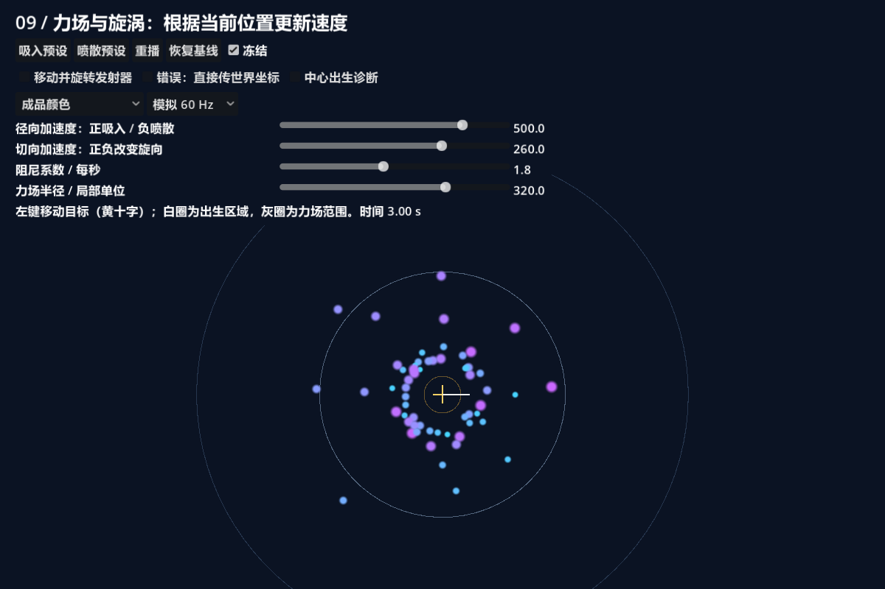
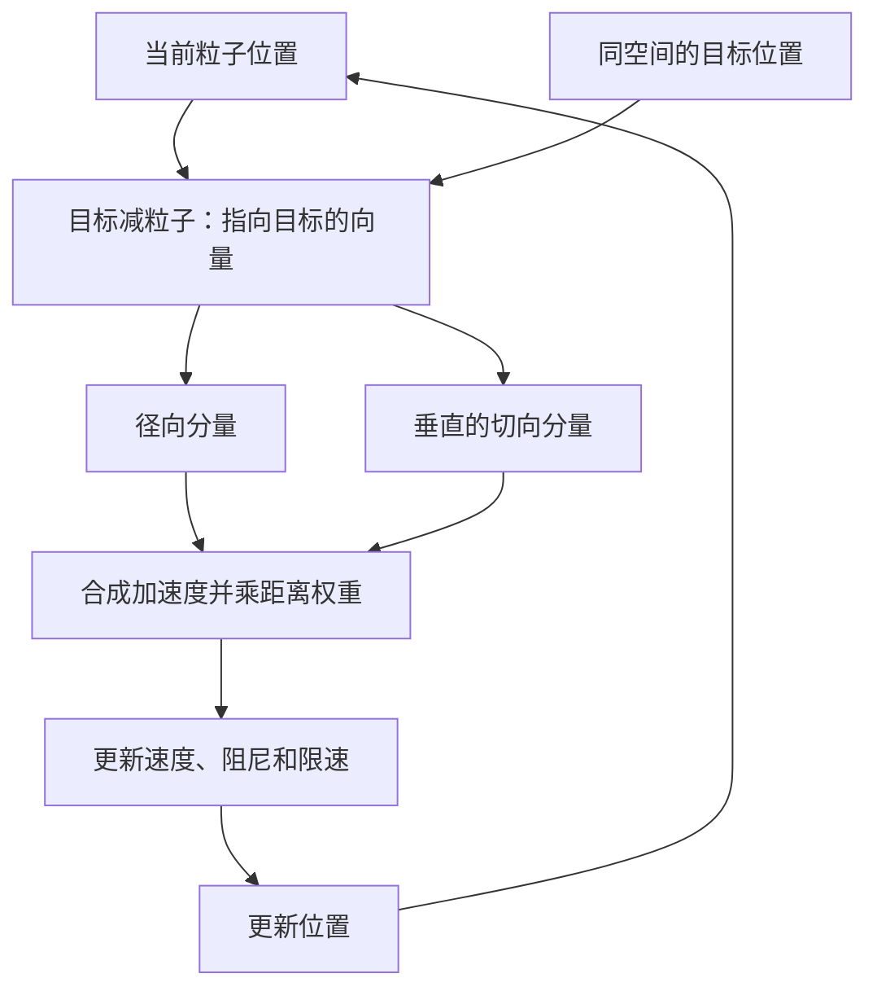
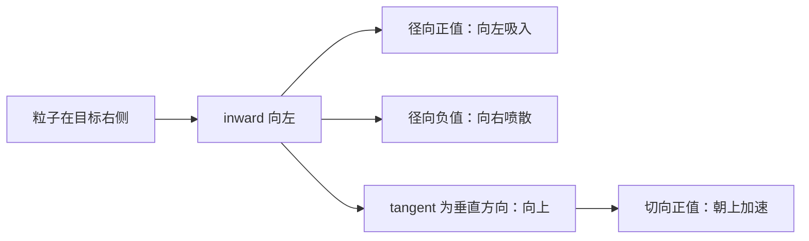
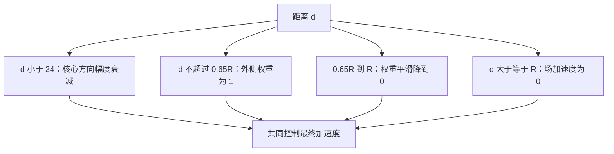
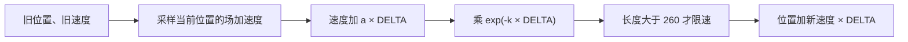
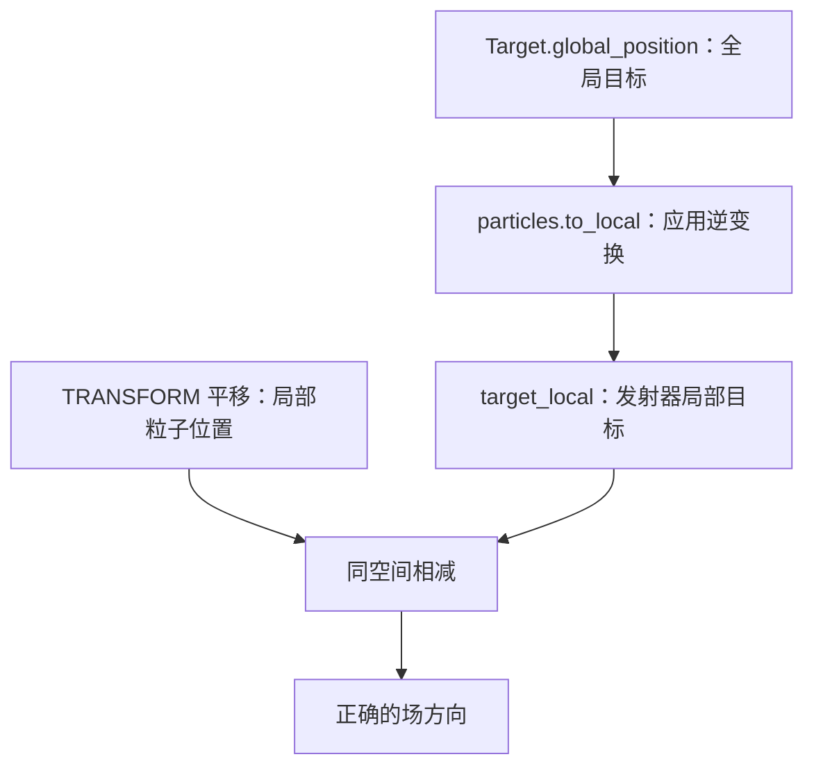
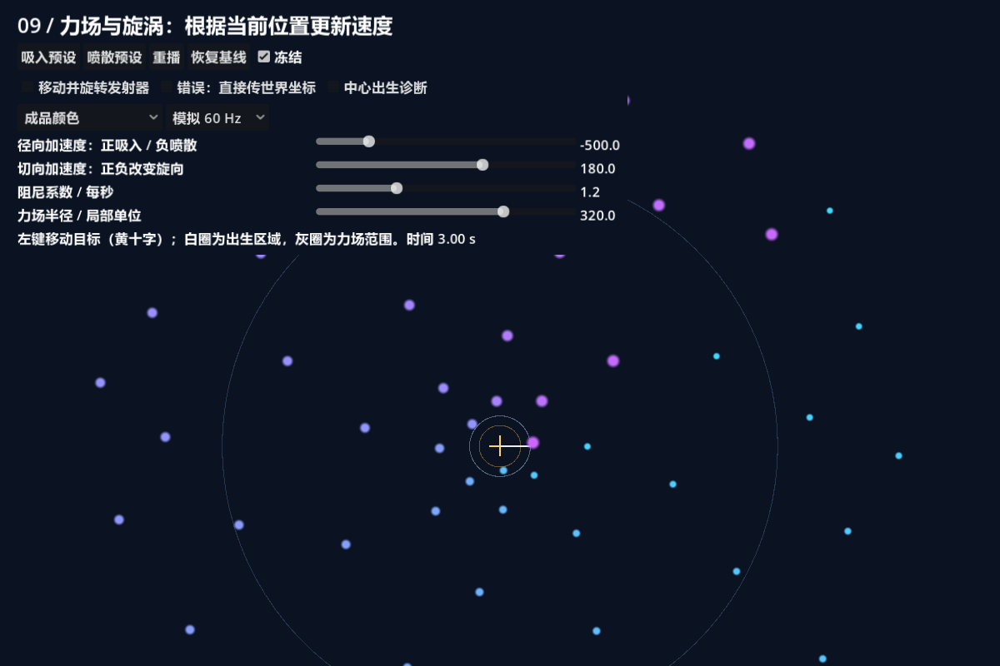
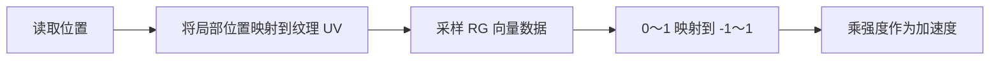

# 第九课：用力场设计运动——旋涡与吸引

[返回大纲](../../README.md) · [第八课](../08_data_protocol/README.md) · [实验记录](WORKSHEET.md)

建议用时：2～3 小时。先修：第七课的速度、DELTA 与手动积分，第八课的数据协议。

本课目标：**每个模拟步根据粒子与目标的位置关系计算加速度，让粒子吸入、旋转或向外喷散。** 你还会移动目标与发射器，验证它们是否在同一个坐标空间中计算。

## 1. 先运行实验场（10 分钟）

打开 `field_lab.tscn`，按 **F6**，建议 1200 × 800 或更大的运行区域。默认是吸入预设：粒子从较大的环带出生，向黄色十字附近旋转收拢。点击界面下方的空白区域可以移动目标。



灰色大圆表示力场作用半径；目标周围的小圆是 24 单位核心区。白灰色出生参考圆以发射器为中心，表示基准出生半径；实际出生半径分布在它的 0.75～1.25 倍。白色短线表示发射器的局部 X 轴。

| 控件 | 含义与注意事项 |
| --- | --- |
| 吸入 / 喷散预设 | 同时修改径向、切向、阻尼、作用范围与出生半径，然后重播；它们是设计方案，不是单变量实验 |
| 重播 | 清除旧粒子、时间归零、解除冻结，保留当前目标位置与参数 |
| 恢复基线 | 关闭错误及诊断开关，目标归中，恢复 60 Hz 吸入预设 |
| 径向加速度 | 正值向目标，负值离开目标，0 无径向加速度 |
| 切向加速度 | 绕目标方向的加速度；正负切换旋向，不是直接设置角速度 |
| 阻尼系数 | 越大速度衰减越快；0 关闭阻尼 |
| 力场半径 | 只限定加速度作用范围，不是粒子不能越过的墙 |
| 移动并旋转发射器 | 发射器平移并旋转，目标仍是独立节点 |
| 错误：直接传世界坐标 | 故意把世界位置当作局部目标位置 |
| 中心出生诊断 | 粒子直接出生在目标位置、速度为零，自动重播 |
| 速度 / 距离视图 | 由模拟阶段输出颜色，冻结时切换后需恢复模拟才更新 |
| 模拟频率 | 60、30、15 Hz，切换后自动重播 |

粒子持续分批出生，寿命 5 秒，数量上限 96，没有拖尾。喷散后部分粒子可能离开视口；看不见不等于 ACTIVE 已结束。界面覆盖在场景上方，防止粒子影响文字阅读。

**先预测**：只增加切向加速度，能否保证所有粒子最终到达中心？目标移出力场范围后，粒子会立即停住吗？先把答案写入记录。

## 2. 从固定重力变成位置函数（15 分钟）

第七课所有粒子使用相同重力。本课每颗粒子根据自身位置，得到不同方向的加速度：

```text
加速度 = F(粒子位置, 目标位置, 径向强度, 切向强度, 作用范围)
```



这里称作“力场”，实现中直接计算加速度，等效于不显式建模质量。参数单位是局部单位/秒²。它是可控的特效运动模型，不是万有引力或真实流体模拟。

核心模拟仍为 `shader_type particles`。使用 `disable_velocity` 后，代码只在一处更新位置；没有第七课的重复位移问题。[粒子 Shader 内置变量与模式](https://docs.godotengine.org/en/4.7/tutorials/shaders/shader_reference/particle_shader.html)

## 3. 径向与切向：一条向量，两个方向（20 分钟）

先定义：

```glsl
vec2 offset = target_local - TRANSFORM[3].xy;
float distance_to_target = length(offset);
vec2 inward = offset / max(distance_to_target, 24.0);
vec2 tangent = vec2(-inward.y, inward.x);
```

在距离至少 24 时，inward 长度为 1，指向目标。tangent 与 inward 垂直，因为两者点积为零。它不是速度，而是用于构造切向加速度的方向。

在屏幕 Y 向下的本课坐标中，粒子位于目标右侧时，inward 向左，正的 tangent 向上。因此切向参数为正时，该位置开始朝屏幕上方加速；用一个具体位置判断旋向，比背“顺时针/逆时针”更可靠。



合成方式：

```glsl
vec2 acceleration = (inward * radial_accel
                   + tangent * swirl_accel) * falloff;
```

**实验 A**：恢复基线，将切向加速度设为 0，重播。粒子主要径向收拢。保持其他参数不变，将切向改成 260，再改成 -260，每次重播，比较旋向。不要同时点击不同预设，否则多个参数一起变化，无法归因。

增加切向加速度会持续补充绕行运动；吸入与旋转平衡后可能形成环状运动，不保证所有粒子最后停在中心。若要严格“收集到中心后消失”，应另外设计捕获半径和 ACTIVE 结束条件，留作本课练习。

## 4. 中心处理与距离衰减（20 分钟）

不能直接对零向量无条件归一化。这里使用 24 单位核心区：

| 到中心距离 | inward 长度 | 结果 |
| --- | --- | --- |
| 48 | 1 | 正常径向强度 |
| 12 | 0.5 | 核心区内减弱 |
| 0 | 0 | 加速度为零，不除零 |

它不是用一个极小数勉强避免异常，而是明确设计了中心附近的力：越接近中心，径向和切向加速度都逐渐减弱。不要把 inward 在核心内仍称作“单位向量”。

外侧权重为：

```glsl
float falloff = 1.0 - smoothstep(field_radius * 0.65,
                                field_radius, distance_to_target);
```



核心处理与外侧权重是两层规则，区间可能重叠；不是互斥的四选一分支。场外仍有已有速度，并继续应用阻尼，因此粒子可凭惯性越出灰圈。灰圈不承担碰撞或裁剪职责。

**实验 B**：恢复基线，开启中心出生诊断，不移动目标和发射器。粒子应重叠在目标处，不会突然飞走。因为出生速度为零且场加速度为零，保持原位是正确结果。再移动目标，原有粒子不再处于新中心，会开始响应力场；新粒子则出生在新目标处。

**实验 C**：恢复基线，把力场半径改为 100，部分出生位置位于场外。初始速度为零的这些粒子不受场加速，可能停留原处直到寿命结束。移动目标使它们进入范围，观察变化。这是局部作用范围的结果，不是 Shader 卡住。

## 5. 加速度、指数阻尼和限速（20 分钟）

本课积分顺序：

```glsl
VELOCITY.xy += acceleration * DELTA;
VELOCITY.xy *= exp(-damping * DELTA);
float speed = length(VELOCITY.xy);
if (speed > 260.0) {
    VELOCITY.xy *= 260.0 / speed;
}
TRANSFORM[3].xy += VELOCITY.xy * DELTA;
```

先更新速度，再用新速度更新位置，属于半隐式 Euler 的基本顺序；阻尼和限速是额外步骤。第七课为对齐引擎自动路径采用了先位移后加速度，本课完全控制手动积分，因此明确选择另一顺序。



阻尼系数 k 的单位为每秒。在没有加速度和限速干预时，速度经过 t 秒乘 `exp(-k*t)`；例如 k=1 时，一秒后保留约 36.8%。这比每步固定乘 0.98 更便于保持不同模拟频率下相近的衰减时间尺度。

但这里先加速度再阻尼，是分步近似；指数阻尼并不让整个带场系统在所有时间步长下完全一致。限速保证计算路径中的速度长度不超过 260，它是风格与稳定性保护，不是物理精确性证明，也不能修复已经出现的 NaN。

在控件范围内，场方向长度不超过 1，falloff 不超过 1；径向与切向相互垂直，加速度幅值有界。核心没有距离平方分母，不会在靠近中心时无限放大。

**实验 D**：恢复基线，固定场参数，将阻尼从 1.8 改为 0，重播观察惯性；再设为 4。速度图中蓝色较慢、红色较快，按 0～260 归一化。颜色不同不是粒子类型变化，而是当前速度的编码。

## 6. 目标在哪个坐标空间（25 分钟）

本课 local_coords=true，TRANSFORM 中的位置属于发射器局部空间。Target.global_position 则属于全局空间。两者不能直接相减。

```gdscript
var local_target := particles.to_local(target.global_position)
particles.process_material.set_shader_parameter("target_local", local_target)
```



只做 `target.global_position - particles.global_position`，在只有平移时可能够用；一旦发射器旋转，这个结果仍未转换到它的局部轴。to_local 处理完整的变换。[Node2D 坐标转换](https://docs.godotengine.org/en/4.7/classes/class_node2d.html)

**实验 E**：恢复基线，开启移动并旋转发射器。目标十字不跟随它移动，但粒子使用正确换算后的目标。打开错误坐标，粒子可能不再被吸向十字，甚至因错误目标太远而完全不受场影响；关闭恢复。更明确的对照是在相同开关和参数下分别重播。

注意：local_coords=true 意味着旧粒子也会跟随发射器平移与旋转。这是本课的运动设计，不是坐标转换失败。to_local 保证场目标换算正确，**不负责让旧粒子留在世界原地**。若要世界空间模拟，必须一致处理初始变换、位置、速度、目标与范围，不能只关 local_coords 就结束修改。

本例两个节点在同一画布，没有 Camera2D、非均匀缩放或跨 CanvasLayer。全局点转换可处理缩放，但局部“圆形半径”和“固定速度”在非均匀缩放后不再对应世界中的圆和等速。本课未把这种行为包装成通用世界空间力场。

## 7. 模拟频率和调试视图（15 分钟）

固定目标与发射器后，依次选择 60、30、15 Hz。先比较大体趋势，再看轨迹和平滑程度。低频率一步移动更远，可能跨过核心或衰减区；即使位置仍为有限值，轨迹也可能失真。

| 视图 | 编码 | 观察重点 |
| --- | --- | --- |
| 成品 | 出生相位控制基础颜色，保留末段淡出 | 轮廓、节奏、吸入或喷散 |
| 速度 | 0 蓝 → 260 红 | 惯性、阻尼、限速是否长期触发 |
| 距离 | 0 黑 → field_radius 白，超出后仍白 | 哪些粒子在场内或场外 |

距离颜色对应当前模拟步更新位置之前的距离，显示位置已完成本步推进；两者有一个模拟步的取样差，不应拿它当精确距离测量仪。调试视图忽略淡出，便于观察，但粒子到寿命仍会结束。

**实验 F**：关闭移动和错误开关，固定参数。比较 60 与 15 Hz；记录是否越过中心、形成何种环、速度是否频繁达到红色。渲染帧率与模拟频率不是同一件事。若低频率不满足需求，可提高模拟频率、减小强度或增加子步，而不是单凭“乘了 DELTA”宣布稳定。

## 8. 吸入与喷散两种设计（15 分钟）

| 参数 | 吸入基线 | 喷散预设 |
| --- | --- | --- |
| 径向加速度 | 500 | -500 |
| 切向加速度 | 260 | 180 |
| 阻尼 | 1.8 | 1.2 |
| 场半径 | 320 | 320 |
| 出生基准半径 | 160 | 35 |

吸入从外围出生，喷散从靠近中心出生。切向加速度增加弯曲感，阻尼控制扩散后收缓的速度。预设保持现有目标位置、移动和诊断开关；要进行干净对照，先恢复基线再选择预设。



沿用第八课通道编号：x 年龄、y 出生相位、z 初始大小、w 类型。本课相位按 INDEX 确定，用于出生角度与配色；类型固定为 0，绘制只画圆点。没有新随机算法，也不把动态速度塞进原本属于出生属性的通道。速度和距离调试直接写 COLOR。

## 9. 独立练习与加餐（30 分钟）

在个人目录重建一个最小吸引场：

1. 先将切向设为零，实现安全的径向方向与距离衰减。
2. 加入手动速度、位置更新与指数阻尼，明确各参数单位。
3. 加入切向分量，并能反向旋转。
4. 用独立 Target 节点控制中心，移动和旋转发射器验证转换。
5. 增加“捕获半径”：粒子到达目标附近时 ACTIVE=false；只在吸入模式启用，避免喷散刚出生就被回收。

另一变体：先蓄积旋转，再令径向加速度由正变负释放。它属于外部参数调度，第十课会将这种控制整理成可复用接口。



上图是向量场纹理加餐的思路，不是本课已实现功能。需要另外定义空间范围、方向约定、边界采样与数据纹理处理。先能解释和控制当前解析力场，再研究 curl noise，无需把它当作本课先修。

## 10. 排查、验收与自测

| 现象 | 优先检查 |
| --- | --- |
| 吸向错误位置 | 目标和粒子是否同空间；是否开启错误坐标 |
| 旋转发射器后方向错 | 是否仅减位置，没有使用完整逆变换 |
| 粒子直冲中心没有旋转 | 切向强度是否为零，是否又把速度覆盖为径向值 |
| 中心出现 NaN | 是否无条件 normalize 零向量或使用无保护距离分母 |
| 场外仍在运动 | 已有惯性不会因场加速度归零而消失 |
| 强度提高后仍不是更快 | 是否已到达速度上限 |
| 低 Hz 轨迹失真 | 时间步过大；阻尼与限速不等于准确积分 |
| 看不到远处粒子 | 区分视口之外、visibility_rect 裁剪、寿命结束 |
| 移动发射器时旧粒子也移动 | 本课 local_coords=true 的预期行为 |

- [ ] 能画出径向与切向分解，并说明正负号。
- [ ] 能解释核心弱化、外侧衰减、阻尼和限速各解决什么问题。
- [ ] 精确中心出生、零速度时没有异常飞离。
- [ ] 移动目标和旋转发射器时，能修复坐标错误。
- [ ] 能通过速度/距离颜色解释运动，而不是只调数量。
- [ ] 比较至少两种模拟频率，记录误差与适用范围。
- [ ] 独立完成捕获半径或蓄力释放变体。

通过后再自行更新 [学习进度](../../progress.md)。

**自测**：为什么切向力不等于恒定角速度？为什么核心向量不是处处单位向量？为什么力场范围外粒子仍会动？限速能否修复 NaN？为什么 to_local 后旧粒子仍跟随发射器？

<details>
<summary>参考答案</summary>

切向加速度每步改变速度，角速度还取决于速度、半径、径向运动和阻尼。核心处用固定半径作分母，方向幅度随距离减小。场外只有加速度归零，速度仍有惯性。NaN 需要从源头避免，限速比较不能可靠修复它。to_local 只转换目标，旧粒子跟随由 local_coords 的模拟空间决定。

</details>

## 文件与下一课

`field_lab.tscn` 是运行入口；`field.gdshader` 负责模拟，`field_draw.gdshader` 绘制软圆点，`field_lab.gd` 提供目标、控件与验证。协议编号引用第八课，白色纹理引用第一课。实际验证范围见 [VALIDATION.md](VALIDATION.md)。

第十课会把各层特效与参数调度整理成可复用场景，处理多实例独立参数、暂停、连续触发和结束回收。
