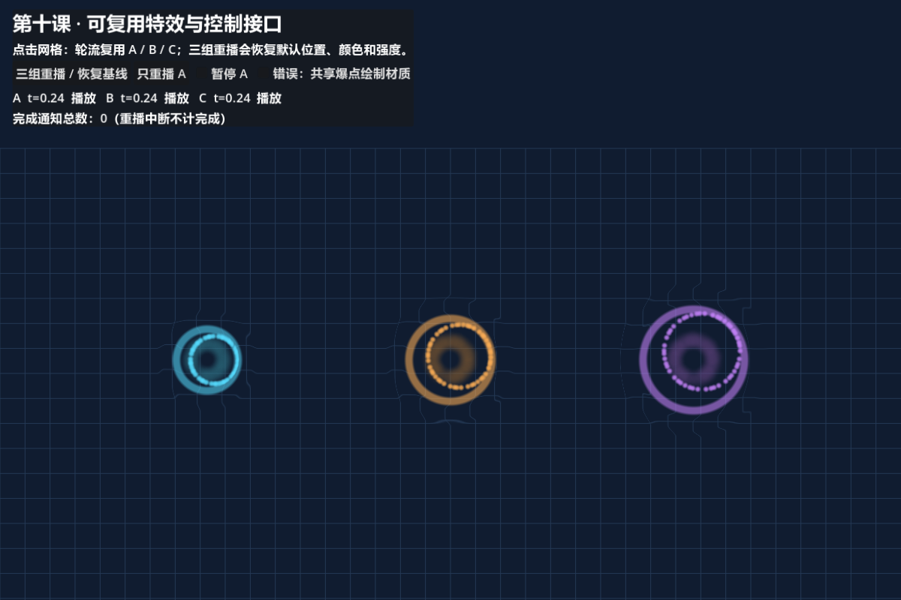
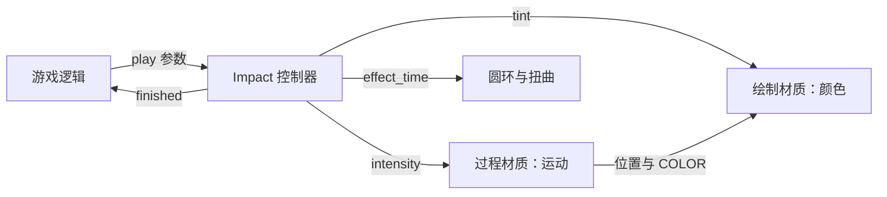
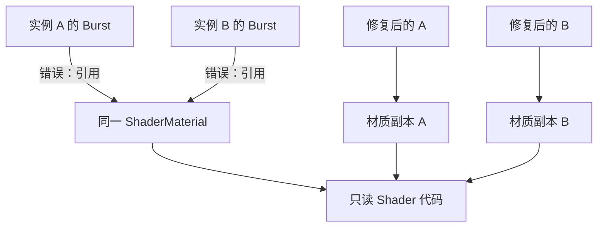
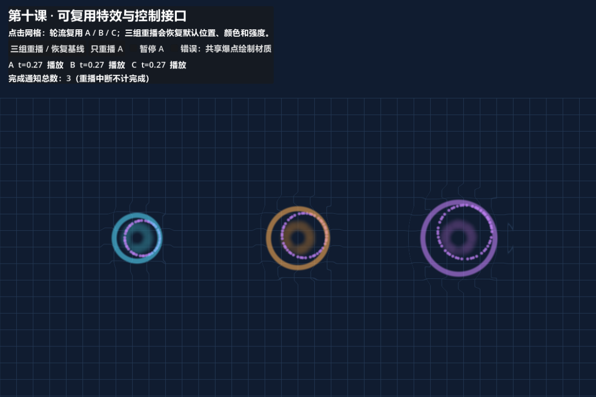
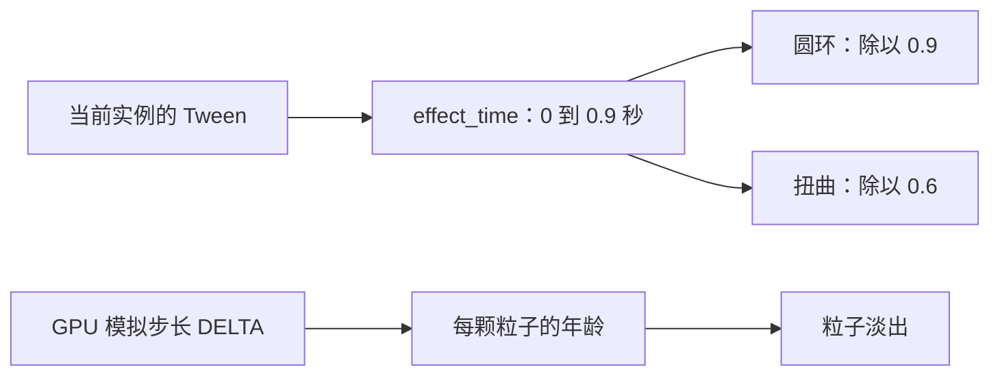
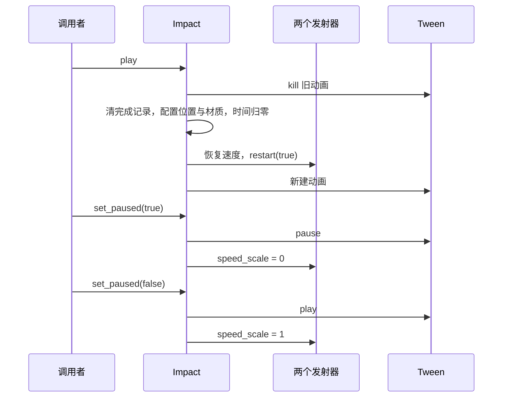
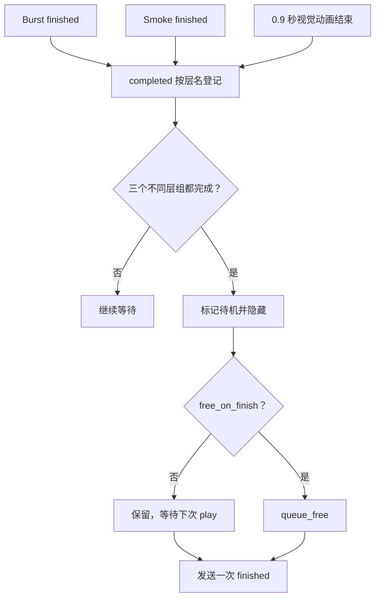
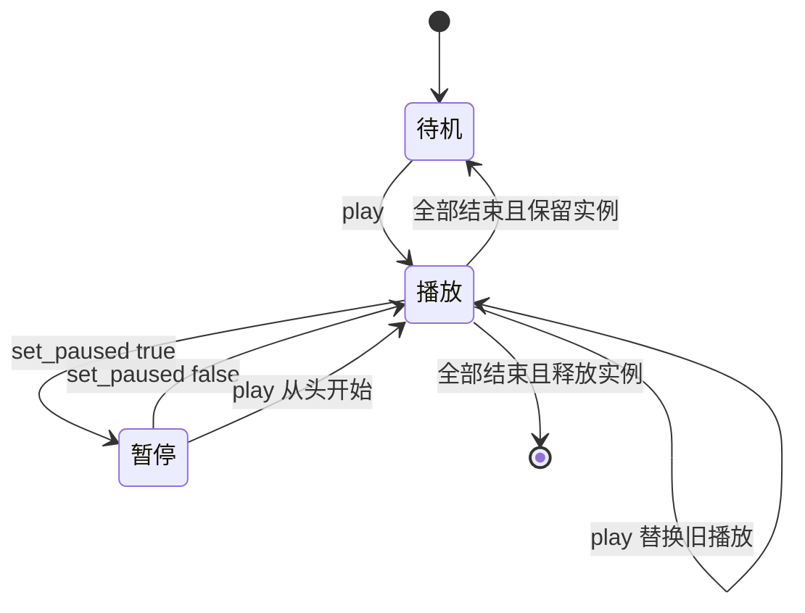
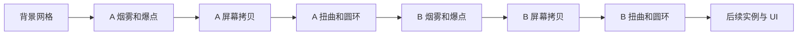

# 第十课：把效果变成可复用的场景

[返回大纲](../../README.md) · [第九课](../09_fields/README.md) · [实验记录](WORKSHEET.md) · [验证范围](VALIDATION.md)

建议用时：2～3 小时，阶段挑战另留 1 小时。先修：第二课的一次性发射、第五课的粒子年龄、第六课的屏幕拷贝、第七至九课的自定义模拟。

本课目标：**让调用者只传位置、方向、强度和颜色，就能可靠播放一个多层特效；同时存在三个实例，也能分别暂停、重播和结束。**

## 1. 先运行，再提出问题（10 分钟）

打开本目录 `reuse_lab.tscn`，按 **F6**，建议运行区域 1200 × 800。场上出现青、橙、紫三组效果，约两秒后全部进入待机。点击“ 三组重播 / 恢复基线”可重新观看。



每组有四层：短促的亮点爆发、缓慢消散的软圆烟雾、向外扩张的圆环、短暂扭曲网格的波纹。烟雾刻意使用简单软圆，方便把注意力放在接口和时间上；后续可换成第四课的噪声形状。

| 操作 | 预期行为 |
| --- | --- |
| 三组重播 / 恢复基线 | 关闭共享错误，恢复三组位置、颜色和强度；清除旧播放并解除暂停 |
| 只重播 A | A 从零重新播放，B、C 继续原来的播放或待机 |
| 暂停 A | A 的粒子模拟、圆环和扭曲时间全部暂停；恢复后继续 |
| 错误：共享爆点绘制材质 | 自动重播三组；只有爆点共用材质，最后写入的紫色影响三组 |
| 点击网格 | 按 A→B→C 循环复用现有实例，在点击处播放；不增加实例数量 |

状态中的 `t` 是圆环和扭曲使用的时间，最多走到 0.9 秒，不是整个场景的最长寿命。完成通知计数只统计完整结束；中途重播不算一次完成。恢复基线不会清零累计计数。

先预测：A 的圆环结束时，烟雾是否也结束了？如果暂停时只停 Tween，会发生什么？把预测写进实验记录。

## 2. 封装的是契约，不只是节点（15 分钟）

可复用的主体是 `impact.tscn`；`reuse_lab.tscn` 只是调用它的演示场。文件职责如下：

| 文件 | 负责什么 |
| --- | --- |
| `impact.gd` | 公共接口、材质隔离、时间控制、完成条件 |
| `impact.tscn` | 两个发射器、拷贝节点、两张效果卡片及默认资源 |
| `motion.gdshader` | 爆点与烟雾的出生、运动和淡出，通过 smoke 区分 |
| `dot.gdshader` | 软圆遮罩及主色，保留模拟传来的颜色与透明度 |
| `ring.gdshader` / `warp.gdshader` | 使用自定义 effect_time 播放圆环和扭曲 |
| `reuse_lab.gd` | 按钮、鼠标输入、三个实例以及验证入口 |



箭头表示数据或事件传递。游戏不应为了换颜色去寻找 `$Smoke`，也不应知道哪个 Shader 的 uniform 叫什么。否则改一个节点名就会影响所有调用者。

本课接口是：

```gdscript
play(at: Vector2, direction: Vector2, intensity: float, color: Color)
set_paused(value: bool)
signal finished
```

| 输入或行为 | 明确约定 |
| --- | --- |
| at | 特效父节点的局部坐标，单位为该 Canvas 中的 2D 单位 |
| direction | 同一空间中的朝向向量；长度不影响强度；零向量按朝右处理 |
| intensity | 限制在 0.5～1.2；修改粒子初速度、圆环半径、扭曲范围与偏移幅度，不增加粒子数量 |
| color | 写到两种粒子的绘制材质和圆环；扭曲读取背景颜色，不染色 |
| play | 替换本实例的当前播放，解除实例暂停；调用前节点必须已 ready |
| finished | 只有本次完整播放结束才通知一次；被替换的旧播放不通知 |
| free_on_finish | 默认 false：隐藏待复用；true：结束时 queue_free |

在一个已进入场景树的 Node2D 脚本中接入：

```gdscript
const Impact = preload("res://tutorial/lessons/10_reusable/impact.tscn")

func show_hit(world_point: Vector2) -> void:
    var effect = Impact.instantiate()
    effect.free_on_finish = true
    add_child(effect) # 此时父节点已在树中，子节点完成 _ready
    effect.play(to_local(world_point), Vector2.RIGHT, 1.0, Color.CYAN)
```

如果还有世界朝向，先将世界中的起点和“起点＋方向”分别 `to_local()`，再相减得到父空间方向。不要只转换位置而忘了方向。这里假设同一 Canvas，父级无非均匀缩放；旋转整个效果也会旋转烟雾的局部上升方向。它是效果设计，不是世界重力。

`impact.tscn` 单独 F6 会处于隐藏待机；演示请运行 `reuse_lab.tscn`。待机正是一个被动特效组件的合理初始状态。

## 3. 为什么三个节点会共用一种颜色？（20 分钟）

**节点实例不同，不代表其引用的 Resource 不同。** 对共用的 ShaderMaterial 调用 `set_shader_parameter()`，会修改所有引用者看到的 uniform。我们要隔离的是“可变参数容器”，Shader 代码和纹理可以继续共用。



本课在 `_ready()` 中显式复制需要修改的材质：

```gdscript
for layer in [burst, smoke, ring, warp]:
    layer.material = layer.material.duplicate()
for emitter in [burst, smoke]:
    emitter.process_material = emitter.process_material.duplicate()
```

这里浅复制已经足够：我们只修改材质上的标量、布尔和颜色参数，不修改被引用的 Shader、Texture 或嵌套资源。若以后改噪声纹理中的 Noise 参数，必须重新检查那一层资源是否也需要独立。

另一条路径是在场景资源中事先设置 `resource_local_to_scene = true`，让实例化处理隔离。本课采用显式复制，便于直接观察副本产生的位置；不要把运行时勾选 Local To Scene 当作对已有实例的修复。[Resource 的复制与场景局部资源](https://docs.godotengine.org/en/stable/classes/class_resource.html)

实验：

1. 重播基线，确认三组颜色不同。
2. 勾选共享错误：A、B 的亮点也变紫，但烟雾、圆环不变。
3. 点击“只重播 A”：共用爆点材质被改成青色，仍活着的其他爆点也受到影响。
4. 取消错误，再重播。查看远程检查器中三个 Burst 材质，或比较 `get_instance_id()`，确认它们不同。



错误开关只改实验场中现有实例的引用，不修改磁盘上的场景模板。取消时产生独立副本；“恢复基线”也会处理这种共享。

## 4. 为一次播放建立自己的时钟（20 分钟）

内置 `TIME` 不是“本次特效从零开始的时间”，也不随场景暂停停止。本课以 Tween 驱动 `effect_time`，然后明确送入两份材质。`effect_time` 单位为秒，卡片各自除以持续时间得到 0～1 进度。[CanvasItem Shader 的 TIME](https://docs.godotengine.org/en/stable/tutorials/shaders/shader_reference/canvas_item_shader.html)



这里有两种时间：一次播放的公共时间，和粒子各自的年龄。它们承担不同职责，不需要硬塞进同一 CUSTOM 分量。

```gdscript
if timeline:
    timeline.kill()
_set_time(0.0)
timeline = create_tween()
timeline.tween_method(_set_time, 0.0, 0.9, 0.9)
timeline.tween_callback(_layer_done.bind("visual"))
```

代码摘录只展示时间部分；完整顺序见 `impact.gd`。**每次播放新建 Tween，重播前杀掉旧 Tween**，避免两条动画同时写参数或旧回调影响新播放。`create_tween()` 将它绑定到本节点。本课选择 Tween 是因为参数来自运行时；需要美术在编辑器里调整复杂关键帧时，可以选择 AnimationPlayer，但同一属性不要同时交给两者控制。[Tween 的创建、重启与暂停](https://docs.godotengine.org/en/stable/classes/class_tween.html)



本课暂停按钮是**单实例暂停接口**，没有设置 `get_tree().paused`。它同时停 Tween 和 GPU 模拟。只把 `emitting` 设为 false 不会冻结已经出生的粒子；只隐藏节点也不是暂停。

实验：重播后立即暂停 A，等待 B、C 结束，再恢复 A。A 应继续完成剩余动作；再次点“只重播 A”应解除暂停并从零开始。全局 SceneTree 暂停是另一层策略，接入游戏时还需验证节点 process_mode、UI 和其他系统，本实验没有为其提供统一控制按钮。

## 5. 等谁结束，才能回收？（20 分钟）

本课基线：

| 层 | 数量 / 时长 | 结束依据 |
| --- | --- | --- |
| Burst | 48 颗，0.65 秒；爆发系数 1 | 自己的 finished 信号 |
| Smoke | 20 颗，1.6 秒；爆发系数 1 | 自己的 finished 信号 |
| Warp | 0.6 秒 | 进度到端点后 discard，由视觉时间线统一报告 |
| Ring | 0.9 秒 | 透明度到零，由视觉时间线统一报告 |

两种发射器 `one_shot = true`，固定种子 137，60 Hz 模拟，局部坐标；没有预热、延迟启动、拖尾和寿命随机。粒子过程沿用第八课通道编号：x 是年龄、y 是稳定相位、z 固定 1、w 固定 0；绘制端不读取 CUSTOM，尺寸直接写到 TRANSFORM。年龄淡出来自模拟输出的 COLOR，而 tint 是整个实例的乘色。



字典按层名去重，`playing = false` 防止完成之后重复通知。只在三组完成后回收，所以 0.9 秒的圆环结束不会截断 1.6 秒烟雾。粒子信号的到达时刻可能有调度差异，不应把它当作精确伤害计时器。

Godot 的粒子 `finished` 用于 one_shot 发射器。需要立即清掉旧周期并重播时，使用 `restart()`；仅设 `emitting = true` 不能覆盖所有重播情境。`restart(true)` 保留种子，但本课出生分布实际由 INDEX 决定，并没有调用 RANDOM_SEED。[GPUParticles2D 的 finished 与 restart](https://docs.godotengine.org/en/stable/classes/class_gpuparticles2d.html)

注意：动画结束等待的是“层完成”，不是“肉眼看不见”。一层透明了但仍模拟、仍在计时，也可能尚未报告完成。扩展新层时，必须把它加入完成条件，或明确归入既有视觉时间线。



本例循环复用三个已经存在的实例，属于固定槽位复用，不是完整对象池。三个都忙时再次点击，会替换轮到的那一个；没有“自动扩容”的隐含行为。`free_on_finish = true` 的实例则交给引擎释放，不应再放入可复用列表。

## 6. 四层组合时，绘制顺序也是接口的一部分（15 分钟）

场景树依次绘制 Smoke → Burst → Copy → Warp → Ring。`Copy` 为全屏 BackBufferCopy；它让每个实例在扭曲前获得当前画面。第二个实例的拷贝会包含前一个已经画出的效果。遮罩外 discard，避免把旧拷贝整块写回。



箭头表示绘制先后。这种叠加有顺序性：后面的扭曲可以扭曲前面的效果，反过来则不成立。每实例全屏拷贝便于教学，却有额外成本；第十三课再测量和优化，不凭粒子数判断性能。

卡片为 440 × 440，局部 UV 仅用于计算圆形遮罩；背景采样始终使用 SCREEN_UV。偏移方向由顶点阶段把中心到顶点的向量通过 MODEL_MATRIX、CANVAS_MATRIX 转到画布空间，再以 varying 插值传入片元阶段，因此实例旋转后偏移仍朝向画面中的径向。方向变换使用 w=0，排除平移；偏移强度以渲染像素表达。本例默认无 Camera2D、无额外画布变换、节点等比缩放；若加相机、非均匀缩放或改变画布方向，应重新核对遮罩和屏幕偏移方向，不能直接宣称通用。

## 7. 按控制变量做四个实验（25 分钟）

1. **改变强度**：在 `_play_slot()` 中将三组都设为 1.0，重播；再只改 A 为 0.5。记录范围和速度变化，确认粒子数量不变。三个默认实例同时改变颜色、方向和强度，只用于展示，不是单变量比较。
2. **冻结一组**：暂停 A，比较 A、B 的时间；检查 A 的圆环和烟雾是否都冻结。故意注释 speed_scale 的修改，再解释为什么烟雾继续消失；恢复原代码。
3. **快速重播**：在 0.9 秒内连续触发 A。最后一次必须完整播放一次，旧时间线不应提前隐藏新效果。可临时记录 finished 事件，验证中断不计完成。
4. **延长烟雾**：只把 Smoke 的 lifetime 改为 2.4，重新运行。整体应等它结束；圆环仍在 0.9 秒结束。对比“固定 0.9 秒后 queue_free”的错误方案会截断哪一层。结束后恢复 1.6。

如果一个实例多个播放需要真正重叠，就新建或借用另一个实例。对同一个实例反复 play 的语义是替换，不能既要求替换又要求保留全部旧粒子。

## 8. 独立重建与阶段挑战

**最低练习**：不看 `impact.gd`，新建一个只有爆点和圆环的特效场景，保留同名接口。让三个实例分别接收不同颜色；实现暂停、恢复、重播、全部结束通知。再接入烟雾，看完成条件是否容易扩展。

**阶段挑战：鼠标旋涡法术**，这是需要你独立完成的扩展，成品示例没有实现蓄力阶段：

- 按下鼠标创建或借用一个实例，用第九课旋涡蓄力，目标为实例局部原点。
- 松开鼠标停止蓄力，调用释放阶段，播放本课四层组合；蓄力时长映射到 0.5～1.2 的强度。
- 对持续发射的蓄力层，不能等待 one_shot 的 finished。明确设计“停止发射后等最长剩余寿命”或“释放时直接清除蓄力粒子”的策略，并记录视觉取舍。
- 同时允许三个实例处于不同阶段，暂停其中一个不会改变其他实例。
- 把蓄力、释放、消散写进状态图；不要让旧 Tween 和新阶段同时修改同一参数。

完成后把新的场景放在你自己的练习目录，保留本课基线用于对照。

## 9. 排查与验收

| 现象 | 优先检查 |
| --- | --- |
| 改 A 的颜色，B 也变 | 两个材质的实例 ID 是否相同；是否改到共享嵌套资源 |
| 暂停后某层仍动 | 是否使用 TIME；是否只停了 Tween 或只停了 GPU |
| 重播一会儿突然消失 | 旧 Tween 是否 kill；完成记录是否清空；是否另有定时回收 |
| 烟雾被截断 | 是否只等圆环结束；是否错误地按固定短时间释放 |
| 永远不回收 | 粒子 one_shot 是否开启；是否添加了未登记结束的层 |
| 卡片擦掉前一个实例 | BackBufferCopy 的位置；遮罩外是否 discard |
| 特效跟着父物体跑 | 本例 local_coords=true；播放后移动父级会带走已有粒子 |

验收时逐项勾选，教程制作完成不等于学习完成：

- [ ] 在新场景仅通过公共接口播放，不直接访问内部节点。
- [ ] 三种颜色互不影响，能复现并修复共享错误。
- [ ] 暂停一组时四层都停住，另两组继续。
- [ ] 连续重播后，最后一次完成且只发出一次通知。
- [ ] 延长烟雾后清理时间跟随烟雾，圆环时间不变。
- [ ] 能分别演示隐藏复用和结束释放。
- [ ] 解释坐标空间、强度范围、资源所有权和重播语义。
- [ ] 完成独立简化版，或完成旋涡法术阶段挑战。

自测：

1. 三个节点引用同一 Shader，必然串色吗？**不一定。共享只读 Shader 合理；本课串扰来自共用可变 ShaderMaterial。**
2. 为什么清除旧 Tween 还要 restart 粒子？**两个系统维护各自状态，停止一条动画不会清空 GPU 粒子。**
3. 为什么透明度归零不直接代表完成？**透明度是绘制结果，完成是生命周期契约；其他层可能仍在运行。**
4. 为什么不把所有效果都塞进 TIME？**它不能为每次播放单独归零，暂停行为也不符合本课接口。**
5. 从隐藏待机再次调用 play 需要新建材质吗？**不需要；副本已经属于该实例，重新写入参数和重置播放状态即可。**

下一课进入可选的 3D 粒子与 Spatial Shader。只做 2D 时，可以在后续课程制作完成后跳到第十三课的性能测量；本课每实例的屏幕拷贝正好是一个待测对象。
