# 第十一课：3D 粒子与 Spatial Shader

[返回大纲](../../README.md) · [第十课](../10_reusable/README.md) · [实验记录](WORKSHEET.md) · [验证范围](VALIDATION.md)

建议用时：2～3 小时。这是可选的 3D 扩展课。先修：第五课的生命周期外观、第七课的模拟与绘制分工、第八课的自定义数据协议、第十课的资源隔离。

本课目标：**把“会随自身年龄变化的光点”放入真正的三维场景，理解它的网格、朝向、颜色、遮挡和可见范围。** 不需要先学完整 PBR；我们只引入解释当前画面所需的概念。

## 1. 运行两组漂浮魔法尘（10 分钟）

打开 `spatial_lab.tscn`，按 **F6**。建议运行区域 1200 × 800。等待约 4 秒，持续出生的粒子会填满两座平台附近的空间：A 的方卡固定在 XY 平面，B 的方卡始终面向相机。两者的轨迹、粒子数量、大小、颜色和生命周期相同。


中间的灰柱是不透明物体。它前方的粒子可见，后方被挡住；灰柱本身不会与粒子发生物理碰撞。图片是模拟到 3 秒后冻结的实际运行画面，F6 的默认运行状态是持续模拟。

| 控件 | 作用与是否重播 |
| --- | --- |
| 同步重播 | 两组清除旧粒子、从零开始，解除冻结，保留实验参数 |
| 恢复基线 | 正面相机、Emission 2、暗背景、Glow 关闭、正确颜色与包围盒、按视深排序，然后重播 |
| 正面 / 侧面 90° / 方位角滑块 | 相机绕场景转动，不改变模拟状态 |
| 冻结粒子 | 两组 speed_scale 设为 0；相机和绘制参数仍能调整 |
| Glow | 切换 WorldEnvironment 的后处理辉光 |
| 亮背景 | 只改变环境背景色，不改变灯光和环境光强度 |
| 显示方卡 | 关闭圆形遮罩，显示半透明方形，便于观察几何朝向和排序 |
| 错误：丢弃粒子颜色 | 用白色、alpha=1 替代粒子 COLOR，出生与结束淡入淡出也随之丢失 |
| 不透明遮挡柱 | 隐藏或显示两根灰柱，不重播 |
| B 原点移出镜头 | 只把 B 发射器原点向 +X 移 14 单位，局部轨迹减 14 抵消；自动重播 |
| 错误：B 极小包围盒 | 把 B 可见范围改成原点附近的小盒子；自动重播 |
| 按视深 / 按索引排序 | 改两个发射器的 draw_order，不重播 |

先预测：从侧面看，A 为什么可能只剩细线？打开 Emission 就一定会有光晕吗？粒子还在屏幕里，为什么发射器原点移出镜头会导致错误裁剪？

## 2. 从 2D 的纹理到 3D 的 Draw Pass（15 分钟）

3D 粒子需要一份用于绘制的 **Mesh**。本课使用边长 0.28 的 QuadMesh；它是带 UV 的平面几何体，不是体积球。Shader 根据 UV 把方卡画成软圆。

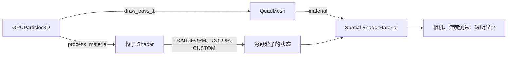

箭头标明资源引用与数据传递。Draw Pass 不是“再模拟一次”；它指定用什么网格表现同一份粒子状态。多个 Draw Pass 可以给同一颗粒子增加几何层，但也增加绘制工作，本课只用一个。

| 第五课的 2D 概念 | 本课 3D 对应 |
| --- | --- |
| GPUParticles2D 的纹理卡片 | GPUParticles3D 的 QuadMesh |
| canvas_item 绘制 Shader | spatial 绘制 Shader |
| fragment 写 COLOR | fragment 写 ALBEDO、EMISSION、ALPHA 等输出 |
| 画布前后顺序 | 相机空间深度、不透明深度测试、透明排序 |
| visibility_rect | visibility_aabb |
| 2D 中 +Y 向下 | 3D 场景中 +Y 向上，相机看向自己的 -Z |

在检查器展开 `Fixed → Draw Passes → Pass 1 → Material`，就能找到绘制材质；`Process Material` 是另一份资源。我们的材质直接放在网格上，没有额外设置 `material_override`。

两个发射器的 Mesh、ShaderMaterial 都独立，Shader 文件共用。如果你复制节点后修改绘制参数，先按第十课检查资源引用。材质独立不等于必须复制一份 Shader 源码。

## 3. 迁移外观进度，先核对协议（15 分钟）

第五课使用内置过程材质时，通常从 `INSTANCE_CUSTOM.y` 读取年龄。本课采用自己控制的模拟，沿用第八课协议，**年龄是 x**。不要只把 `shader_type canvas_item` 改成 `spatial`，然后照搬旧的通道索引。

| 通道 | 本课写入 | 谁使用 |
| --- | --- | --- |
| CUSTOM.x | 归一化年龄，出生清零，每步加 DELTA / LIFETIME | 模拟计算轨迹与淡出；绘制计算亮度脉动 |
| CUSTOM.y | 由 INDEX 得到的稳定相位 | 模拟计算初始角度与颜色 |
| CUSTOM.z | 0.65～1.25 的大小倍率 | 模拟写到 TRANSFORM 的三个轴 |
| CUSTOM.w | 固定为 0，表示圆点 | 保留协议；绘制端不读取它 |

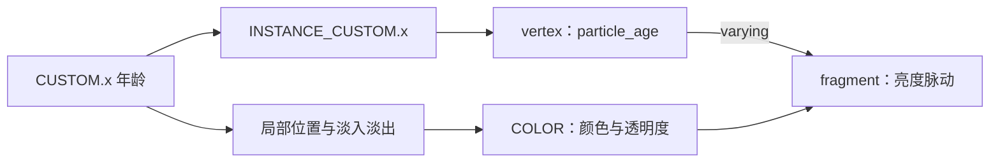

`dust_motion.gdshader` 沿着缓慢旋转的圆柱形分布上升：

```text
angle = TAU × phase + age × 1.4
x = spawn_offset_x + cos(angle) × radius
y = 0.3 + age × 2.6
z = sin(angle) × radius
```

radius 在 0.35～1.1 之间，单位为场景单位。位置由年龄直接计算，开启 `disable_velocity`，没有第二条 VELOCITY 积分路径。它是可控的漂浮轨迹，不是空气动力学模拟。

基线是每组 80 颗、寿命 4 秒、持续分批出生、局部坐标、60 Hz 模拟，无预热。固定 seed=137 便于保持配置一致，但本课分布实际依赖 INDEX，不读取 RANDOM_SEED，因此修改 seed 不会改变这些出生属性。

绘制阶段通过 `varying float particle_age` 把年龄传到片元，并使用 `COLOR` 保留粒子的颜色与淡出：

```glsl
vec4 tint = ignore_particle_color ? vec4(1.0) : COLOR;
ALBEDO = tint.rgb * 0.25;
EMISSION = tint.rgb * emission_energy * pulse;
ALPHA = tint.a * mask;
```

这里 `pulse = 0.75 + 0.25 * sin(age * TAU)`，是每颗粒子随自身年龄变化的亮度，不依赖全局 TIME。本课冻结模拟时，年龄不再变化，脉动也会停住。

实验：运行到有足够粒子后冻结，打开“丢弃粒子颜色”。颜色变白，接近出生和死亡的颗粒也变得突兀。修复不是重新做渐变，而是保留已有 COLOR 的 RGB 与 alpha。

## 4. Billboard 改的是朝向，不是模拟位置（25 分钟）

QuadMesh 默认位于 XY 平面，法线朝局部 +Z。从侧面看，面积接近零。设置 `cull_disabled` 只允许看见背面，**不能把侧面的薄片变厚，也不会让它转向相机**。

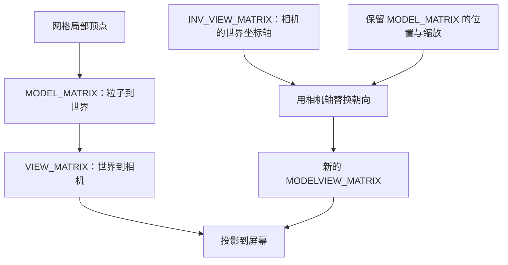

上半条是固定卡片的普通变换，下半条是本课的 Billboard 替换。完整实现见 `dust.gdshader`：

1. 用 MODEL_MATRIX 三个轴的长度取出缩放，避免所有粒子被强行变成相同大小。
2. 取 INV_VIEW_MATRIX 的右、上、后轴，作为卡片的世界朝向。
3. 保留 MODEL_MATRIX 的第四列，也就是每颗粒子的位置。
4. 用 VIEW_MATRIX 乘上新的矩阵，赋给 MODELVIEW_MATRIX。
5. 同步设置法线变换，避免几何朝向更新了，照明朝向却仍旧不变。

本课不修改投影矩阵，也不手写 POSITION。用 Shader 改朝向只影响绘制，不会让粒子的轨迹绕相机旋转。代码假设无镜像、无剪切变换；模拟只使用正的等比缩放。

节点的 `transform_align` 保持默认禁用，朝向只由绘制 Shader 处理。StandardMaterial3D 也提供 Billboard 设置，但自定义 ShaderMaterial 不会自动继承另一份 StandardMaterial3D 的选项。为了看到矩阵关系，本课把实现写出来。[Spatial Shader 的变换矩阵与内置变量](https://docs.godotengine.org/en/stable/tutorials/shaders/shader_reference/spatial_shader.html) · [BaseMaterial3D 的 Billboard 选项](https://docs.godotengine.org/en/stable/classes/class_basematerial3d.html)

实验步骤：

1. 正面等待约 3 秒，冻结粒子，打开“显示方卡”。
2. 滑动方位角，观察 A 越来越薄，B 保持方形。
3. 到 90°，A 接近细线；两组沿视线重叠是正常透视现象，不表示它们到了同一位置。
4. 到 180°，A 从背面又有面积，因为关闭了背面剔除。
5. 回正面并关闭方卡，确认模拟轨迹没有被相机操作改变。

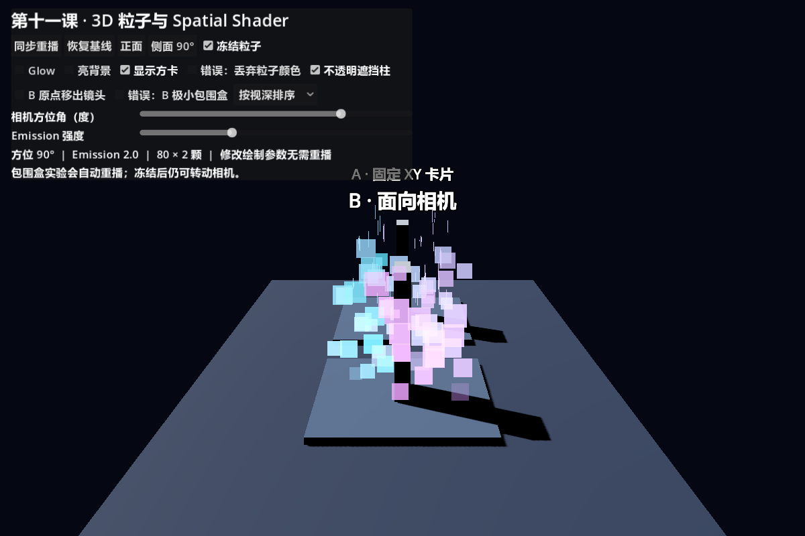

## 5. 自发光、灯光与辉光是三件事（20 分钟）

本课 Spatial Shader 没有使用 unshaded：ALBEDO 提供少量受光的表面颜色，ROUGHNESS=1；EMISSION 提供不依赖表面受光的亮度。提高 EMISSION 会使粒子变亮，但不自动把周围地面照亮。

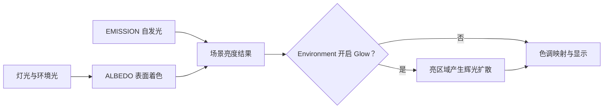

图是职责示意，不是渲染器所有内部通道的精确执行表。本课没有启用 GI，粒子也不是灯；要照亮邻近物体，需要另行设计灯光或合适的 GI 方案。

单变量比较：

1. 冻结粒子、保持暗背景和 Glow 关闭，把 Emission 从 2 调到 6，观察亮度和颜色趋向。
2. 固定 Emission=6，只打开 Glow。比较亮点周围有没有额外扩散。
3. 只关闭 Glow，光点仍然很亮；这说明 EMISSION 和 Glow 不是同一个开关。
4. 保持其他参数，切换亮背景。透明光点对比度降低，并不意味着 Shader 失效。

| Emission 6，Glow 关闭 | Emission 6，Glow 开启 |
| --- | --- |
| 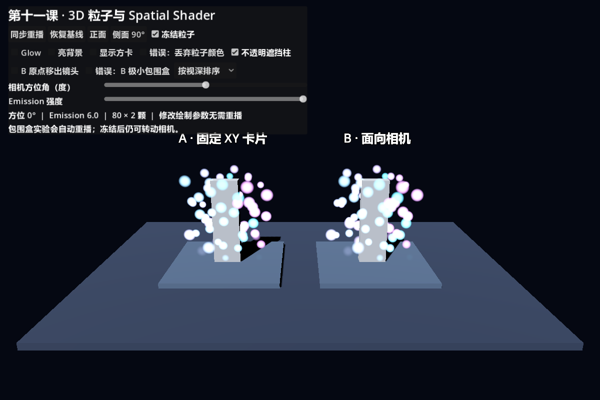 | 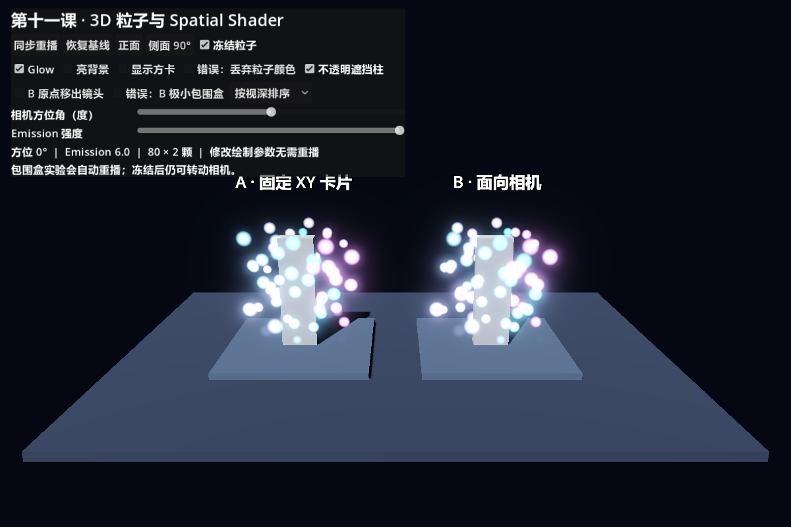 |

Glow 依赖 WorldEnvironment 和目标渲染器能力。本课以 Forward+ 实测；不把另一渲染器或环境参数下的结果当作相同。[环境与后处理中的 Glow](https://docs.godotengine.org/en/stable/tutorials/3d/environment_and_post_processing.html)

## 6. 不透明遮挡正确，不等于透明排序全部正确（20 分钟）

灰柱先建立不透明深度，粒子绘制时保留深度测试，因此后面的片元会被挡住。我们的 `depth_draw_never` 是“不写深度”，并不是“不进行深度测试”。不要用 `depth_test_disabled` 修复“被挡住”的粒子，那会造成穿墙。

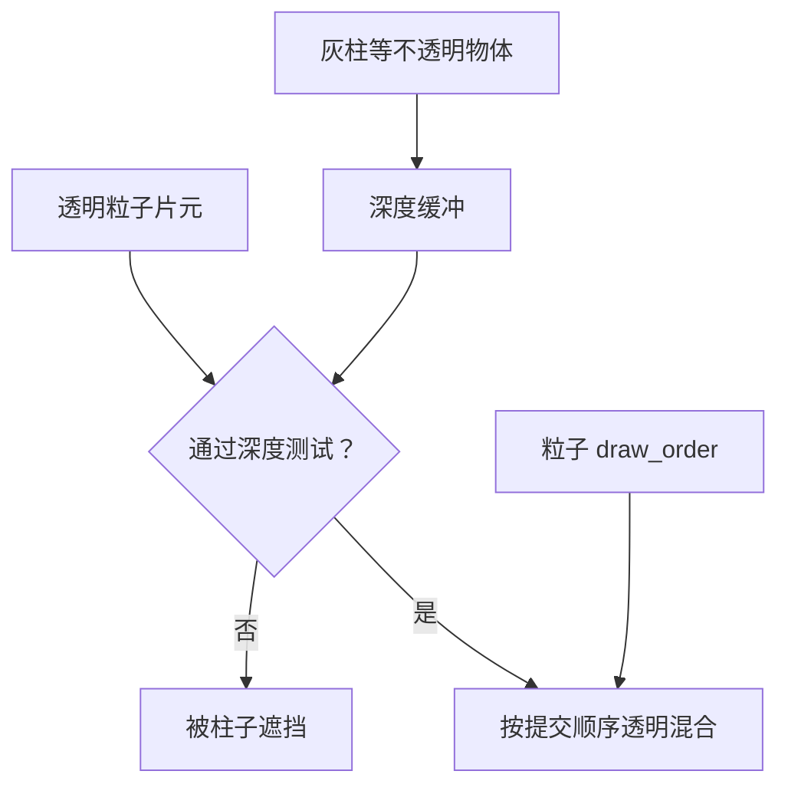

ALPHA 让材质进入透明路径。普通透明混合与顺序有关，两个不同颜色的半透明卡片，先画谁可能改变结果。本课默认 `DRAW_ORDER_VIEW_DEPTH`，相比按 INDEX 绘制，更符合相机深度上的前后关系。

但这个排序作用于一个粒子系统内部，不保证两个独立发射器、相交透明网格或复杂透明层得到完美的逐像素排序。相交面可能一半在前、一半在后，单一顺序无法完全解决。[3D 透明渲染限制](https://docs.godotengine.org/en/stable/tutorials/3d/3d_rendering_limitations.html)

实验：冻结、打开方卡、隐藏灰柱，先用按视深排序；再只改按索引排序。缓慢绕相机观察重叠区域的颜色。差异取决于此刻的重叠，不能要求每个角度都发生明显跳变。最后恢复灰柱，确认透明排序选项并没有让墙后的粒子穿出来。

这里还会有卡片与柱子交界处的硬切边，这是正常深度交线；“深度淡化的软粒子”是后续扩展，本课没有实现。粒子节点关闭了投射阴影，避免镜头相关卡片生成难以解释的影子；地面上的阴影来自灰柱等实体。

## 7. 可见包围盒描述的是整团效果（20 分钟）

发射器原点是一个点，粒子可以分布在很大范围。引擎需要一个包住效果的盒子，判断是否值得模拟和绘制。本课是发射器局部空间的 `visibility_aabb`，不是世界空间盒子，也不是给粒子设置的不可穿越边界。

基线 AABB 为位置 `(-1.5, 0, -1.5)`、尺寸 `(3, 3.3, 3)`。选择理由：轨迹水平半径最大 1.1，y 范围 0.3～2.9，还要留出 QuadMesh 半边和大小倍率形成的边缘余量。一次 capture_aabb 只观察当前粒子，不能证明整个生命周期与所有配置都被覆盖。

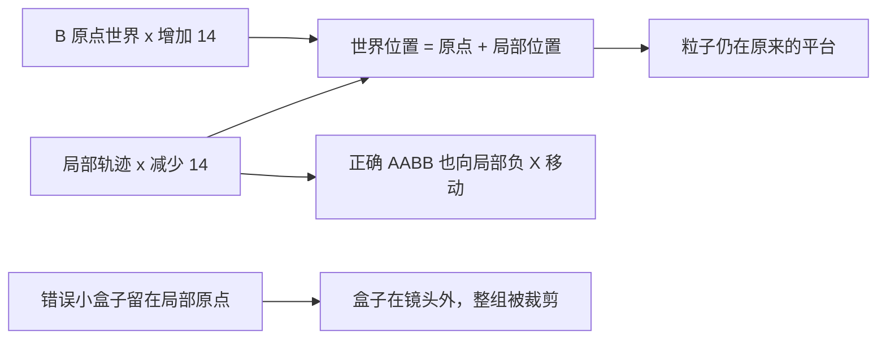

这个实验只在未旋转缩放的发射器上用加减抵消，不能直接推广成任意父变换公式。

操作：

1. 恢复基线，保持正面相机。
2. 勾选“B 原点移出镜头”，等待粒子重新出生。B 应仍在右平台，说明原点不必在镜头内。
3. 再勾选“B 极小包围盒”，B 整组消失；A 仍正常。
4. 只取消极小包围盒，等待重播，B 恢复。

| 正确包围盒 | 原点处的错误小盒子 |
| --- | --- |
| 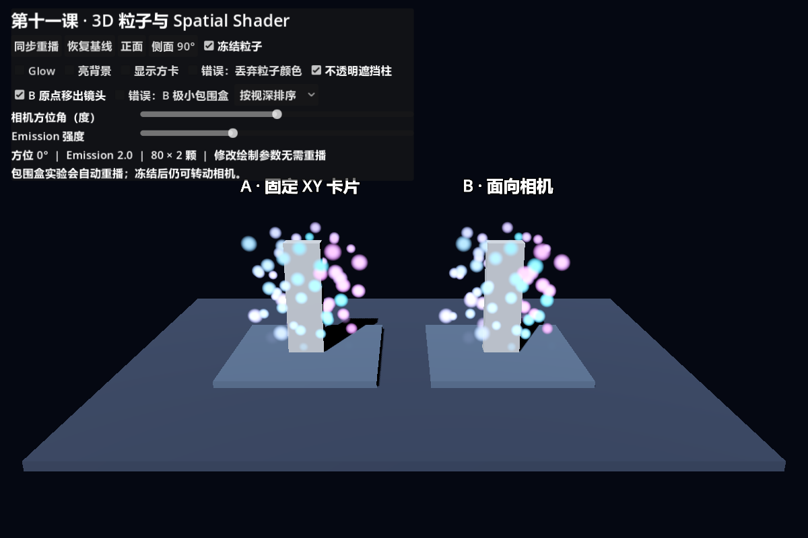 | 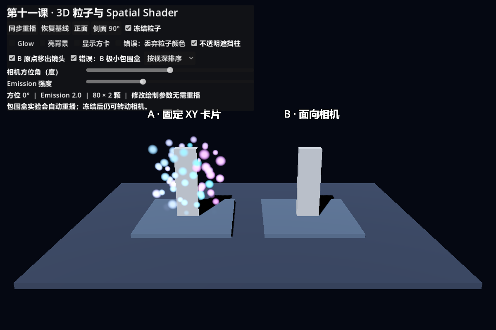 |

可见范围还会影响粒子系统是否保持活跃，所以恢复后本实验主动重播，不假设被裁剪期间时间始终继续推进。单独勾选极小包围盒、但原点仍在镜头内时，错误不一定明显，这正是需要移出原点的原因。

编辑器也提供生成 AABB 的工具；生成后仍要覆盖最大寿命、速度、尺寸以及后续参数变化。无限放大包围盒虽能掩盖裁剪，却失去有效裁剪收益。若设置了非默认 `custom_aabb`，还要检查它对 visibility_aabb 的覆盖关系。[GPUParticles3D 的可见范围、排序与 Draw Pass](https://docs.godotengine.org/en/stable/classes/class_gpuparticles3d.html)

## 8. 分步重建与独立变体

先不复制实验场 UI，按以下顺序建立自己的场景：

1. 创建 Node3D、Camera3D、DirectionalLight3D、地面和一个 GPUParticles3D。
2. 指定过程材质，再给 Draw Pass 1 添加 QuadMesh；先确认能画出方卡。
3. 添加 Spatial Shader，用 UV 距离构造软圆，正确接收 COLOR。
4. 添加年龄 varying，做一次自己的亮度变化；注明所用 CUSTOM 协议。
5. 实现或配置 Billboard，绕相机验证正面、侧面和背面。
6. 加入不透明柱子；再测透明卡片重叠，分清两个问题。
7. 计算或生成足够的 AABB，验证原点在镜头外时效果是否仍应显示。

独立变体任选一项：

- **萤火虫群**：保持有限的漂浮范围，让年龄亮度曲线更短促；不靠提高数量填满画面。
- **空间符文碎片**：改成程序圆环或菱形；明确选择固定朝向或 Billboard，并说明理由。
- **低亮度尘埃**：Emission 设为 0，调整 ALBEDO，再改变光源方向；比较受光表面和自发光粒子的区别。

如果使用 ParticleProcessMaterial 重建，必须改用它的数据约定；不要直接接入当前读取 x 年龄的绘制代码而不调整。你可以复用思想，但不能混接协议。

## 9. 排查、验收与自测

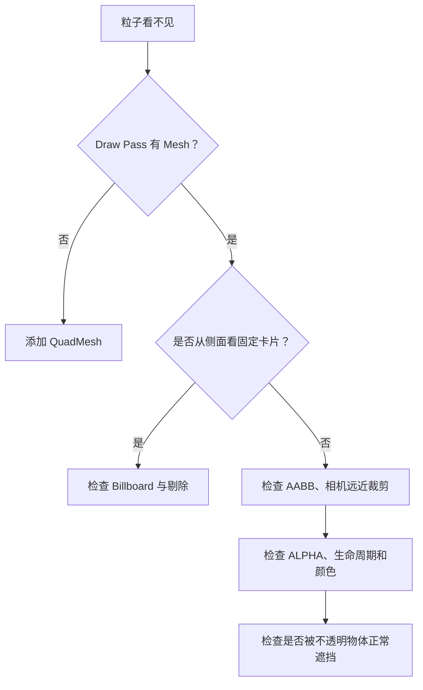

补充常见问题：

| 现象 | 检查方向 |
| --- | --- |
| 所有粒子朝向正确但大小一样 | 替换矩阵时是否丢弃了原来的缩放 |
| 颜色全白或死亡闪断 | 是否忽略了 COLOR 或用了错误年龄通道 |
| 发光但没有光晕 | WorldEnvironment 的 Glow、Emission 强度、色调映射 |
| 发光但地面没被照亮 | EMISSION 不是局部灯，本课也没有启用 GI |
| 透明交叠颜色异常 | 系统内 draw_order、多个透明对象的排序限制 |
| 发射器移出画面就整组消失 | AABB 是否包含局部轨迹和网格边缘 |

验收：

- [ ] 能指出模拟材质、Draw Pass 网格和绘制材质各在哪里。
- [ ] 正面、侧面、背面比较固定卡片与 Billboard，解释其差异。
- [ ] 粒子颜色和淡入淡出正确，冻结后年龄脉动也停止。
- [ ] 分别展示只有 Emission，以及相同 Emission 下的 Glow。
- [ ] 灰柱正确遮挡后方粒子；不使用禁用深度测试“修复”正常遮挡。
- [ ] 知道按视深排序的范围和限制。
- [ ] 复现并修复原点在画面外时的 AABB 错误。
- [ ] 在新场景独立完成一个变体，保存自己的实验记录。

自测及参考答案：

1. QuadMesh 粒子看起来是圆球，它真是球吗？**不是，几何仍是方卡，软圆来自片元遮罩。**
2. cull_disabled 能代替 Billboard 吗？**不能；它允许绘制背面，不改变平面朝向。**
3. 为什么这里年龄读 x，第五课却读 y？**过程材质的数据协议不同，绘制端必须与生产者一致。**
4. depth_draw_never 会让粒子穿墙吗？**不会，它关闭深度写入，深度测试仍保留。**
5. 按视深排序能解决所有透明交叉吗？**不能，尤其是不同系统和相交透明面。**
6. AABB 越大越好吗？**应覆盖可能范围及网格余量；过大会减少有效裁剪。**

下一课仍是 3D 选修，将继续学习拖尾、湍流、粒子碰撞与子发射器。本课的灰柱仅用于绘制遮挡，不是下一课的粒子碰撞体。
