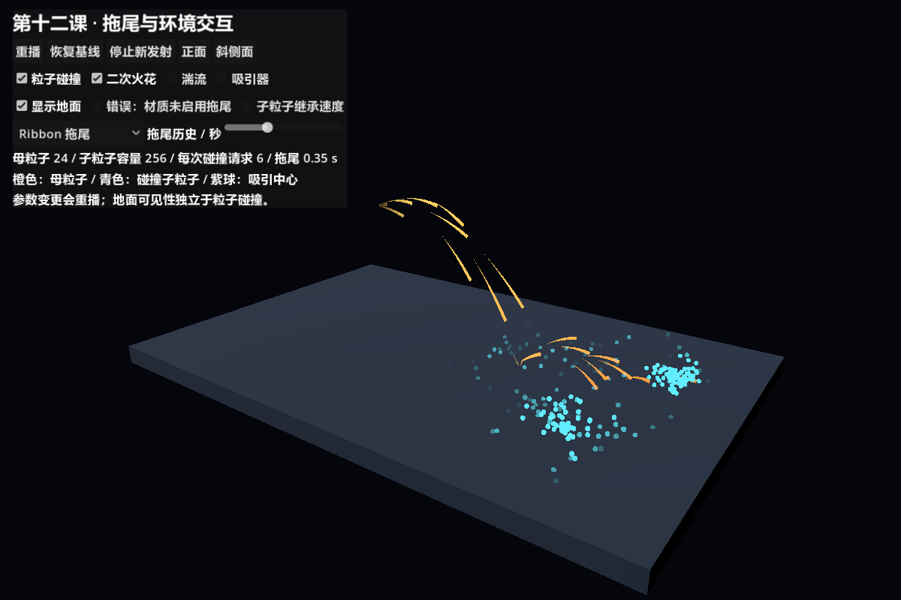
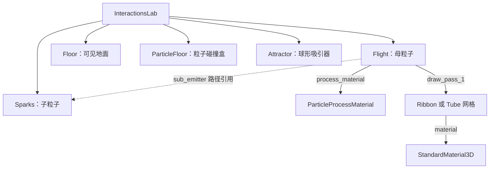
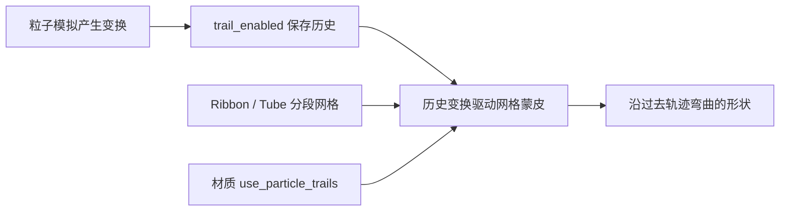
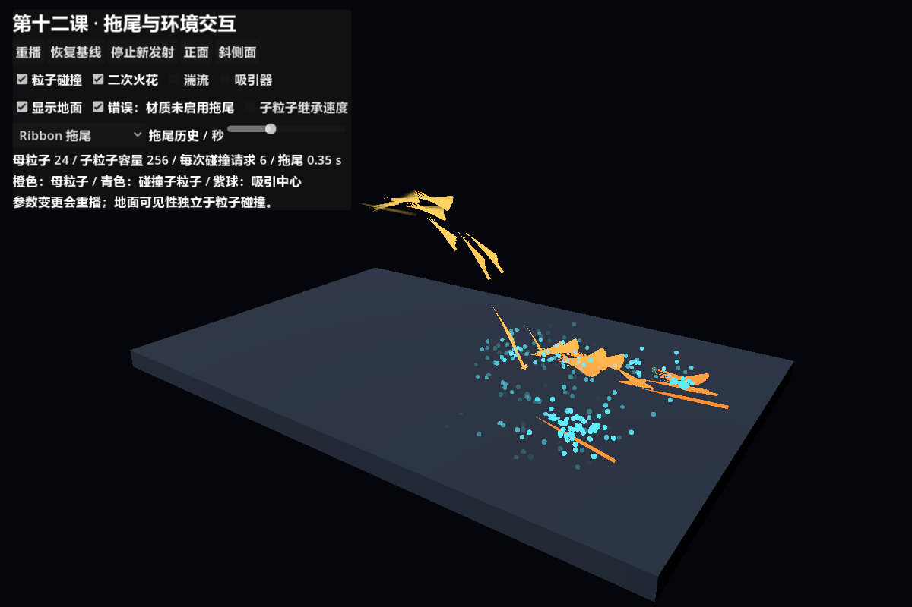
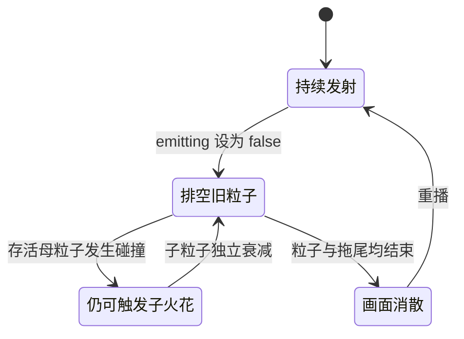
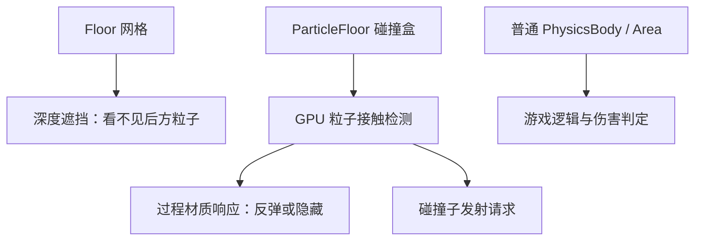
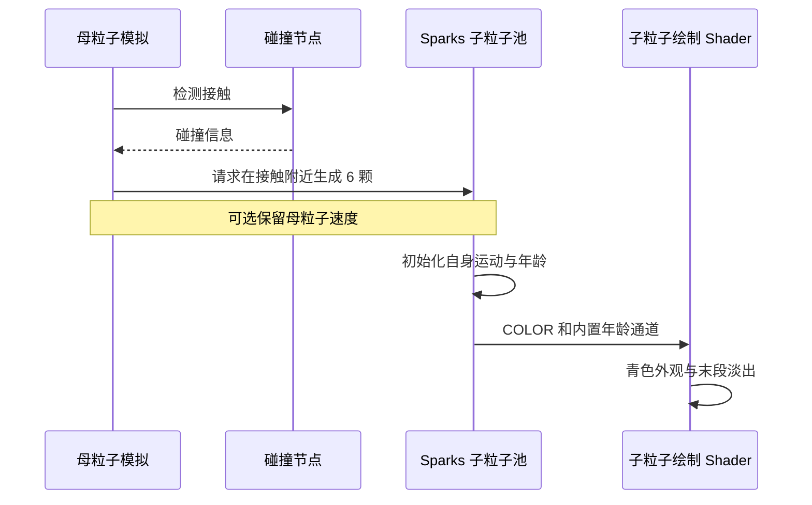
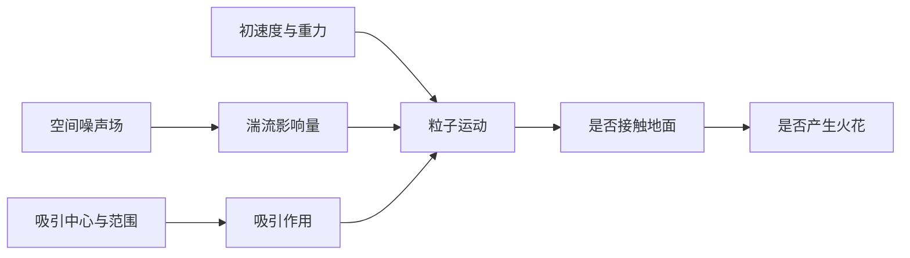
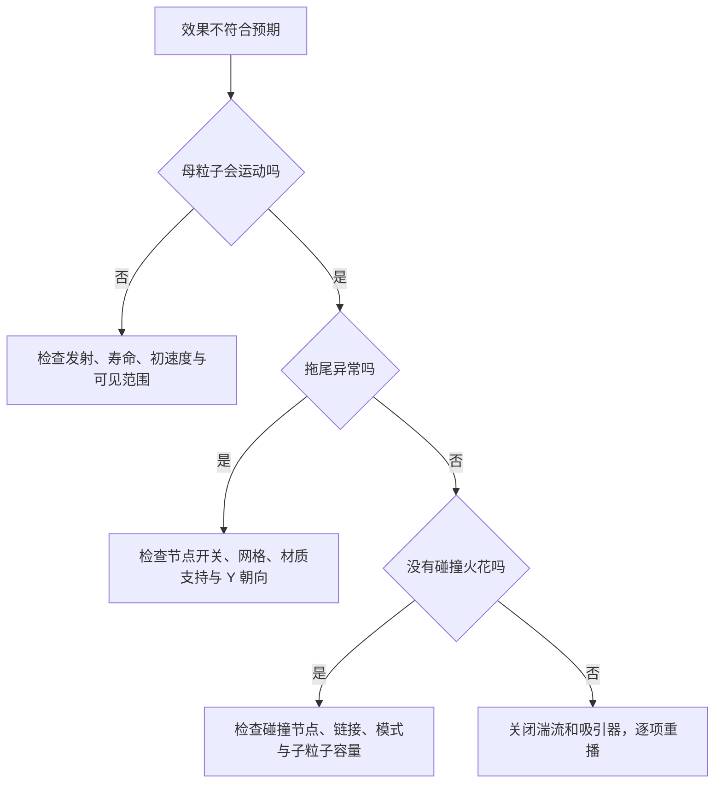

# 第十二课：拖尾、湍流、碰撞与子发射器

[返回大纲](../../README.md) · [第十一课](../11_spatial/README.md) · [实验记录](WORKSHEET.md) · [验证范围](VALIDATION.md)

建议用时：3 小时，可拆成两次。先修：第二课的生命周期，第七课的模拟分工，第八课的数据协议，第十一课的 3D 网格、深度与包围盒。

本课目标：**制作带拖尾的飞行火星，在地面发生碰撞并生成二次火花，能够逐项关闭功能解释因果。** 前半课解决“运动如何留下形状”，后半课解决“一个粒子的事件如何触发另一组粒子”。

## 1. 运行入口与本机适配（10 分钟）

打开本目录的 `interactions_lab.tscn`，按 **F6**，建议窗口 1200 × 800。等待约 3 秒：橙色轨迹从左上方飞出、下落、反弹，青色小球在接触区域产生并淡出。



**本机的完整实验使用 Forward+ / Vulkan。** Godot 4.7.1、RTX 5060 Ti、D3D12 初次验证在启用湍流后发生设备丢失。原因尚未定位，不能据此断言所有 D3D12 设备都不支持湍流。本课脚本在 D3D12 下禁用湍流按钮；其余实验仍可通过 F6 学习。项目全局设置保持原状。

要完成湍流实验，在项目根目录的 PowerShell 执行：

```powershell
& .\tutorial\lessons\12_interactions\run_vulkan.ps1
```

启动脚本只为这一次运行指定 Vulkan。默认使用已验证的本机 Godot 路径；换电脑后用 `-GodotPath '你的 Godot 可执行文件路径'` 指定。若系统不允许运行 PowerShell 脚本，可直接执行相同命令：

```powershell
& 'G:\GodotEditor\Godot_v4.7.1-stable_win64.exe\Godot_v4.7.1-stable_win64.exe' --path 'E:\GodotProject\partical-gl' --rendering-driver vulkan --resolution 1200x800 res://tutorial/lessons/12_interactions/interactions_lab.tscn
```

拖尾需要 Forward+ 或 Mobile；本课未验证 Mobile，不能切换到 Compatibility 后仍期待相同结果。[官方拖尾说明](https://docs.godotengine.org/en/stable/tutorials/3d/particles/trails.html)

| 控件 | 修改对象与作用 |
| --- | --- |
| 重播 / 恢复基线 | 清除旧子粒子再重播母粒子；恢复还重设实验选项和相机 |
| 停止新发射 | 仅将 Flight.emitting 设为 false；等待已有粒子与拖尾结束 |
| 正面 / 斜侧面 | 只移动相机，不重播 |
| 粒子碰撞 | 同时开关 ParticleFloor 节点与母过程材质的碰撞响应 |
| 二次火花 | 改母过程材质 sub_emitter_mode，保持节点链接 |
| 湍流 | 改母过程材质 turbulence_enabled；D3D12 下禁用入口 |
| 吸引器 | 吸引强度在 0 和 8 之间切换；紫球只标记中心 |
| 显示地面 | 只控制 Floor 网格可见性，不改变碰撞节点 |
| 错误：材质未启用拖尾 | 关闭绘制材质 use_particle_trails |
| 子粒子继承速度 | 开关母材质 sub_emitter_keep_velocity |
| Ribbon / Tube / 圆点 | 换母粒子的网格；圆点模式同时关闭拖尾 |
| 拖尾历史 | 改 GPUParticles3D.trail_lifetime，范围 0.1～0.8 秒 |

除相机、停止按钮外，实验选项变化都自动重播。每次比较都等待相近时间，不拿刚出生的状态和填满后的状态比较。

## 2. 先拆解节点与资源（15 分钟）

场景已经保存母/子过程材质、Ribbon 网格和地面碰撞节点，可直接在检查器检查。Tube 和圆点对照网格由 `_prepare_meshes()` 创建；运行中切换场景树到“远程”可检查它们。



实线是节点或资源关系，虚线是子发射器引用。**“子发射器”不要求是母节点的场景树子节点。** 本场景两个粒子节点是兄弟，Flight 使用 `../Sparks` 指向目标。

本课主动使用内置 `ParticleProcessMaterial` 处理拖尾相关状态、湍流和碰撞。第七课证明你能写模拟，第十二课练习的是选择合适的内置能力并正确组合它们。直接把第十一课的过程 Shader 替换进来，并不会自动拥有这套碰撞与子发射逻辑。

## 3. 基线参数：先知道比较的是什么

| 对象 | 参数 | 基线及理由 |
| --- | --- | --- |
| 母节点 Flight | amount / lifetime | 24 / 3.5 s；数量少，方便观察独立轨迹 |
| 母节点 | position | (-2, 3, 0)，地面上方 3 个世界单位 |
| 母过程材质 | direction / speed | (1, 0.3, 0) / 3～3.6 单位每秒 |
| 母过程材质 | spread / gravity | 18° / (0, -5, 0) 单位每平方秒 |
| 两个粒子节点 | local_coords / fixed_fps | false / 60；世界空间模拟，固定模拟步长 |
| 母节点 | trail_lifetime | 0.35 s，便于辨认轨迹又不铺满画面 |
| Ribbon 网格 | size / sections | 0.075 / 12；窄条与适中的弯曲分段 |
| Ribbon 网格 | section_length / section_segments | 0.08 / 3；静态网格分段与轮廓细分 |
| 母节点 | transform_align | Y to Velocity，Tube 也沿速度朝向 |
| 母过程材质 | collision_mode / bounce / friction | Rigid / 0.35 / 0.25；保留可见反弹 |
| 碰撞盒与地面网格 | size / position | (12, 0.4, 8) / (0, -0.2, 0)，上表面都在 Y=0 |
| 母节点 | collision_base_size | 0.06；是碰撞近似尺寸，不是整条拖尾的碰撞形状 |
| 母过程材质 | sub_emitter_amount_at_collision | 6；每次碰撞请求 6 颗子粒子 |
| 子节点 Sparks | amount / lifetime | 256 / 0.7 s；容量与短寿命控制重叠 |
| 子过程材质 | direction / speed / spread | 向上 / 1.8～3 / 65°；明确区别于飞行方向 |
| 湍流 | influence / scale / strength | 0.02 / 3 / 2；默认关闭，开启时先从小影响量观察 |
| 湍流 | noise_speed / speed_random | 均为 0；固定噪声场，减少对照变量 |

两组都使用固定种子 137，`restart(true)` 保留种子。截图按实时时间等待，不是逐帧对齐的科学对照；固定种子也不保证跨后端、硬件逐像素一致。

母粒子颜色与透明度由 `color_ramp` 提供；StandardMaterial3D 开启 `vertex_color_use_as_albedo` 和透明混合接收它。这里使用无光照材质便于看清颜色，没有叠加 Glow。

## 4. 拖尾是历史变换驱动的网格（30 分钟）

先预测：如果只是把一个细长网格放到粒子当前位置，它会记录弯曲轨迹吗？



三个配置要配套：节点开启拖尾、Draw Pass 使用适合的分段网格、绘制材质启用粒子拖尾支持。只把网格拉长，得到的是当前朝向的一段几何体，无法表达过去怎样转弯。

本课两个拖尾网格有意共用一份绘制材质，让错误开关对两者一致；圆点材质单独复制并关闭拖尾支持。不是所有共享都是错误，关键是共享范围符合意图。

### 实验 A：从圆点恢复历史

1. 恢复基线，关闭“二次火花”，减少干扰。
2. 选“圆点”，观察母粒子的抛物线运动。
3. 改成 Ribbon，保持相机、种子与运动参数不变。
4. 比较历史 0.1 s 和 0.8 s。预测速度大的位置，哪一种更容易铺满画面？
5. 改成 Tube，切换正面与斜侧面。本课 Ribbon 用默认 Cross 交叉条带；Tube 是有径向面的管状网格，不等于画了一张更宽的卡片。

匀速且近似直线时，空间拖尾长度可粗略理解为 `速度 × 历史时长`。速度为 3 单位每秒、历史为 0.35 秒时约为 1.05 单位。弯曲、反弹、出生不足 0.35 秒时不能套成一条固定长度直线。

不要把 `trail_lifetime` 和网格 `section_length` 混为一谈：前者是秒，后者是网格几何长度。网格的 Curve 从头部 1 到尾部 0 控制收尖；它不是整颗粒子的年龄曲线。增加 Sections 改善轨迹分段，细分参数改善轮廓表达，同时增加几何成本。[Ribbon/Tube 参数说明](https://docs.godotengine.org/en/stable/tutorials/3d/particles/trails.html)

### 实验 B：制造配置不完整

在 Ribbon 模式开启“错误：材质未启用拖尾”。观察条带展开、朝向或轮廓异常，再关闭开关修复。不要用增大粒子数量掩盖此问题。



最后点击“停止新发射”：旧粒子仍运动，颜色随年龄衰减，历史拖尾随后消失。基线等待 5 秒应看不到活动效果。这不是把整个节点立刻隐藏，也不是把 `speed_scale` 设成 0。



这是效果层面的状态图，不表示引擎提供了同名信号。正式封装时要把母、子粒子和历史拖尾都纳入结束条件，不能仅以停止发射作为回收时机。

## 5. 可见地面、碰撞检测、碰撞响应（25 分钟）



图中三条链路彼此不同：网格可以挡住粒子却不改变它的运动；粒子碰撞盒可以不可见但仍让火星反弹；GPU 视觉碰撞不会自动成为游戏伤害事件。

### 实验 C：做一张二维对照表

恢复基线后依次测试以下状态，每次重播等待约 3 秒：

| 显示地面 | 粒子碰撞 | 需要观察的证据 |
| --- | --- | --- |
| 开 | 开 | 接触附近反弹并产生青色子粒子 |
| 关 | 开 | 没有可见地板，仍在原平面附近反弹 |
| 开 | 关 | 粒子可能被地面遮挡，不能仅凭“消失”判断发生碰撞 |
| 关 | 关 | 轨迹穿过原地面高度继续向下，没有新的碰撞火花 |

代码同时控制检测节点和母粒子响应：

```gdscript
$ParticleFloor.visible = _enabled("collision")
motion.collision_mode = ParticleProcessMaterial.COLLISION_RIGID if _enabled("collision") else ParticleProcessMaterial.COLLISION_DISABLED
```

最初验证中，只把母材质响应关掉，母粒子虽穿过地面，仍生成了碰撞火花。因此本课“关闭碰撞”也隐藏碰撞节点，停用接触检测。这是有运行证据的诊断结论，不把“无反弹”等同于“没有事件”。粒子碰撞节点支持通过隐藏临时停用。[GPUParticlesCollision3D](https://docs.godotengine.org/en/stable/classes/class_gpuparticlescollision3d.html)

地面盒顶面要对齐可见网格。修改盒子尺寸用 `size`；本课不使用非均匀节点缩放。粒子采用近似碰撞，不会让拖尾每个三角形都参与精确接触；高速运动也可能穿透，必要时检查模拟频率、速度与碰撞盒厚度。[碰撞盒 API](https://docs.godotengine.org/en/stable/classes/class_gpuparticlescollisionbox3d.html)

## 6. 子发射器传递事件与初始状态（30 分钟）



节点链接回答“发给谁”，母过程材质的 `sub_emitter_mode` 回答“何时发”。少任何一项都不构成完整子发射。

### 实验 D：确认子粒子来自事件

1. 恢复基线，关闭“二次火花”：橙色轨迹仍反弹，青色小球消失。
2. 重新打开：青色小球在接触区域生成，而不是从 Sparks 的节点原点持续喷出。
3. 保持碰撞开启，切换“子粒子继承速度”。比较火花向上扩散与沿母运动偏移的区别。继承的是触发时的速度，不能简单假定为最初发射方向或碰撞前速度。
4. 在检查器阅读两个过程材质：母的重力、子自己的方向与寿命是不同职责。

本例父子都采用世界空间、根节点无旋转缩放，方便理解事件位置。改变父子变换或改成局部模拟后，先验证生成位置与方向，不能把已有坐标假设直接照搬。

Sparks 被链接为子发射器后不再自行按普通发射周期出生。重播会先清除旧子粒子，再重播母粒子；代码没有用 GDScript 循环模拟每次碰撞，也没有把 `emitting=true` 当作碰撞事件。

**容量和单次数量是两回事。** `sub_emitter_amount_at_collision=6` 是每次请求数量，`Sparks.amount=256` 是活跃粒子容量。母粒子使用 Rigid，可以反复接触；一次出生不保证只生成一次火花。容量不足时请求可能无法全部满足。[官方子发射器说明](https://docs.godotengine.org/en/stable/tutorials/3d/particles/subemitters.html)

粗略预算可从 `每秒事件数 × 每次数量 × 子寿命` 开始，但还要给集中碰撞留余量。不要用 `母粒子 amount × 6` 就宣称覆盖所有情况。本课没有给出 GPU 事件计数器，也没有保证 256 永远不会满。

### 回到 GDShader：年龄协议不能串用

`spark.gdshader` 读取的是**内置过程材质**的 `INSTANCE_CUSTOM.y`，子材质 `lifetime_randomness=0`。第八、十一课自定义协议使用 x 存年龄，本课没有引用那个协议。

```glsl
varying float age;

void vertex() {
	age = INSTANCE_CUSTOM.y;
}

void fragment() {
	ALBEDO = vec3(0.12, 0.85, 1.0) * COLOR.rgb;
	ALPHA = COLOR.a * (1.0 - smoothstep(0.35, 1.0, age));
}
```

前 35% 寿命保持亮度，之后淡出；子材质颜色默认白色，青色来自绘制 Shader。这里使用小 SphereMesh，自带体积，不需要再做 Billboard。透明度变为零仍不等于回收粒子槽位，槽位生命周期由模拟管理。

## 7. 湍流与吸引器：先分别加入（25 分钟）

先通过 Vulkan 启动本课。恢复基线，再单独打开湍流。先看空中轨迹变化，后看接触时间变化；如果没有到达地面，火花减少可能是轨迹改变的结果。



这是因果依赖图，不代表引擎内部每条计算的执行顺序。湍流不是把第四课的可见噪声贴到粒子表面，而是扰动运动。吸引器也不是每帧把粒子坐标直接设置到目标上。

### 实验 E：区分三个噪声参数

成品只暴露启用开关；以下在场景副本的母过程材质里修改，或运行时通过远程检查器修改后按重播：

| 一次只改一个 | 先做的预测 |
| --- | --- |
| Influence Min/Max 从 0.02 同时改成 0.08 | 运动偏离基线会更明显吗？落地时间还相同吗？ |
| 恢复 Influence，再改变 Noise Scale | 转弯的空间尺度是否改变？不要将其当成粒子速度 |
| 恢复 Scale，将 Noise Speed 从 0 改成 (0.3, 0, 0) | 流场移动后，同一位置不同时间的运动是否仍相同？ |

Noise Strength 调整流场特征，Influence 调整粒子受其影响的程度；两者不要一起改。本课将噪声平移速度与随机变化速度均设为 0，以减少随时间变化的因素。初始位移保持 0，避免同时改变出生位置。湍流仍需要已有运动来源，本例有初速度与重力。[官方湍流说明](https://docs.godotengine.org/en/stable/tutorials/3d/particles/turbulence.html)

### 实验 F：吸引中心与影响范围

关闭湍流，打开吸引器。紫球标记 `(0, 2, -1.5)` 的中心，**不是半径 4 的影响范围**。观察橙色轨迹向该区域偏转；子材质关闭 `attractor_interaction_enabled`，所以青色小球不会直接受这个吸引器影响。

吸引器以 `strength=0` 停用。`directionality=0` 表示朝中心作用；未来做定向风时再研究方向性。若只想影响指定系统，应配合吸引器 `cull_mask` 与粒子的可见层；这不同于普通物理碰撞层。[吸引器 API](https://docs.godotengine.org/en/stable/classes/class_gpuparticlesattractor3d.html)

最后才同时开启湍流和吸引器。出现问题时按相反次序关闭，恢复单因素对照。

## 8. 排查路径



| 现象 | 优先检查 |
| --- | --- |
| 地面存在却直接穿过 | 地面网格不是碰撞体；检查 ParticleFloor 和过程材质 |
| 母粒子反弹但没有子粒子 | 子发射链接、At Collision、子网格材质、容量与包围盒 |
| 子粒子在奇怪位置出现 | 父子空间约定、变换、错误路径及陈旧状态 |
| Tube 扁掉或拐弯异常 | Y to Velocity、分段与材质拖尾支持 |
| 停止后立即截断 | 是否直接隐藏、释放或停模拟；区分排空和重播 |
| 新火花数量忽多忽少 | 反复碰撞、子容量、可见性与淡出；先关复杂运动 |
| 切换湍流后窗口异常 | 阅读本机后端限制，通过 Vulkan 运行，不继续堆叠参数 |

可见包围盒刻意留有余量，适合本课范围。扩大速度、吸引范围或湍流强度后需要重检；子节点在原点也不表示子粒子只会出现在原点附近。

## 9. 独立练习与验收（30 分钟以上）

复制到自己的练习目录，不覆盖本课成品。从以下方向选一个：

1. **落地碎裂**：母粒子改为 Hide On Contact，落地后主要保留二次火花。验证实际接触次数与残余拖尾，不能未经检查就断言一次命中只触发一次。
2. **冰晶反弹**：保留 Rigid，缩短拖尾，调整颜色、反弹系数与子寿命，让轨迹清脆而不是铺满地面。
3. **被吸引的流星**：用吸引器改变着地点，先关闭湍流建立可解释的轨迹，再小幅加入扰动。

进一步挑战：若需求严格要求“每颗只触发一次”，参考第七课与粒子 Shader 的 `COLLIDED`、`emit_subparticle()`，设计显式触发标记和状态协议。这是独立扩展，本课成品没有实现一次命中锁，也没有把自定义数据强塞进内置材质通道。

完成后检查：

- [ ] 能从圆点恢复 Ribbon 与 Tube，并指出三处必要配置。
- [ ] 能解释历史秒数、几何分段和年龄曲线的区别。
- [ ] 能用地面可见性与碰撞开关证明遮挡不等于碰撞。
- [ ] 关闭二次火花后，母粒子仍保持原来的碰撞响应。
- [ ] 能指出子发射链接、触发模式、单次数量、容量分别在哪里。
- [ ] 能解释本课为什么读 INSTANCE_CUSTOM.y，而不是 x。
- [ ] 能单独演示湍流与吸引器，并解释对子发射的间接影响。
- [ ] 停止新发射后等待自然消散，重播不残留旧子粒子。
- [ ] 独立做出一个变体，并填写实验记录。

## 10. 自测与参考答案

1. **为什么拉长 Quad 不等于拖尾？** 它只表达当前变换，没有历史轨迹驱动的分段蒙皮。
2. **地面隐藏为什么还能反弹？** 可见网格和粒子碰撞盒是两个节点。
3. **Sparks.emitting 关闭为什么还有火花？** 它接收的是母粒子的子发射请求，不能用普通持续发射状态判断。
4. **母粒子 24、每次 6，容量设成 144 就够吗？** 不能保证；需要考虑重叠寿命、反复接触与集中事件。
5. **湍流打开后火花减少一定是子发射坏了吗？** 不是；先检查母粒子是否还在相同时间到达碰撞面。
6. **停止发射能马上释放整个场景吗？** 若要自然结束，应等待已有母/子粒子及拖尾排空。
7. **这个效果能直接判定敌人受伤吗？** 不能；游戏命中逻辑需要独立可靠的物理查询或玩法判定。

## 11. 资料与下一课

- [ParticleProcessMaterial](https://docs.godotengine.org/en/stable/classes/class_particleprocessmaterial.html)：按碰撞、子发射、湍流属性查阅。
- [GPUParticles3D](https://docs.godotengine.org/en/stable/classes/class_gpuparticles3d.html)：拖尾、子发射链接与模拟配置。
- [Particle shaders](https://docs.godotengine.org/en/stable/tutorials/shaders/shader_reference/particle_shader.html)：自定义碰撞和子发射扩展入口。

第十三课将测量数量、几何分段、屏幕覆盖面积、湍流与碰撞的成本。保留本课基线，作为之后“先测量再优化”的对照对象。
