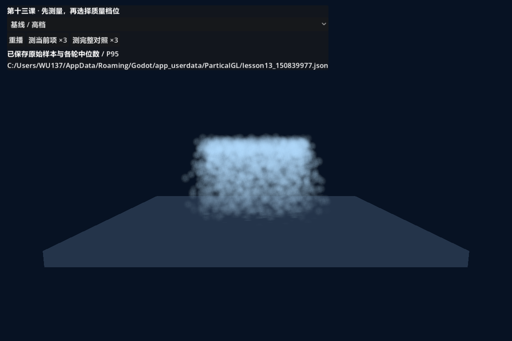
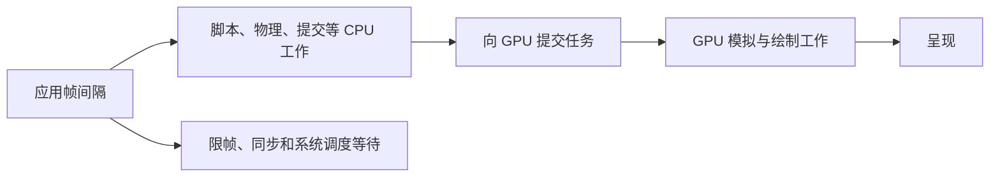
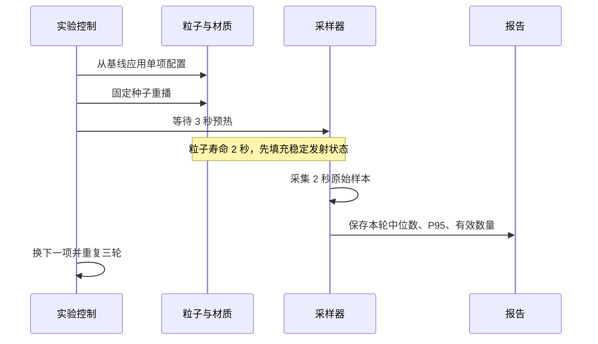
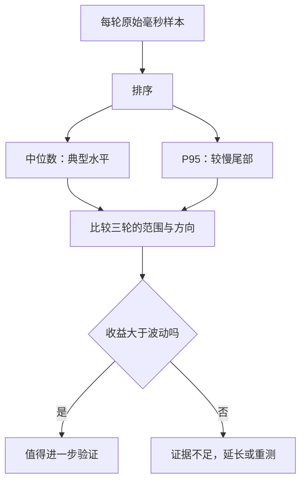
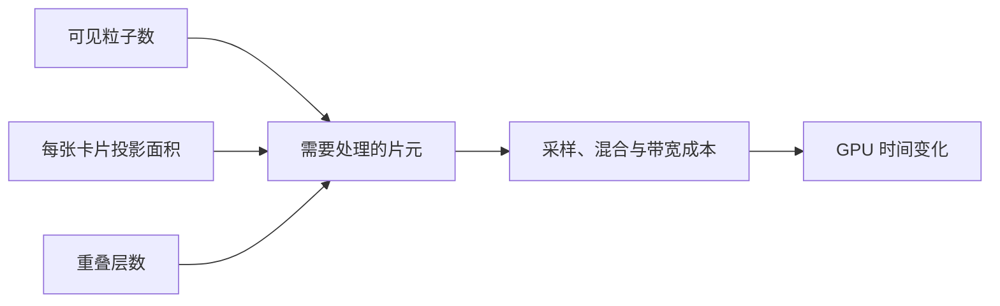
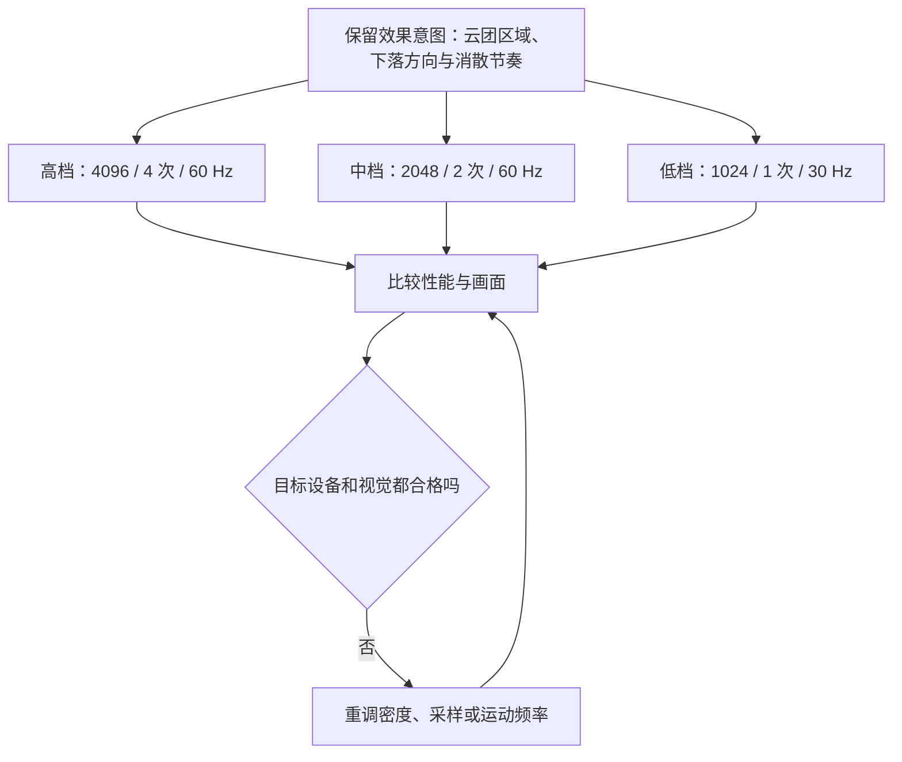
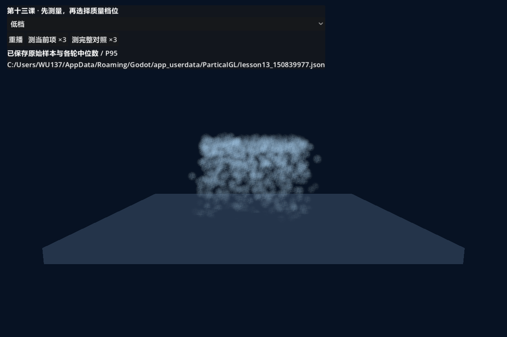
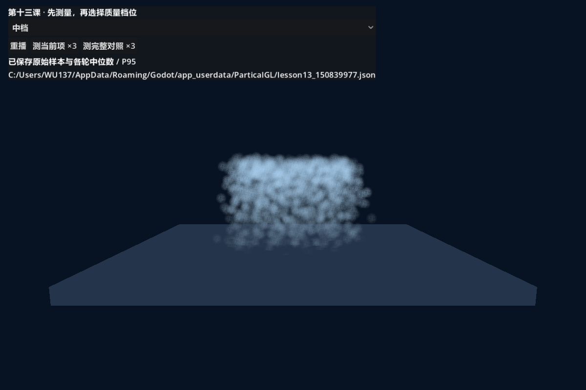
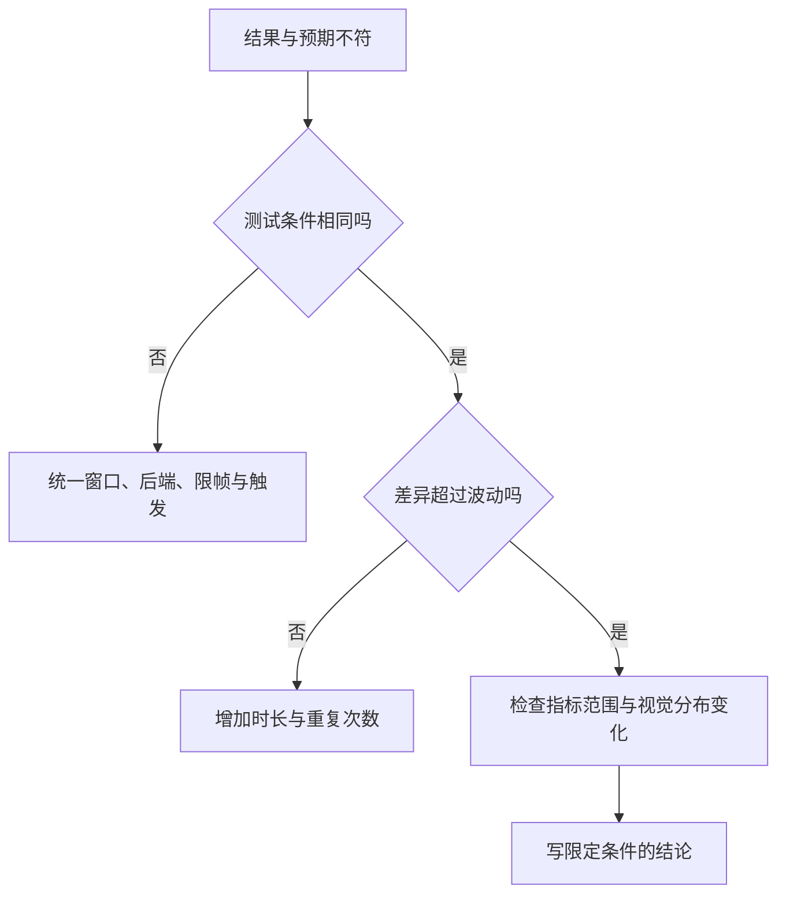

# 第十三课：用测量决定优化方向

[返回大纲](../../README.md) · [第十二课](../12_interactions/README.md) · [实验记录](WORKSHEET.md) · [验证记录](VALIDATION.md)

本机的完整三轮结果见 [实测分析](MEASUREMENTS.md)，原始数据见 [benchmark-example.json](benchmark-example.json)。它们是特定环境的示例，不是各设备的性能保证。

建议用时：2～3 小时。先修：第四课纹理采样、第五课透明混合、第六课屏幕采样、第十一课 3D 绘制；湍流与碰撞部分接续第十二课。只做 2D 的读者也可以学习测量方法，把模拟功能扩展作为选做。

本课的成果是**一份有条件、有对照、有局限的性能判断，以及能解释取舍的低、中、高质量档位**。不是记忆“粒子不能超过多少颗”。同样数量的粒子，其覆盖面积、材质和目标硬件不同，成本就会不同。

## 1. 运行实验（10 分钟）

打开 `performance_lab.tscn`，按 F6。场景中是一团下落的蓝色粒子云。下拉框切换对照项，按钮重播或开始测量。节点和资源由 `_build_world()` 创建，可在运行后的“远程”场景树检查 `MeasuredParticles`。



本课不改主场景和全局渲染配置。运行期间会关闭该窗口的 VSync，并将 `Engine.max_fps` 设为 240；退出场景时恢复原值。它是有明确上限的教学测试，不是完全不限帧的极限测试。

**完整实验建议使用 Vulkan：** 第十二课在本机 D3D12 湍流路径发现设备错误，本课延续限制，D3D12 自动跳过湍流项。项目根目录 PowerShell 中执行：

```powershell
& .\tutorial\lessons\13_performance\run_vulkan.ps1
```

手动点“测完整对照 ×3”，约需 150 秒。也可自动测量、截图并退出：

```powershell
& .\tutorial\lessons\13_performance\run_vulkan.ps1 -Benchmark
```

脚本默认使用本机 Godot 路径；其他电脑传 `-GodotPath '你的 Godot 路径'`。如系统不允许 PowerShell 脚本，可直接启动：

```powershell
& 'G:\GodotEditor\Godot_v4.7.1-stable_win64.exe\Godot_v4.7.1-stable_win64.exe' --path 'E:\GodotProject\partical-gl' --rendering-driver vulkan --resolution 1200x800 res://tutorial/lessons/13_performance/performance_lab.tscn
```

固定窗口大小、可见状态和相机，不拖动窗口、不切换后台应用、不同时运行其他 GPU 测试。外部程序、温度和功耗仍可能影响结果，这些不是脚本能完全隔离的因素。

| 操作 | 行为 |
| --- | --- |
| 下拉选择 | 从基线重新应用配置并重播，防止继承上一项参数 |
| 重播 | 保持选项、固定种子 137 重新开始 |
| 测当前项 ×3 | 三轮独立重播、预热和采样 |
| 测完整对照 ×3 | 每项测三轮，中间一轮反转顺序 |
| 测量期间 | 锁定控件；采样结束检查视口尺寸，变化则中止完整对照 |
| 测量完成 | 保存 JSON 原始样本和摘要，界面与日志显示绝对路径 |

报告默认写入 `user://lesson13_*.json`。在 Godot 中可通过“项目 → 打开用户数据文件夹”查找，或复制界面路径。每次运行使用当前运行计时构造文件名；它不是跨进程全局唯一编号，长期归档时请另存有日期和条件的文件名。

## 2. 三种时间，不要混成一个数字（20 分钟）



这张图说明责任关系，不表示所有阶段串行。CPU 与 GPU 可以并行，不能把两者时间简单相加当成帧间隔。

| 报告字段 | 采集方式 | 不能据此声称什么 |
| --- | --- | --- |
| wall | 相邻 `process_frame` 之间的单调时钟差，单位毫秒 | 不是纯 CPU 执行时间，也不是显示器呈现延迟 |
| viewport_cpu | RenderingServer 的当前视口渲染 CPU 耗时 | 不含全部脚本、物理等 CPU 子系统 |
| viewport_gpu | RenderingServer 的当前视口 GPU 渲染计时 | 不能当成“粒子模拟独占耗时”或整个进程所有 GPU 工作 |

通过 `viewport_set_measure_render_time()` 开启测量。数值为零、非有限或不可用的样本不会记成有效耗时；完全没有有效样本时摘要为 `null`，同时记录 `valid_n=0`。GPU 查询可能延迟，采样值不保证与同一行的帧间隔一一对应。[RenderingServer 计时 API](https://docs.godotengine.org/en/stable/classes/class_renderingserver.html#class-renderingserver-method-viewport-get-measured-render-time-gpu)

本课主视口还绘制地面和 UI。全局粒子计算、驱动等待等成本未必都被视口计时区间涵盖；判断模拟瓶颈时，还要用 Godot 的 Visual Profiler 或 GPU 工具进一步定位，不能仅凭这里的一个 GPU 数字定案。

换算目标预算：60 FPS 对应约 16.67 ms，120 FPS 对应约 8.33 ms。**240 限帧约为 4.17 ms**：若一项 GPU 工作从 0.5 ms 降到 0.3 ms，应用帧间隔可能仍在 4.17 ms 左右。此时不能说“没有收益”，也不能说“整体快了 40%”。

## 3. 可重复的实验协议（20 分钟）



首次导入、纹理生成和 Shader 编译可能比平时慢。3 秒是本机的教学基线，不是任何设备都足够的保证；若首次一轮显著偏高，增加预热，完成一次全套预运行，再测正式数据。

脚本采用三轮扫描，第二轮反转项目顺序，以减轻固定顺序与温度漂移混淆；这不等同于严格随机化试验。每项每轮保留数据，不把三轮直接混成一堆然后隐藏差异。



本实现中位数取排序后的下中位数，P95 使用 nearest-rank：索引 `ceil(n × 0.95) - 1`。没有剔除慢帧；原始数组保留在报告里。两秒采样适合入门对照，但不能证明长期没有卡顿。

## 4. 基线与单变量实验（35 分钟）

母粒子采用内置 ParticleProcessMaterial，寿命 2 s、持续发射、世界空间、固定种子 137、重力 `(0,-2,0)`。方卡通过 Spatial Shader 面向相机，年龄读取内置 `INSTANCE_CUSTOM.y`；没有使用第八课自定义 x 年龄协议。

| 对照项 | 相对基线改变的内容 | 先预测哪个部分受影响 |
| --- | --- | --- |
| 基线 / 高档 | 4096 颗、卡片边长 0.35、4 次噪声采样、60 Hz | 记录起点 |
| 数量减半 | amount=2048 | 模拟、顶点、片元等都有可能减少 |
| 卡片边长加倍 | 边长 0.7 | 相同距离下卡片投影面积约变四倍 |
| 噪声采样 8 次 | 每个片元循环采样 8 次 | 纹理与片元工作，不等于时间必然翻倍 |
| 模拟 30 Hz | fixed_fps=30 | 模拟更新减少，同时观察运动平滑度 |
| 启用湍流 | 仅 turbulence_enabled 开 | 模拟与运动分布同时变化 |
| 启用碰撞 | 仅 collision_mode 改为 Rigid | 模拟及粒子空间分布变化 |
| 全屏扭曲 | 同时启用屏幕拷贝和扭曲绘制 | 完整功能成本，包含拷贝与全屏采样 |

每个选项都会先复制 BASE，再覆盖本项字段。否则先开湍流、再选择数量减半，如果湍流仍留着，就不是单变量实验。

### 实验 A：面积比数量更重要吗？

先比较基线与数量减半，再比较基线与边长加倍。不要预先认定某一项一定是瓶颈。



这是一张方向性关系图，不是精确乘法模型。视锥、深度遮挡、缓存和实际分布都会影响结果。

绘制 Shader 用圆形遮罩把方卡边缘变透明，但仍先进行了噪声采样；`ALPHA=0` 不自动让之前的片元工作消失。本课没有 discard 对照，不据此宣称 discard 一定更快。透明区域的几何覆盖、混合与排序需要结合真实测量理解。[GPU 优化专题](https://docs.godotengine.org/en/stable/tutorials/performance/gpu_optimization.html)

### 实验 B：增加采样是否一定变慢？

噪声来自第四课资源，每次采样使用不同 UV，并参与最终结果，避免写完全无用的计算。但缓存、编译器优化、限帧和工作量大小仍会影响可测差异。若三轮区间重叠，记录“当前条件下差异不明确”，不要为了符合预期编结论。

### 实验 C：模拟成本如何与外观分开？

比较 60/30 Hz，并观察运动是否跳变。然后分别开湍流、碰撞。注意：两者会改变粒子位置，从而改变屏幕重叠和被地面遮挡的情况。因此这两个按钮测的是**功能开关的总效果**，并非纯粹隔离出的计算成本。

要进一步定位：固定画面观察区域、扩大样本，在 Visual Profiler 中查看相关阶段；或独立构造近似相同分布的模拟对照。不能把视口 GPU 时间相减直接命名为“湍流耗时”。

### 实验 D：屏幕扭曲不是多采一次普通纹理

开启时：3D 画面 → BackBufferCopy → 全屏 ColorRect 扭曲 → UI。关闭时同时禁用拷贝和 ColorRect。若只把扭曲强度设为零，仍可能付出拷贝和全屏绘制成本。

本例测量这个功能的整体成本，没有将拷贝和 Shader 分别拆开。第六课的屏幕时序概念仍适用，UI 位于更高 CanvasLayer，不参与这次扭曲。

## 5. 阅读报告并写出有边界的结论

使用配套脚本查看报告：

```powershell
& .\tutorial\lessons\13_performance\read_report.ps1 -ReportPath '界面显示的完整 JSON 路径'
```

先检查 `SmokeOnly=False`、`Aborted=False`、相同后端与分辨率，以及每项三轮是否齐全。冒烟测试仅检查程序运行，其短预热数据不能作为性能证据。

按每项的三轮 GPU 中位数看范围，再看帧间隔和 P95。示例表达方式：

> 在记录的设备、后端、分辨率和限帧条件下，某项三轮视口 GPU 中位数为……，基线为……。变化是否超过轮间波动：……。应用帧间隔是否同步改善：……。暂时支持的判断是……，还需验证的是……。

百分比使用 `(基线耗时 - 新耗时) / 基线耗时 × 100%`。只对相同指标计算，不把 FPS 百分比和毫秒节省百分比混用。附带绝对毫秒差，避免把极小差异包装成巨大收益。

## 6. 制作低、中、高三档（25 分钟）



三个档位保持出生区域、方向、寿命、重力、卡片尺寸与淡出公式。改变数量会降低密度和累计透明度，因此不宣称视觉完全相同。低档不是把全部粒子调得更大去填空，那可能重新增加屏幕覆盖成本。

| 档位 | amount | 噪声次数 | fixed_fps | 主要取舍 |
| --- | --- | --- | --- | --- |
| 高 | 4096 | 4 | 60 | 最密集，较多绘制工作 |
| 中 | 2048 | 2 | 60 | 保留模拟频率，减少密度和细节 |
| 低 | 1024 | 1 | 30 | 密度更低，低频模拟需观察运动质量 |

这是一组候选档位，是否适用于你的作品要由本机和目标设备数据决定。质量对照会同时改变多个变量，不能拿低档结果反推“全是数量减少的收益”。





图片为同一固定相机、重播后约 2.2 秒的实际截图；未做逐粒子对应或逐像素一致对齐。先检查主区域与消散节奏，再决定是否需要补偿视觉密度。

## 7. 故意制造一次错误测量

选以下一种，不修改成品原文件：

1. 在测试副本把预热改为 0，与正常预热对照。解释首次编译或空发射阶段为什么可能污染结果。
2. 同时改变数量和尺寸，却把收益归因于数量。用原有单变量项重测，修正结论。
3. 只看 FPS，把 240 限帧下的两个方案称为“成本相同”。查看视口 GPU 指标，说明两种指标的区别。



不要为得到预设结论只挑最快一轮。记录慢帧、失败和缺失数据，解释它们是否影响判断。

## 8. 裁剪与几何成本扩展

回到第十一课，用相机视角和正确包围盒验证裁剪行为。为了提速缩小到错误 AABB 会导致可见粒子突然消失，这不是合格优化。扩大到无限范围又可能失去合理裁剪机会。

回到第十二课，在副本中比较 Ribbon/Tube、分段数、拖尾历史，使用同样的固定视角和三轮记录方法。这些是迁移练习，本课主实验没有给出拖尾几何成本数字。

绘制开销下降也不保证总帧时间下降：如果系统受其他 CPU 工作限制，应回到对应的 CPU 分析器继续定位。导出包与编辑器 F6 的环境不同，目标设备上应重新验证。

## 9. 独立作业与验收

为自己的一个已有特效写“视觉不可丢失项”，再设计两处有依据的优化。提交优化前后相同条件下的三轮数据，附画面与取舍说明。

- [ ] 能区分帧间隔、视口 CPU、视口 GPU 三种指标。
- [ ] 报告有设备、后端、分辨率、VSync、限帧和采样条件。
- [ ] 完成数量、面积、采样、频率及屏幕扭曲对照。
- [ ] 通过 Vulkan 完成湍流、碰撞对照，并说明分布变化的混淆。
- [ ] 用三轮范围判断差异，不只比较一次 FPS。
- [ ] 能解释低/中/高档保留了什么、牺牲了什么。
- [ ] 数据缺失时标为未知，不填 0 冒充测量。
- [ ] 做出独立优化并填写记录；确认实际视觉目标仍满足。

## 10. 自测与参考答案

1. **alpha=0 为什么仍可能贵？** 已执行的顶点、采样与片元工作不会因最终透明而自动消失。
2. **GPU 0 ms 表示没有开销吗？** 不一定；计时未开启或读数不可用，本课用 null 表示缺失。
3. **P95 是最慢帧吗？** 不是；它是排序后约 95% 位置的值，最慢 5% 中还可能有更慢帧。
4. **限帧下 FPS 不变能否继续优化？** 可以观察有效 GPU/CPU 指标和负载余量，但不能声称帧率已提高。
5. **湍流开关的时间差都是湍流计算吗？** 不是，轨迹、覆盖和遮挡也可能变化，计时范围亦有限。
6. **低档和高档差距能用于判断单个参数吗？** 不能，它们改变多个变量；单变量归因要看专门对照项。
7. **本机高端显卡通过是否代表手机通过？** 不代表，渲染路径、算力、带宽和热限制不同。

下一课会把这些方法带入综合作品：先确定视觉目标与接口，再制作效果，最后用数据选择质量档位。
