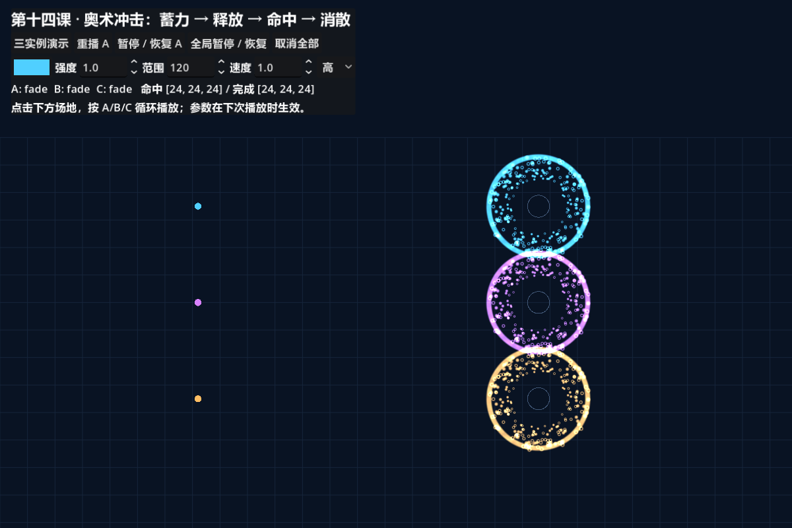

# 综合项目性能与复盘

制作日期：2026-10-13。[原始报告](benchmark-example.json) · [运行日志](benchmark.log) · [讲义](README.md)

## 测试问题

在不减少粒子、噪声次数和阶段的条件下，收紧核心绘制矩形是否能减少主视口 GPU 工作？这不是质量档位测试，也不是整个游戏的压力测试。

## 固定条件

- Godot 4.7.1 stable official，Forward+ / D3D12，NVIDIA GeForce RTX 5060 Ti。
- 三个高档实例，256 颗/实例，核心 3 次噪声采样，固定种子 137，半径 120，速度 1。
- VSync 关闭，限帧 240。逻辑画布为 1152×768，`ViewportTexture.get_size()` 报告 1250×834（JSON 的 `render_target_size`），保存的 PNG 为 1200×800。这些观测值并不相同，尺寸差异的底层来源未进一步定位，不能把某一个值冒称为全部渲染阶段的物理分辨率。两种优化配置使用同一窗口，测试每组结束核对纹理报告尺寸不变。
- 同一组起终点、主色与固定相机。每组先预热一个完整 2.6 秒周期，再采三个周期，共约 7.8 秒；三轮，中间一轮逆序。
- 截图在测量结束后生成，不计入采样。每轮 GPU 有效样本约 1872 个；0 或非有限读数被排除，完全缺失时摘要为 null。
- 独立调试运行，未锁定 GPU 时钟、未记录温度，不是导出包或跨设备基准。

## 唯一改变的变量

| 版本 | 核心绘制矩形 | 图形定义 |
| --- | --- | --- |
| 优化前 | 1024×1024 | 局部像素距离、相同半径与噪声坐标 |
| 优化后 | 264×264，公式为 2×radius+24 | 同上 |

对可见形状以外区域，初版仍会执行 fragment 内噪声采样再输出透明。收紧矩形减少这部分片元覆盖。它不改变粒子 visibility_rect，不以裁掉可见粒子换取速度。

## 三轮结果

单位 ms；数值按三位小数展示。

| 轮次 | 优化前 GPU 中位数 / P95 | 优化后 GPU 中位数 / P95 | 两版帧间隔中位数 |
| --- | --- | --- | --- |
| 1 | 0.193 / 0.194 | 0.162 / 0.164 | 约 4.166 |
| 2 | 0.193 / 0.194 | 0.163 / 0.164 | 约 4.166 |
| 3 | 0.193 / 0.194 | 0.163 / 0.164 | 约 4.166 |

视口 GPU 中位数节省约 **0.030～0.031 ms，约 15.5%～16.1%**。此结果支持默认采用紧凑绘制矩形。应用帧间隔仍受 240 限帧约束，不能声称整个应用帧率提高相同比例。

视口 GPU 指标包含背景和 UI 等工作，也不是 GPU 粒子模拟的独占计时。中位数在三轮中接近，不说明消除了驱动或系统噪声；原始数组保留，供进一步分析。

## 画面证据

在该时刻查看了两张截图，粒子分布、圆环主轮廓和噪声缺口保持一致。排除顶部 UI，比较截图从第 220 行开始的 RGB：每通道最大差值为 2/255，超过 2 的像素数为 0。

这仅证明本机、此时间、此种子和半径下没有明显差异，不代表全部生命周期、所有参数和后端都逐像素相同。若扩大核心柔边或最大半径，应重新计算矩形余量并检查完整时间线。

## 制作复盘

### 有效的决定

- 先确定四阶段时长，再让粒子、图形与事件读取同一时钟，减少不同层各自结束导致的错位。
- 采用解析轨迹表达已设计的运动，便于暂停、重播和截图定位；明确它不是外力积分。
- play 时重新应用所有配置，材质每实例独立，run_id 处理信号回调重入。
- 将逻辑画布单位与物理渲染目标区分，等启动窗口稳定后再记录测量尺寸。

### 发现的问题及修正

最初性能元数据只记录画布尺寸；补充纹理尺寸后，发现其报告值与截图尺寸也不相同。为排除启动阶段尺寸变化，最终在开始测量前等待窗口稳定，并在每组结束检查报告尺寸一致，再重跑完整数据。差异仍然存在，因此记录各自读数与测量限制，而不假定等待后它们就一定相同。

### 保留的限制

- 主色变化不等同于完整元素风格变化；火焰、冰霜需要重新设计形状和运动。
- 所谓命中是按时刻到达预设目标，未验证障碍物或伤害。
- 演示是三个固定复用槽位，没有做任意数量、多场景的生命周期管理。
- 低档更稀疏，噪声细节和粒子平滑度会改变；没有宣称质量档位无损。
- 下一步应在作品真实使用规模和目标设备上测量，并检查亮背景、移动父级和不同画面缩放。
