# 第十四课：综合项目——可配置的奥术冲击

[返回大纲](../../README.md) · [第十三课](../13_performance/README.md) · [一页设计](DESIGN.md) · [接口说明](API.md) · [实验记录](WORKSHEET.md) · [性能与复盘](MEASUREMENTS.md) · [验证范围](VALIDATION.md)

建议用时：6～8 小时，分三次完成：第一天拆分视觉与时序，第二天完成实例接口，第三天做边界验证与性能对照。前十三课不必全部背熟，但需要能够查回坐标、生命周期、自定义粒子 Shader、资源隔离与测量方法。

最终目标：**交付一个能被游戏逻辑调用、能同时播放多个实例、能说明质量取舍的完整特效组件。** 本课提供可运行参考成品和制作路线；验收还需要你独立完成一个变体，而不只是按 F6 看成品。

## 1. 先看完整成果（15 分钟）

打开本目录 `capstone_lab.tscn`，按 **F6**。它会同时播放三个不同颜色的实例：粒子旋入起点，核心飞向终点，终点爆亮并展开圆环，最后碎裂消散。标准速度下整个过程 2.6 秒。

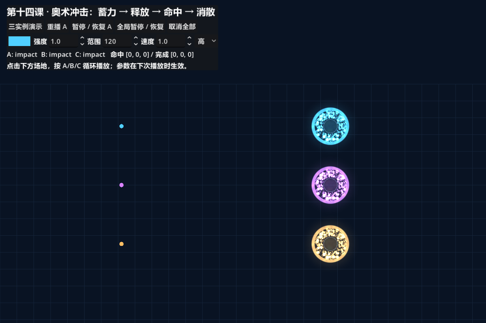

截图通过测试辅助函数定位到指定视觉时间，方便逐阶段观察；这个辅助函数不发送命中信号，所以截图中的逻辑计数不代表手动播放时的计数。

| 操作 | 观察重点 |
| --- | --- |
| 三实例演示 | 用默认配置、三种颜色同步播放；解除全局暂停 |
| 重播 A | 读取当前控件，只替换 A 的播放 |
| 暂停 / 恢复 A | A 的时钟和粒子停止，B/C 继续 |
| 全局暂停 / 恢复 | 所有组件停止；UI 仍可操作 |
| 取消全部 | 立即隐藏、停止模拟；取消不发送 finished |
| 颜色、强度、范围、速度、质量 | 下次“重播 A”或点击场地时生效 |
| 点击下方场地 | 从对应行起点飞向点击位置，A/B/C 循环复用 |

演示固定三个槽位，第四次点击会替换轮到的实例。这是明确的复用策略，不是动态无限扩容的对象池。界面的三实例按钮使用默认值作基线，不读取当前控件；测试参数用“重播 A”。

运行目录与组件目录分开：

```text
tutorial/
  lessons/14_capstone/
    capstone_lab.tscn       # F6 演示、验证与测量入口
    capstone_lab.gd
    README.md / DESIGN.md / API.md / WORKSHEET.md
    MEASUREMENTS.md / VALIDATION.md
  final_project/arcane_spell/
    spell.tscn             # 调用者实例化的组件，默认隐藏
    spell.gd
    motion.gdshader        # 自定义运动
    spark.gdshader         # 粒子外观
    core.gdshader          # 程序形状与噪声溶解
    noise.tres / particle.svg
```

组件目录含独立运行资源，不引用前面课程。它的场景初始只有挂脚本的根节点，子节点与材质在 ready 中创建；运行时用“远程”场景树检查。直接 F6 组件场景不会自动播放，演示入口才负责调用 play。

## 2. 从设计稿开始，而不是从参数列表开始（25 分钟）

先阅读 [DESIGN.md](DESIGN.md)，然后合上成品，用自己的话写三个句子：这个效果表达什么、视觉焦点在哪里、哪些元素不能删。

本例选择 **2D 奥术**，不同时做三种元素主题。2D 综合要求通过更完整的自定义运动完成：一组粒子经历旋入、随行和径向散开，不增加屏幕采样或 3D 碰撞。

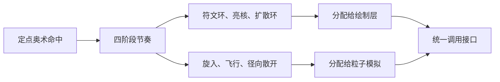

这里的箭头是设计推导关系。先决定运动和形状的职责，再决定由哪些节点表达；不要为了“用到所有技术”把每层都加上噪声、拖尾与扭曲。

### 里程碑一：只做灰盒

复制成品到练习目录前，先在新场景里用三个普通圆表示起点、弹体与终点。实现 0.8 秒等待、0.5 秒飞行、1.3 秒消散的时序。此时不加粒子，验收点是：反复播放时每次都能到达目标，并能暂停和恢复。

这样你能先发现坐标错误，而不是等效果变复杂后再从数百颗粒子里排查。

## 3. 统一时钟与状态机（35 分钟）

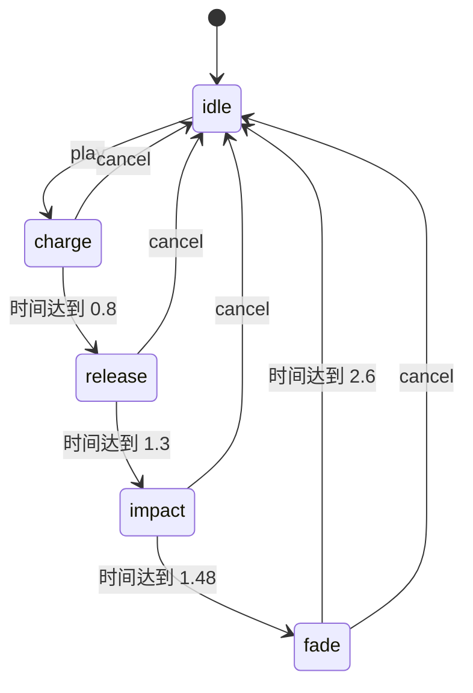

任何播放状态再次调用 play 都会取消旧一轮，再进入 charge。暂停是额外的控制标记：保留当前状态和时间，不是切换到 idle。

`spell.gd` 拥有唯一视觉时间：

```gdscript
effect_time = minf(effect_time + delta * playback_speed, DURATION)
```

这个时间同时传给模拟与核心绘制，不使用全局 TIME。播放速度为 2 时，约 1.3 秒播完；为 0.25 时，约 10.4 秒播完。粒子按自己的 fixed_fps 采样最新 uniform，核心每个渲染帧更新，因此低频粒子可能滞后一小步，不能承诺两者每帧严格重合。

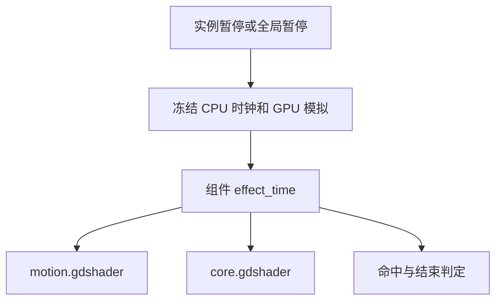

### 为什么本课不等待粒子节点 finished？

这一组粒子同时出生，视觉阶段由统一时间控制。GPUParticles2D 的 lifetime=120 是槽位寿命上限，不是可见效果时长。到视觉 2.6 秒时，组件隐藏并把 speed_scale 设为 0；下一次 restart 清除旧状态。这样可以让解析轨迹与 CPU 时钟保持一致，不必在每个阶段新建发射器。

代价也要说清：隐藏复用保留了资源内存；扩展到任意长时间播放时必须重新评估槽位寿命。本例最慢支持播放约 10.4 秒，暂停也冻结 GPU，落在约定范围内。

## 4. 自定义运动：一组粒子的三段轨迹（45 分钟）

先在 `motion.gdshader` 中阅读 start：重置 TRANSFORM、VELOCITY、COLOR 和 CUSTOM，固定种子决定相位和大小。不是每帧重新抽随机数。

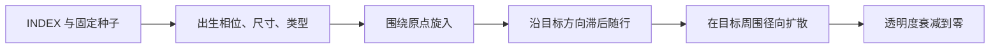

### 蓄力：缩小半径，同时改变角度

把阶段进度记为 q：半径从 `radius × 随机倍率` 缩到 9；角度增加 `q × TAU × 1.5`。这不是第九课的力积分，而是根据当前时间直接计算位置的**解析轨迹**。

它的优点是易于重播、暂停和定位某一时刻；缺点是不能直接对任意外力作真实动力学响应。如果作品需要碰撞、追踪或受风推动，应重新设计运动模型，不是把解析位置和速度积分同时叠上去。

### 释放：亮核与粒子有轻微时间差

核心中心由 `target_offset × smoothstep(0,1,q)` 推进；粒子使用出生相位产生最多 0.06 秒的滞后，并保留少量环绕偏移。这样呈现出跟随弹体的能量轨迹。

这不是第十二课的历史蒙皮拖尾，只是一组位置不同的粒子。命中时切换到目标中心附近的散开轨迹是视觉设计，不是物理碰撞反弹。

### 消散：扩散越来越慢

扩散距离使用：

```text
travel = (1 - exp(-3 × 阶段进度)) × radius × 出生大小倍率
```

距离随时间增加，但增长速度减小。额外的正 Y 偏移让残留粒子略微下坠；这是 2D 局部坐标，正 Y 朝下。公式中的进度无量纲，radius 为本地像素，不要把它误当成米每秒的物理速度。

本课通道编号延续第八课：x 视觉年龄、y 相位、z 大小、w 类型。区别是 x=`effect_time/2.6`，不再使用 DELTA 累加；全部粒子同时出生，因此共享归一化年龄符合本例设计。通道详情见 [API.md](API.md)。

### 里程碑二：只开粒子层

在练习副本中隐藏 GlyphAndImpact，仅观察粒子：能否独立看出旋入、飞行和扩散？然后把目标设为起点，确认没有除零；换种子，确认形状变化但主时序不变。

## 5. 程序形状、噪声和溶解（40 分钟）

`core.gdshader` 的核心是把 UV 转回以矩形中心为原点的局部像素坐标：

```glsl
vec2 p = (UV - 0.5) * extent;
float d = length(p);
```

蓄力时绘制收缩圆环和角度辐条；飞行时绘制柔边亮核；命中时绘制扩散圆环与短闪光；消散时用噪声阈值切开圆环。

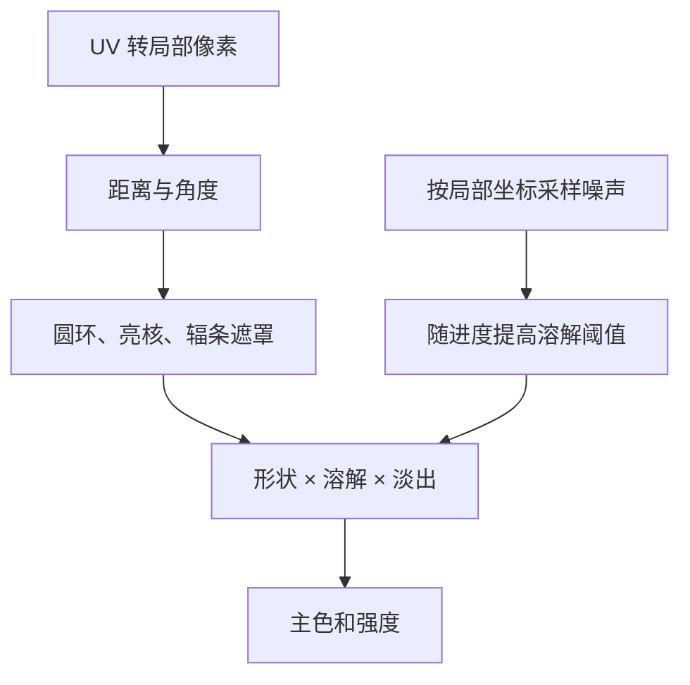

噪声同时参与颜色细节与溶解，读取位置依赖 `p/radius`，而不是原始 UV。这样缩小绘制矩形时，噪声和形状仍落在相同位置。

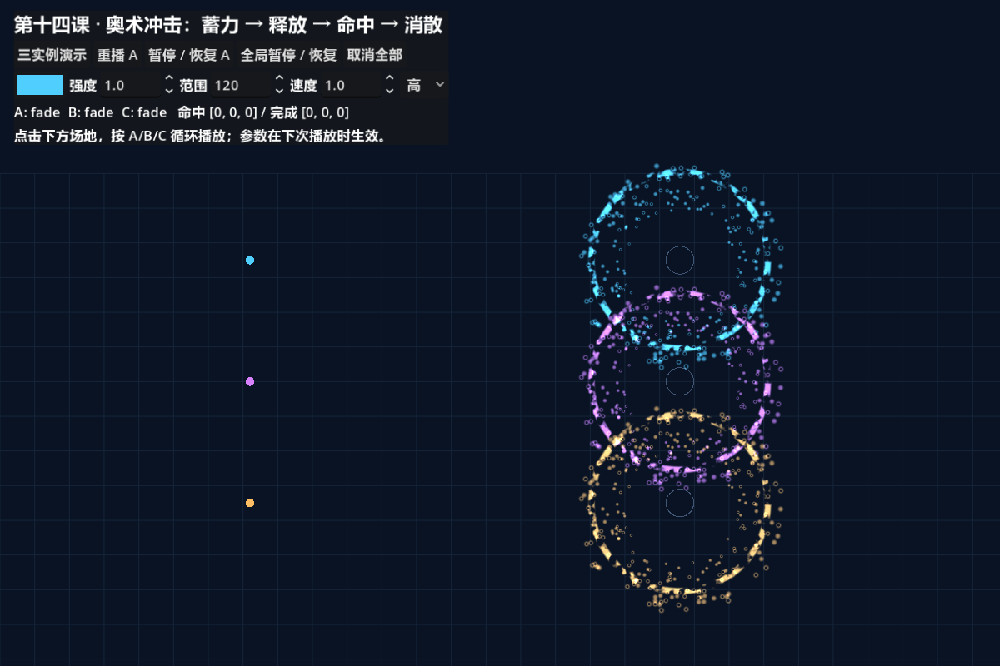

### 里程碑三：故意把坐标写错

在练习副本把噪声采样坐标改成 UV。比较 1024 矩形与紧凑矩形：虽然圆环仍可通过像素距离保持尺寸，噪声图案却会缩放。这证明“优化前后看起来不同”有时来自坐标定义，不是性能本身。

修复后确认相同时间、颜色、种子下的形状与噪声基本重合。不要只看一张最终消失的空画面来证明等价。

## 6. 接口、资源隔离和回调重入（45 分钟）

接入代码和参数表见 [API.md](API.md)。play 的起终点都属于组件父级局部空间；组件内部用 `to-from` 表达目标偏移。若游戏传来世界位置，先在父节点上 to_local。

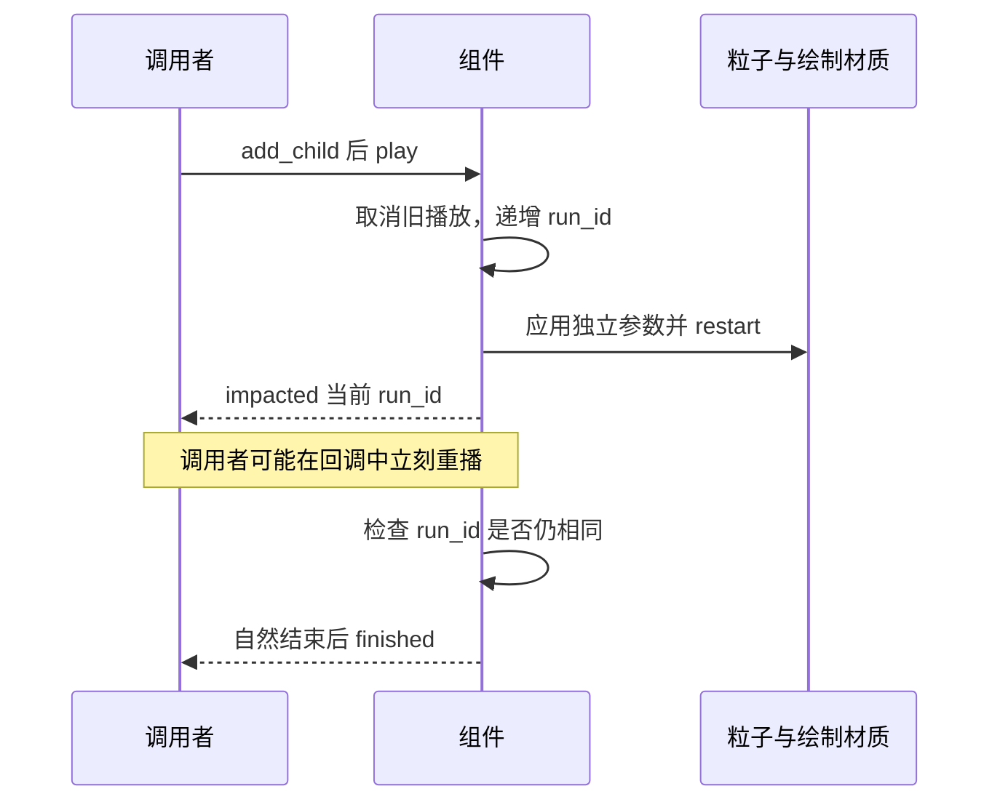

`impacted` 在时钟第一次跨过 1.3 时发送，并先设置 `impact_sent=true`。调用者若在回调中调用 play，run_id 就改变；旧调用返回后不能继续把新播放结束掉。

这里没有用旧 Timer 或 Tween 回调来推进阶段，但同步信号回调仍可能改变状态。**没有异步回调不等于没有重入问题。**

材质隔离采用“每个实例 new 三份材质”，只共享只读 Shader 和纹理。若把材质提到全局缓存再复用，就可能重现第十课的串色问题。

### 里程碑四：完成边界矩阵

按顺序验证：单实例 → 三实例 → 暂停 A → 全局暂停 → 连续重播 → 零距离 → 中断取消 → 自动释放。先看计数是否正确，再看画面；取消不是自然完成，不应补发 finished。

测试成品可在项目根目录执行：

```powershell
& .\tutorial\lessons\14_capstone\run_lab.ps1 -Verify
```

它会自动运行验证、更新本课阶段截图并退出。手动播放时的命中是**预设视觉到达事件**，不会检查路径阻挡，不能直接代替伤害判定。

## 7. 质量档位：保持节奏，降低次要细节（25 分钟）

| 档位 | 粒子数量 | 核心噪声采样次数 | 粒子更新频率 |
| --- | --- | --- | --- |
| 低 | 64 | 1 | 30 Hz |
| 中 | 128 | 2 | 60 Hz |
| 高 | 256 | 3 | 60 Hz |

三档保持阶段时长、起终点、圆环主半径和亮核运动。不同噪声次数会改变细节，低档粒子更稀疏，不能宣称像素等价。

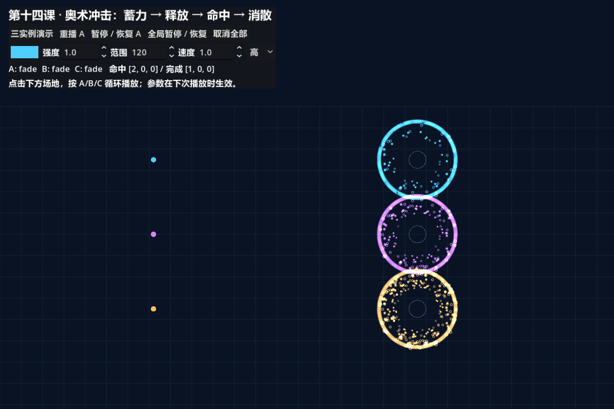

上图同时使用不同颜色展示实例隔离；严谨评估质量差异时，请将同一实例设为同色、同范围，依次切换档位再重播。

这里给出了候选档位和配置验证，**实际性能表比较的是矩形优化，高档参数保持不变**。低中高档的目标设备性能仍需要你测量，不能拿矩形优化数字代替质量档位收益。

## 8. 做一次有证据的优化（35 分钟）

初版核心绘制矩形为 1024×1024，而默认可见半径只有 120。最终 alpha 为零的区域仍可能执行噪声采样。优化版将边长改为 `2×radius+24`，默认 264；多留出的边界覆盖柔边。

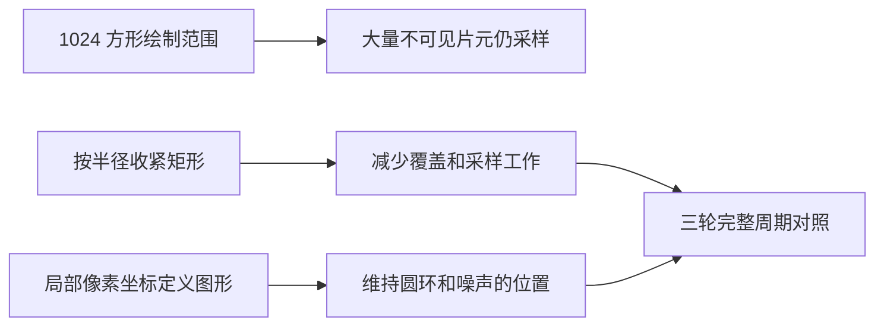

只修改 `oversized_quad`，其他参数保持相同。注意：这是核心 ColorRect 的绘制范围，不是偷偷缩小 GPUParticles2D 的 visibility_rect。错误缩小粒子包围盒可能直接裁掉可见粒子，不是合格优化。

执行性能对照：

```powershell
& .\tutorial\lessons\14_capstone\run_lab.ps1 -Benchmark
```

每组先播一整个周期预热，再采三个完整周期；重复三轮，中间一轮逆序。约需 65 秒。此模式会更新本课 `benchmark-example.json` 和 before/after 图片；要保留已有数据，请先另存。保持窗口可见、尺寸固定，测试期间不操作界面。

本机结果：视口 GPU 中位数从约 0.193 ms 降至 0.162～0.163 ms。应用帧间隔仍约 4.166 ms，受 240 限帧约束，不能声称整个程序帧率提高了相同比例。完整条件、原始数据和截图差异见 [MEASUREMENTS.md](MEASUREMENTS.md)。

## 9. 从参考成品到自己的作品（至少 90 分钟）

任选一种变体，先写新的 DESIGN，再实现：

1. **冰霜定点**：保留时序和接口，改为尖锐扇片与低亮碎晶；解释形状、运动、颜色分别如何支持冰霜，而不仅是改成蓝色。
2. **火焰冲击**：用方向性拉伸和上飘残留替代整齐圆环；明确哪些参数仍可复用，哪些需要新增。
3. **奥术追踪**：让目标位置在释放阶段变化；先定义追踪何时停止，再修改坐标和时间规则。不要直接把旧轨迹公式套上移动终点而不检查跳变。

独立交付内容：设计页、可复用组件、演示入口、接口说明、四阶段截图、性能对照与复盘。放到自己的新目录，保留参考成品作为对照。

## 10. 最终验收

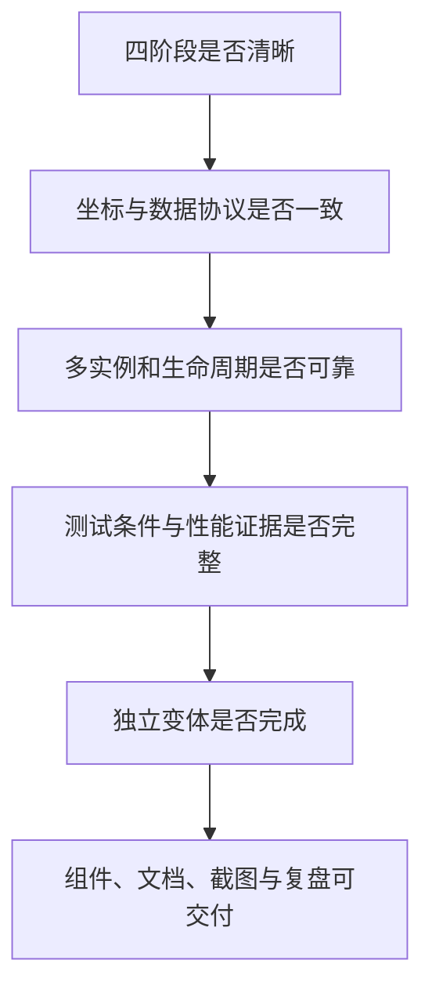

按此顺序检查，不要用发光更强或粒子更多掩盖时序、坐标和接口问题。

- [ ] 能在不看代码时辨认蓄力、释放、命中和消散。
- [ ] 至少一份自定义粒子 Shader 和一份自定义绘制 Shader，各自职责明确。
- [ ] 程序形状与噪声溶解均能解释数据来源和坐标空间。
- [ ] 主色、强度、范围、播放速度、质量档位可配置。
- [ ] 三个实例互不串色，暂停和重播互不串扰。
- [ ] 自然结束、取消、复用和释放语义清楚，信号不会误结束新播放。
- [ ] 有固定条件下的重复性能数据，能指出指标范围和限制。
- [ ] 至少一次优化有画面与耗时证据，而不只是主观“更快”。
- [ ] 独立完成一种变体，并提交自己的复盘。

## 11. 自测与参考答案

1. **解析运动为什么不用 DELTA 积分位置？** 位置直接由当前时间和出生参数计算，再积分会重复推进或破坏轨迹。
2. **GPU lifetime=120 为什么视觉只有 2.6 秒？** 前者是槽位上限，后者由组件时钟和显式停止控制。
3. **cancel 为什么不发 finished？** 取消属于中断；finished 约定为自然完成，混用会让调用者误判。
4. **有独立材质还需要 run_id 吗？** 需要；材质隔离解决参数共享，run_id 解决回调重入后的旧调用继续执行。
5. **缩小矩形为什么不缩小圆环？** 图形由局部像素坐标和 radius 定义，extent 只决定承载它的矩形。
6. **视觉命中能直接作为伤害吗？** 不能保证；游戏命中应独立验证，组件只按约定时刻到达预设终点。
7. **参考成品运行成功等于课程掌握了吗？** 不等于；还需要独立变体、排错和有边界的测量结论。

## 12. 继续学习

如果作品需要真实环境交互，可回到第十二课扩展 3D 碰撞与子发射；需要生产级性能分析时，继续第十三课的目标设备测量；需要更复杂的流动，再研究向量场或计算 Shader。

- [Particle shaders](https://docs.godotengine.org/en/stable/tutorials/shaders/shader_reference/particle_shader.html)：start/process、状态变量和自定义数据。
- [GPUParticles2D](https://docs.godotengine.org/en/stable/classes/class_gpuparticles2d.html)：restart、槽位生命周期与粒子节点行为。
- [RenderingServer 计时](https://docs.godotengine.org/en/stable/classes/class_renderingserver.html#class-renderingserver-method-viewport-get-measured-render-time-gpu)：视口测量与范围限制。

参考教程至此制作完成；用户学习进度仍由自己的练习与验收决定。
